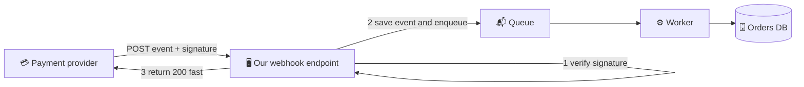

# 04 · Webhooks

> [!info] Topic info
> **Subject:** System Design · **Chapter:** Communication Patterns · **Priority:** 🔥 High · **Status:** ✅ done · **Last reviewed:** 2026-11-19
>
> [← Back to Communication Patterns](README.md) · [Interview questions →](questions/communication-patterns-qa.md)

> [!abstract] In one line
> A **webhook** is a **server-to-server HTTP callback**: when an event happens, the provider **POSTs** it to a URL you registered — "don't call us, we'll call you".

---

## 1. The problem

Our app sells **Premium** using a payment provider like Stripe. After checkout, we need to know: did the payment succeed?

Polling the provider every few seconds for every order is wasteful and slow. Some events (refunds, chargebacks) happen **days later**. We want the provider to **tell us**.

---

## 2. How it works

1. We register a URL: `https://api.ourapp.com/webhooks/payments`.
2. When an event happens, the provider sends `POST` with a JSON body (`event_id`, `type`, data) and a **signature** header.
3. We verify, store, return **2xx fast**, and process in the background.
4. No 2xx (error or timeout)? The provider **retries** with backoff — for hours or days.

> [!tip] 🎤 Say it like this
> "A webhook is a reverse API — the provider calls my URL when something happens instead of me polling. On my side I verify the HMAC signature, store the event, return 200 quickly, and process it from a queue. The handler must be idempotent because the provider retries and will send duplicates."

---

## 3. Receiving webhooks safely — the checklist

| Concern | What to do |
|---|---|
| **Fake requests** | Verify the **HMAC signature** (shared secret signs the raw body). Reject on mismatch. |
| **Replay attacks** | Check the signed **timestamp**; reject events older than ~5 min. |
| **Duplicates** | Store `event_id`; if seen, return 200 and skip. See [Idempotency](../api-fundamentals/03-idempotency.md). |
| **Slow handler → timeouts → retries** | Do the heavy work **async** in a queue; respond in < 1–2 s. |
| **Out-of-order events** | Don't trust arrival order. Check current state or fetch the latest object from the provider API. |
| **Missed events** | Run a periodic **reconciliation** job that pulls recent events from the provider. |

> [!failure] Interview traps
> - Doing all the work inside the request — the provider times out, retries, and you process it **twice**.
> - Assuming exactly-once delivery — webhooks are **at-least-once**.
> - Parsing JSON before verifying — re-serialised JSON changes bytes and breaks the signature check. Verify the **raw body**.
> - Trusting webhooks as the only source of truth — always have reconciliation.

---

## 4. Sending webhooks (if you are the provider)

Interviewers sometimes flip it: "Design a webhook delivery system."

- Put events in a **queue**; delivery workers POST to customer URLs.
- **Retry with exponential backoff** (e.g. 1 min, 5 min, 30 min, … up to ~3 days).
- After all retries fail → **[dead-letter queue](10-dead-letter-queues.md)**, alert the customer, maybe disable the endpoint.
- **Isolate** slow customers so one dead endpoint doesn't block everyone (per-customer queues or rate limits).
- Sign every payload, include `event_id` + timestamp, and give a "replay events" UI.

> [!warning] Security as a sender
> Customers give you arbitrary URLs. Block internal IPs (`10.x`, `169.254.169.254`, localhost) — otherwise webhooks become an **SSRF** hole into your own network.

---

## 5. Webhooks vs others

| | Webhook | Polling | WebSocket / SSE |
|---|---|---|---|
| **Who** | Server → server | Client asks | Server → browser/app |
| **Connection** | New HTTP POST per event | New request per check | Long-lived |
| **Best for** | Third-party event notifications | Simple, rare checks | Live UI updates |

Code example for verifying signatures: [API communication patterns](../../computer-networks/05-api-communication-patterns.md).

---

## Summary

- Provider POSTs events to your URL — push instead of poll.
- Receive: verify signature → store → 200 fast → process async → idempotent.
- Expect retries, duplicates, out-of-order events; reconcile periodically.
- Send: queue + backoff + DLQ + per-customer isolation + SSRF protection.

> [!success] Key takeaway
> Webhooks are at-least-once HTTP callbacks. Verify, ack fast, process idempotently from a queue — and never rely on them alone without reconciliation.
