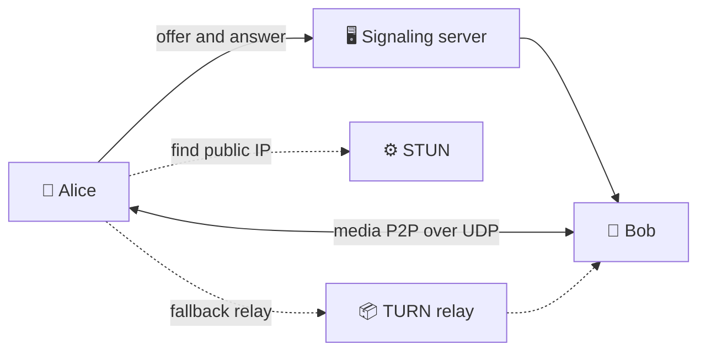

# 05 · WebRTC

> [!info] Topic info
> **Subject:** System Design · **Chapter:** Communication Patterns · **Priority:** 💤 Low · **Status:** ✅ done · **Last reviewed:** 2026-11-19
>
> [← Back to Communication Patterns](README.md) · [Interview questions →](questions/communication-patterns-qa.md)

> [!abstract] In one line
> **WebRTC** lets browsers and apps send **audio, video and data directly peer-to-peer**, with low latency, using a server only to **set up** the call.

---

## 1. The problem

Our app adds **video calls**. Sending every video frame through our servers (client → server → client) doubles latency and costs huge bandwidth — a 1080p call is ~2–4 Mbps per person.

Better: send media **directly** between the two users.

---

## 2. How it works

Two devices usually sit behind routers (**NAT** — many devices share one public IP), so they can't just connect to each other. WebRTC solves this in steps:

| Piece | Job |
|---|---|
| **Signaling server** | Exchanges "how to reach me" info (SDP offer/answer). Not part of WebRTC — you build it, often with WebSockets. |
| **STUN server** | Tells a device its own **public IP:port**. Cheap. |
| **TURN server** | **Relays** media when direct connection fails (strict NATs, firewalls). Expensive bandwidth. |
| **ICE** | Tries all possible paths and picks the best working one. |

Media runs over **UDP** (late frames are useless — no point retrying) and is always **encrypted**.

---

## 3. Group calls

Pure peer-to-peer (**mesh**) breaks past ~4–5 people: each person uploads their video to every other person.

- **SFU** (Selective Forwarding Unit): each user uploads **once** to a server, which forwards streams to others. Used by most group-call apps.
- **MCU**: server mixes all streams into one. Less client work, very CPU-heavy on the server.

> [!tip] 🎤 Say it like this
> "WebRTC sends media peer-to-peer over UDP for low latency. A signaling server — usually WebSockets — exchanges connection details, STUN finds public addresses, and TURN relays traffic when a direct path fails. For group calls I'd use an SFU, so each client uploads once instead of to every peer."

> [!failure] Interview traps
> - Saying WebRTC needs **no servers** — you still need signaling, STUN, and TURN for a real share of users.
> - Using mesh for a 20-person call — upload bandwidth explodes; use an SFU.

---

## Summary

- P2P audio/video/data, UDP, encrypted, very low latency.
- Signaling (you build) + STUN (find address) + TURN (relay fallback) + ICE (pick path).
- Group calls → SFU.

> [!success] Key takeaway
> Use WebRTC for real-time media. Servers set up the call and relay when needed; the media itself goes direct whenever possible.
