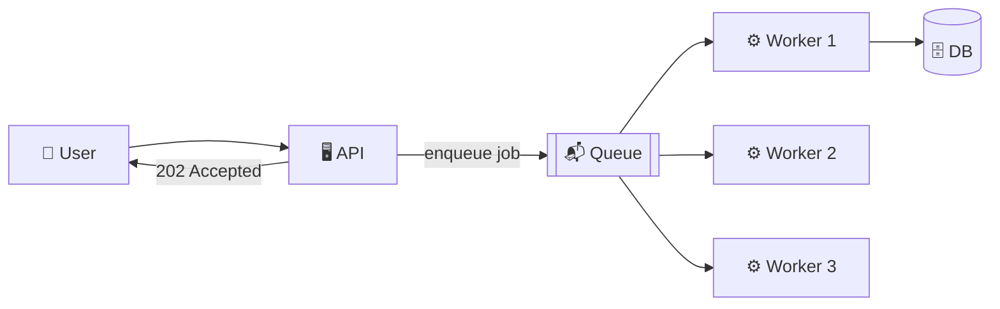

# 06 · Message Queues

> [!info] Topic info
> **Subject:** System Design · **Chapter:** Communication Patterns · **Priority:** 🔥 High · **Status:** ✅ done · **Last reviewed:** 2026-11-19
>
> [← Back to Communication Patterns](README.md) · [Interview questions →](questions/communication-patterns-qa.md)

> [!abstract] In one line
> A **message queue** is a buffer between services: **producers** drop tasks in, **consumers** take them out **later**, and **each message is handled by one consumer**.

---

## 1. The problem

A user uploads a video to our app. The API then has to transcode it, make thumbnails, scan it for abuse, and notify followers — **~2 minutes** of work.

Doing it inside the request means the user waits 2 minutes, and if the transcoder is down, the **upload fails**. One slow service drags everyone down.

---

## 2. How it works

The API puts a message (`{videoId: 991}`) on a queue and returns **"Upload received"** in 50 ms. Workers pull messages at their own pace.

The lifecycle of one message:

1. **Producer** sends it; the queue stores it durably.
2. A **consumer** receives it — the message becomes **invisible** to others for a while (SQS calls this the *visibility timeout*).
3. Consumer finishes and **acks** (deletes) it.
4. No ack in time (crash, timeout)? The message **reappears** and another worker gets it.

This is the **competing consumers** pattern: many workers, each message processed by **one** of them.

> [!tip] 🎤 Say it like this
> "A message queue decouples the producer from the consumer in time. The API enqueues a job and responds immediately; workers process at their own speed. If workers are slow or down, messages just wait — nothing is lost. Each message goes to one worker, and if it crashes before acking, the message is redelivered."

---

## 3. What a queue gives you

| Benefit | In our app |
|---|---|
| **Async / fast responses** | Upload returns in 50 ms, not 2 min |
| **Decoupling** | API doesn't know or care which service transcodes |
| **Load leveling** | A spike of 10k uploads/min waits in the queue; workers drain it steadily |
| **Fault tolerance** | Transcoder down for 10 min? Jobs wait, then resume |
| **Easy scaling** | Queue depth growing? Add workers — autoscale on queue length |

**❌ Cons / costs**
- **Eventual** results — the user sees "processing…" instead of an instant answer.
- One more system to run and monitor.
- **Duplicates** — redelivery means consumers must be idempotent ([Delivery semantics](09-delivery-semantics.md)).
- Ordering is usually **not guaranteed** across many workers.
- Harder debugging — a request now spans several services and time.

> [!warning] Watch queue depth and age
> The key metrics are **queue length** and **age of the oldest message**. If producers add 1,000 msg/s and consumers handle 800 msg/s, the backlog grows **forever**. A queue absorbs spikes; it doesn't fix too little capacity.

> [!failure] Interview traps
> - Saying a queue "makes things faster" — it makes the **response** faster; total work is the same or more.
> - Forgetting **poison messages** — one bad message failing forever. Fix: retry limit + [dead-letter queue](10-dead-letter-queues.md).
> - Visibility timeout shorter than processing time → the same job runs twice in parallel.
> - Using a queue where the user **needs** the answer right now (e.g. login).

---

## 4. Queue vs pub/sub

A queue = **one message → one consumer** (a task to do). If many services all need to hear about the same event, you want [Pub/Sub](07-pub-sub.md) instead. Tools like Kafka, RabbitMQ and SQS are compared in [Message brokers](08-message-brokers.md).

---

## Summary

- Producer → queue → worker; each message handled **once by one worker**.
- Gives async responses, decoupling, load leveling, fault tolerance.
- Ack after processing; un-acked messages are redelivered → be idempotent.
- Monitor depth and oldest-message age; use a DLQ for poison messages.

> [!success] Key takeaway
> Any slow, retryable, non-urgent work (emails, video, reports) belongs behind a queue. Just design for duplicates and growing backlogs.
