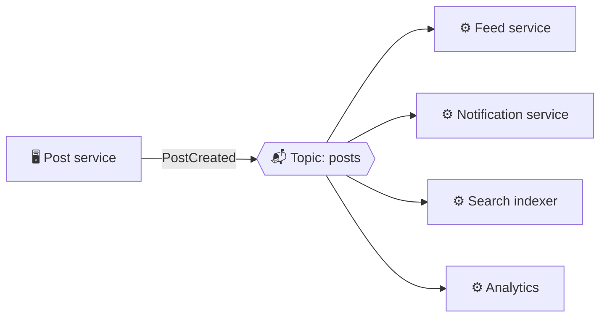
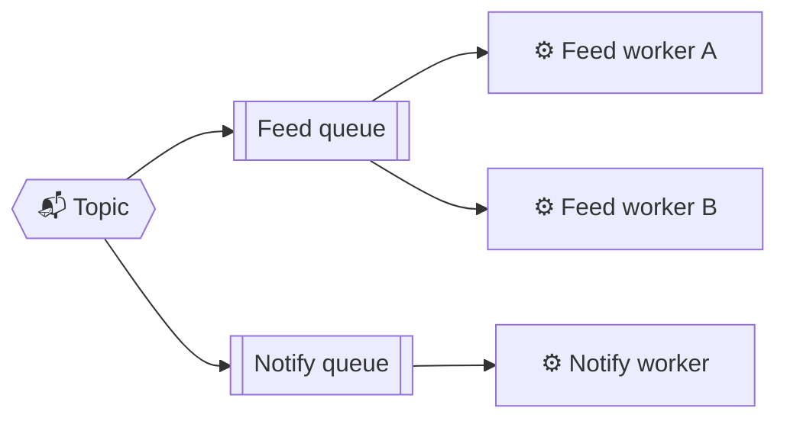

# 07 · Pub/Sub

> [!info] Topic info
> **Subject:** System Design · **Chapter:** Communication Patterns · **Priority:** 🔥 High · **Status:** ✅ done · **Last reviewed:** 2026-11-19
>
> [← Back to Communication Patterns](README.md) · [Interview questions →](questions/communication-patterns-qa.md)

> [!abstract] In one line
> In **publish/subscribe**, a publisher sends an event to a **topic**, and **every subscriber** to that topic gets its **own copy** — the publisher doesn't know who is listening.

---

## 1. The problem

When a user publishes a post, many services care: **feed** (fan out to followers), **notifications**, **search** (index it), **analytics**, **moderation**.

If the Post service calls each one directly, it must know all five, wait on all five, and change its code every time a sixth team appears. One slow service slows down posting.

---

## 2. How it works

The Post service publishes **one event** — `PostCreated {postId: 55}` — to a topic. Each interested service **subscribes** and gets its own copy.

Adding a new consumer (e.g. a spam detector) needs **zero changes** to the Post service — it just subscribes.

> [!tip] 🎤 Say it like this
> "With pub/sub, the producer publishes an event to a topic and every subscriber gets its own copy. It's one-to-many and fully decoupled — the publisher doesn't know who's listening. I use it when one event should trigger several independent reactions, like a new post updating feeds, search and notifications."

---

## 3. Queue vs pub/sub

| | Message queue | Pub/Sub |
|---|---|---|
| **Delivery** | One message → **one** consumer | One message → **every** subscriber |
| **Meaning** | "Do this task" (command) | "This happened" (event) |
| **Scaling** | More workers share the load | More subscribers each get a copy |
| **Example** | Transcode video 991 | PostCreated 55 |

> [!example] Combine them
> Most real systems do both: each subscriber **group** gets every event, and inside a group many workers **share** the work like a queue. Kafka consumer groups and SNS → SQS fan-out both work this way.

---

## 4. Two flavours

| | Fire-and-forget | Durable |
|---|---|---|
| **Examples** | Redis Pub/Sub | Kafka, Google Pub/Sub, SNS + SQS |
| **Subscriber offline?** | Message **lost** | Message waits / can be replayed |
| **Good for** | Live chat fan-out between [WebSocket](03-websockets.md) servers, cache invalidation hints | Business events that must not be lost |

**✅ Pros**
- Loose coupling; add consumers without touching the producer.
- Each consumer scales and fails **independently**.
- Natural fit for [event-driven architecture](../architectural-patterns/05-event-driven.md).

**❌ Cons**
- Hard to see "who reacts to what" — need good tracing and an event catalogue.
- **Eventual consistency** — search may show the post a second after the feed.
- Event schema changes can break unknown subscribers — version your events.
- Duplicates and ordering issues, same as queues.

> [!failure] Interview traps
> - Using Redis Pub/Sub for events that **must not be lost** — it has no storage; offline subscribers miss them.
> - Saying pub/sub guarantees global order — usually only **per partition / key** at best.
> - Putting huge payloads in events — send IDs or small facts; consumers fetch details if needed.

---

## Summary

- Publish to a topic → every subscriber gets a copy.
- Queue = task for one worker; pub/sub = event for many services.
- Real systems combine both (consumer groups, SNS → SQS).
- Pick durable pub/sub for important events; fire-and-forget only for live, lossy-OK data.

> [!success] Key takeaway
> Pub/sub turns "call five services" into "announce one event". You gain decoupling and independent scaling, and pay with eventual consistency and harder debugging.
