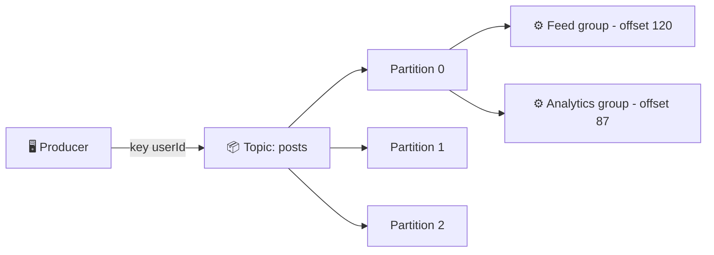

# 08 · Message Brokers

> [!info] Topic info
> **Subject:** System Design · **Chapter:** Communication Patterns · **Priority:** 🔥 High · **Status:** ✅ done · **Last reviewed:** 2026-11-19
>
> [← Back to Communication Patterns](README.md) · [Interview questions →](questions/communication-patterns-qa.md)

> [!abstract] In one line
> A **message broker** is the server that stores and routes messages between producers and consumers. The big split: **queue-style brokers** (RabbitMQ, SQS) **delete** messages once consumed; **log-style** ones (Kafka) **keep** them and let consumers **replay**.

---

## 1. The problem

We know we want [queues](06-message-queues.md) and [pub/sub](07-pub-sub.md). The interviewer now asks: **"Which one — Kafka, RabbitMQ or SQS? Why?"**

Answering "Kafka, because it's popular" is a red flag. You need to know the **model** behind each.

---

## 2. Two models: queue vs log

### Queue-style (RabbitMQ, SQS)

Messages sit in a queue until a consumer **acks** them, then they are **deleted**. The broker tracks the state of every message.

### Log-style (Kafka)

A **topic** is an **append-only log** split into **partitions**. Messages stay for a set **retention** (e.g. 7 days) whether read or not. Each consumer group just remembers an **offset** — "I've read up to message 4,512 in partition 3".

Key Kafka ideas:

- **Partition** = unit of order and parallelism. Order is guaranteed **only within a partition**.
- **Key** (e.g. `userId`) decides the partition → all events for one user stay in order.
- **Consumer group** = a team of consumers sharing the work. Each partition goes to **one** consumer in the group, so max useful consumers = number of partitions.
- Different groups read **independently** → that's how Kafka does pub/sub.
- **Replay**: reset the offset and reprocess old events (e.g. rebuild a search index).

> [!tip] 🎤 Say it like this
> "RabbitMQ and SQS are queues — a message is delivered, acked and deleted. Kafka is a distributed log — messages are kept for days, partitioned by key, and each consumer group tracks its own offset. So Kafka gives me replay, very high throughput and per-key ordering; a queue gives me simple task distribution with per-message acks and retries."

---

## 3. Kafka vs RabbitMQ vs SQS

| | Kafka | RabbitMQ | Amazon SQS |
|---|---|---|---|
| **Model** | Distributed **log** | Queue broker with **smart routing** | Managed **queue** |
| **After consume** | Kept until retention | Deleted on ack | Deleted on delete call |
| **Retention / replay** | Days–forever, ✅ replay | ❌ No replay | Up to 14 days, ❌ replay |
| **Ordering** | Per partition | Per queue, single consumer | Standard: none · FIFO: per group |
| **Consumers** | Consumer groups pull by offset | Broker pushes to consumers | Consumers poll |
| **Fan-out** | Many groups on one topic | Exchanges route to many queues | Via SNS → many SQS queues |
| **Throughput** | Very high — millions msg/s on a cluster | High — tens of thousands/s per node | Near-unlimited (Standard), managed |
| **Ops effort** | High (or use managed) | Medium | None — fully managed |
| **Best for** | Event streams, activity logs, CDC, analytics, many readers | Task queues, complex routing, per-message retries | Simple decoupling on AWS |

> [!example] Quick picker
> - **"Many teams need the same event stream, replay, analytics"** → Kafka.
> - **"Background jobs with flexible routing and priorities"** → RabbitMQ.
> - **"We're on AWS and just need a reliable job queue"** → SQS (+ SNS for fan-out).
> - **"Live, lossy fan-out between WebSocket servers"** → Redis Pub/Sub.

**✅ Pros of using a broker**
- Durability, retries, fan-out and back-pressure without writing them yourself.

**❌ Cons**
- A critical piece of infra — it must be replicated, or it becomes a [single point of failure](../core-concepts/04-single-point-of-failure.md).
- Extra latency hop (a few ms) and operational cost.

> [!failure] Interview traps
> - "Kafka guarantees order" — only **within a partition**. Need per-user order? Use `userId` as the key.
> - Adding more consumers than partitions — the extras sit **idle**.
> - A **hot key** (one celebrity user) overloads one partition — same problem as [hot shards](../database-scaling/04-sharding.md).
> - Using Kafka as a simple job queue with per-message retries — that's awkward; a queue fits better.

---

## Summary

| Need | Choose |
|---|---|
| **Replay, many readers, huge throughput** | Kafka (log) |
| **Task queue, routing, per-message acks** | RabbitMQ |
| **Managed, zero-ops queue on AWS** | SQS (+ SNS) |

> [!success] Key takeaway
> First decide **log vs queue**: do consumers need to replay and read independently (log), or just take tasks and delete them (queue)? Then mention partitions, keys and consumer groups for ordering and scale.
