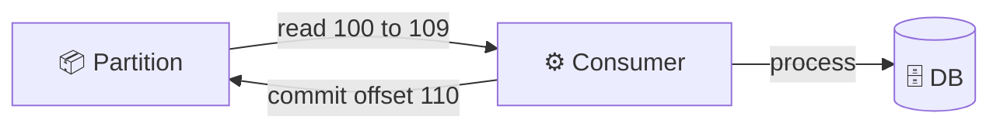

# 09 · Delivery Semantics

> [!info] Topic info
> **Subject:** System Design · **Chapter:** Communication Patterns · **Priority:** 🔥 High · **Status:** ✅ done · **Last reviewed:** 2026-11-19
>
> [← Back to Communication Patterns](README.md) · [Interview questions →](questions/communication-patterns-qa.md)

> [!abstract] In one line
> **Delivery semantics** say how many times a message may be processed: **at-most-once** (may lose), **at-least-once** (may duplicate), or **effectively exactly-once** (at-least-once + **idempotent** consumers).

---

## 1. The problem

Networks drop acks and workers crash mid-job. So a broker can never be sure whether a message was processed. It must choose: **resend** (risk duplicates) or **don't** (risk loss).

Our app's bug reports: "I got the same notification 5 times" and "I was charged twice".

---

## 2. Quick recap — the three guarantees

Covered in [Reliability § 6](../core-concepts/03-reliability.md). In short, it's all about **when you ack / commit**:

| Guarantee | When you ack | On crash | Use for |
|---|---|---|---|
| **At-most-once** | **Before** processing | Message **lost** | Metrics, logs, live typing indicators |
| **At-least-once** | **After** processing | Message **redelivered** | Almost everything — the default |
| **Exactly-once** | After + dedupe / transaction | Neither | Payments, counters, balances |

> [!important] Golden rule
> True exactly-once **delivery** over a network is impossible. What we build is exactly-once **effect**: at-least-once delivery + idempotent processing.

---

## 3. Kafka offsets and commits

In Kafka, the "ack" is **committing the offset** — saving "I've processed up to message N".

- **Commit before processing** → crash = messages 100–109 **skipped** (at-most-once).
- **Commit after processing** → crash before commit = 100–109 **processed again** (at-least-once).
- **Auto-commit** (every ~5 s, by default) commits on a timer, regardless of your processing — it can **lose or duplicate**. Commit manually after the work is done for important data.

> [!note] Kafka's "exactly-once"
> Kafka has **idempotent producers** (no duplicate writes on producer retry) and **transactions** (write output + commit offsets atomically). This gives exactly-once only for **Kafka → Kafka** pipelines. The moment you write to an external DB or send an email, you're back to needing idempotent consumers.

---

## 4. Making consumers idempotent

Processing a message twice must have the **same effect** as once. Common ways:

| Technique | Example |
|---|---|
| **Dedupe table** | Store `messageId` in a `processed` table **in the same DB transaction** as the work; skip if present |
| **Natural idempotency** | `SET status = 'paid'` instead of `balance = balance + 10` |
| **Unique constraint / upsert** | `INSERT … ON CONFLICT DO NOTHING` on `paymentId` |
| **Version check** | Update only if `event.version > row.version` |
| **Store offset with result** | Save the Kafka offset in the same DB transaction as the output |

More on idempotency keys: [Idempotency](../api-fundamentals/03-idempotency.md).

> [!tip] 🎤 Say it like this
> "I assume at-least-once delivery and make consumers idempotent. In Kafka, I commit offsets only after processing, and I dedupe using a message ID stored in the same transaction as the side effect. That gives exactly-once effect — true exactly-once delivery across a network isn't possible."

---

## 5. Ordering

- **Queues with many workers** → order is lost: worker B can finish message 2 before worker A finishes message 1.
- **Kafka** → ordered per **partition**. Same key (e.g. `orderId`) → same partition → in order.
- **Retries break order**: if message 1 fails and goes to a retry queue, message 2 runs first.

When order matters, use a **key** per entity and/or a **version / sequence number** so consumers can ignore stale updates ("order 7 is already `shipped`, ignore this `paid` event").

> [!failure] Interview traps
> - Claiming a broker gives "exactly-once" end-to-end — not once side effects leave the broker.
> - Dedupe check and the work in **separate** transactions — crash between them = duplicate or loss.
> - Choosing at-most-once "to avoid duplicates" for important data — you silently **lose** messages instead.
> - Expecting global order across partitions or workers.

---

## Summary

- At-most-once = ack first; at-least-once = ack after; exactly-once = at-least-once + dedupe.
- Kafka: commit offsets **after** processing; avoid blind auto-commit for important data.
- Idempotency: dedupe table in the same transaction, upserts, versions.
- Order only per partition/key; use versions to drop stale events.

> [!success] Key takeaway
> Design for **at-least-once + idempotent consumers**. That's the real-world answer to "how do you get exactly-once?"
