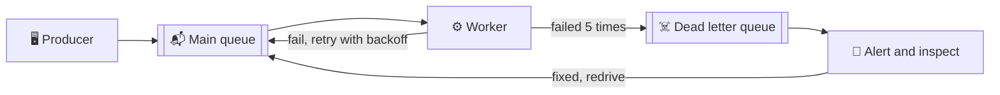

# 10 · Dead Letter Queues

> [!info] Topic info
> **Subject:** System Design · **Chapter:** Communication Patterns · **Priority:** ⚡ Medium · **Status:** ✅ done · **Last reviewed:** 2026-11-19
>
> [← Back to Communication Patterns](README.md) · [Interview questions →](questions/communication-patterns-qa.md)

> [!abstract] In one line
> A **dead letter queue (DLQ)** is a side queue where messages go after they **fail too many times**, so one bad message doesn't block or waste the main queue.

---

## 1. The problem

One notification message has broken JSON. The worker crashes on it, the message is redelivered, the worker crashes again… **forever**.

This is a **poison message**. It burns CPU, fills logs, and in an ordered queue or Kafka partition it **blocks every message behind it**.

---

## 2. How it works

1. Each message has a **receive count**.
2. On failure, retry it — ideally with **backoff** (1 s, 10 s, 1 min).
3. After **N** failures (e.g. 5), move it to the **DLQ** and move on.
4. Alert on the DLQ; a human or tool inspects, fixes, and **redrives** (replays) the messages.

SQS and RabbitMQ support DLQs natively (`maxReceiveCount`, dead-letter exchanges). Kafka has none built in — you publish failed messages to a separate **retry topic** / **DLQ topic** yourself.

> [!tip] 🎤 Say it like this
> "I retry failed messages a few times with backoff, and after that move them to a dead letter queue so they stop blocking or burning resources. The DLQ is alerted on, inspected, and messages are redriven after the bug is fixed. Nothing is lost, and the main queue keeps flowing."

---

## 3. Transient vs permanent errors

| Error | Example | Action |
|---|---|---|
| **Transient** | DB timeout, 503 from email API | Retry with backoff |
| **Permanent** | Bad JSON, unknown user ID, validation error | Send to DLQ **straight away** — retrying won't help |

Store **why** it failed (error message, stack trace, attempt count) with the DLQ message — debugging without it is painful.

> [!failure] Interview traps
> - **No alert on the DLQ** — it silently fills up and messages expire (SQS max retention is 14 days).
> - Retrying **immediately** with no backoff — hammers a struggling downstream service.
> - Redriving without fixing the bug — they all fail again.
> - Redrive and non-idempotent consumers — some messages were partly processed; make consumers [idempotent](09-delivery-semantics.md).

---

## Summary

- Poison messages loop forever and block queues → cap retries.
- Retry transient errors with backoff; send permanent ones to the DLQ fast.
- Alert, inspect, fix, redrive.

> [!success] Key takeaway
> Every production queue needs a retry limit, a DLQ, and an alert on it. It turns "stuck forever" into "parked safely for a human".
