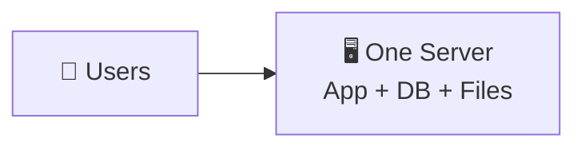
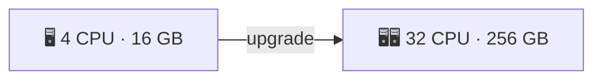
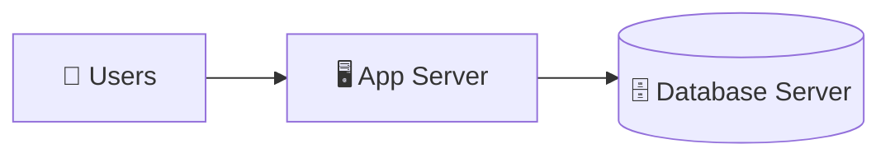
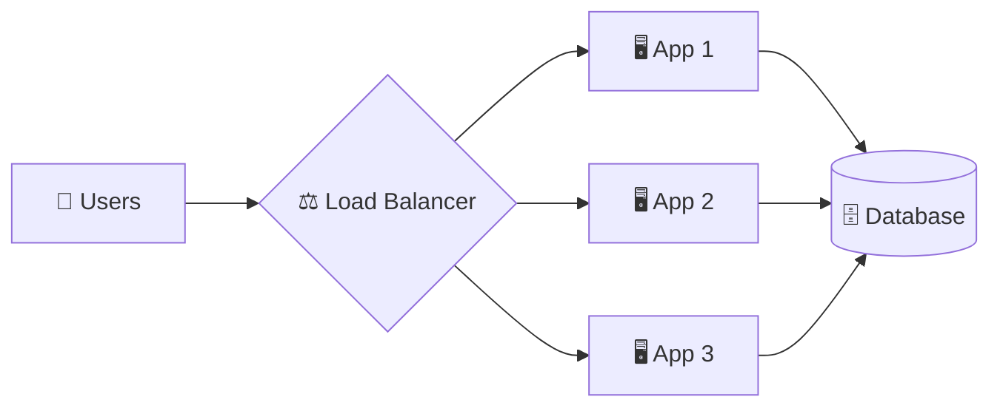
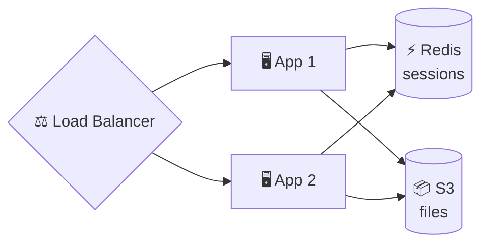
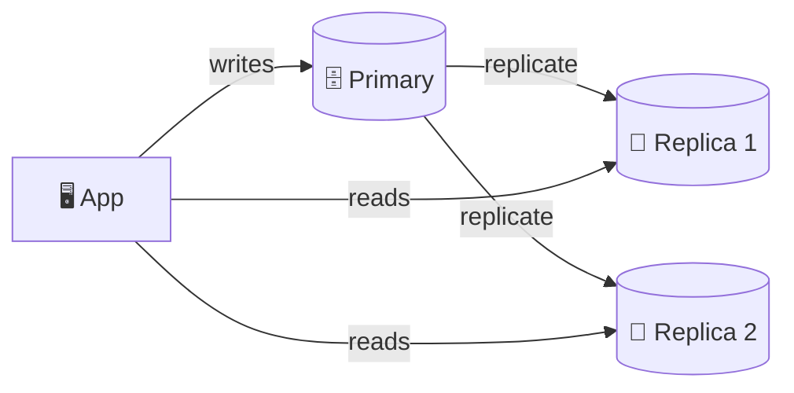
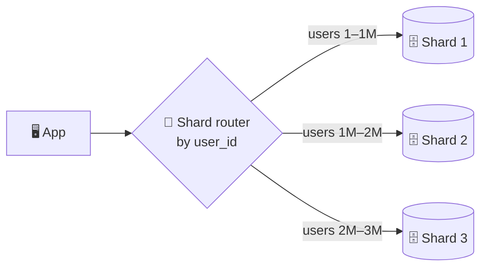
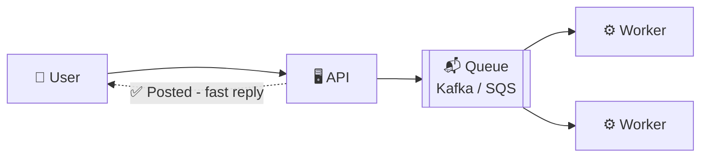

# 01 · Scalability

> [!info] Topic info
> **Subject:** System Design · **Priority:** 🔥 High · **Status:** ✅ done · **Last reviewed:** 2026-11-18
>
> [← Back to Core Concepts](README.md) · [Interview questions →](questions/01-scalability-qa.md)

> [!abstract] In one line
> **Scalability** is a system's ability to handle **more load** — more users, more requests, more data — by **adding resources**, while staying fast and reliable.

---

## 1. The problem

Imagine you build a small social media app. Everything runs on **one server**: the code, the database, the uploaded photos.



On day one you have 100 users. It's fast. Life is good.

Six months later you have **500,000 users**:

- Pages take 5 seconds to load.
- The database CPU is at 100%.
- During evening peak, the server crashes.

Nothing in your code "broke". The system simply **can't handle the load**. This is a scalability problem.

> [!tip] 🎤 Say it like this
> "Scalability means when load grows, I can add resources and the system keeps its performance. If traffic goes 10x and I can handle it by adding servers, the system is scalable. If I need to rewrite everything, it's not."

---

## 2. What scalability really means

Scalability is **not** the same as speed.

| | Performance problem | Scalability problem |
|---|---|---|
| **Symptom** | Slow even for **one** user | Fast for one user, slow for **many** |
| **Fix** | Better code, query, index | Better architecture |

> [!note] Scalability is not all-or-nothing
> Don't say "this system is scalable". Say **what** it scales for.
> A system can handle 10x more *reads* easily but fall over with 2x more *writes*.

---

## 3. Measuring the load

Before fixing anything, ask: **which load is growing?** Each one needs a different fix.

| Load type | Example | Usual fix |
|---|---|---|
| **Requests per second** | 1,000 → 5,000 req/s | More app servers |
| **Read-heavy traffic** | Feed is read 100x more than written | Cache, read replicas |
| **Write-heavy traffic** | Logs, chat messages, clicks | Queues, sharding |
| **Data size** | 50 GB → 20 TB | Partitioning / sharding |
| **Concurrent connections** | 1M open WebSockets | More servers, connection-friendly stack |

Not all requests cost the same. Loading a profile = 1 simple query. Loading a feed = many queries + sorting. **10 feed requests can cost more than 1,000 profile requests.**

---

## 4. Find the bottleneck first

> [!important] Golden rule
> A system is only as fast as its **slowest part**. Find it before you add anything.

Check these on your server:

| Resource | Symptom when it's the bottleneck |
|---|---|
| **CPU** | Constantly 90–100%, requests queue up |
| **Memory** | Swapping, out-of-memory crashes |
| **Disk I/O** | High wait time, slow DB queries |
| **Database** | Slow queries, too many connections, locks |
| **Network** | Bandwidth maxed out, timeouts |

> [!tip] 🎤 Say it like this
> "Before scaling I measure — CPU, memory, DB query time, p99 latency. I fix the biggest bottleneck, and then the next one shows up somewhere else. Scaling is a loop, not a one-time job."

---

## 5. Vertical scaling (scale up)

The first and easiest fix: **buy a bigger machine.**



**✅ Pros**
- Zero code changes
- Simple to operate — still one machine
- Great as a first step

**❌ Cons**
- **Hard limit** — there is a biggest machine you can buy
- **Expensive** — price grows faster than power at the top end
- **Downtime** — upgrading often needs a restart
- **Single point of failure** — if it dies, everything dies (see [Availability](02-availability.md))

> [!tip] 🎤 Say it like this
> "Vertical scaling is making one machine bigger. It's simple and needs no code changes, so I'd start there. But it has a ceiling and it's a single point of failure, so it doesn't work long term."

---

## 6. Separate the database

Next easy win: move the database to **its own machine**.



Now the app and the database don't fight over the same CPU and memory. And you can size each one separately — the DB usually needs more RAM and fast disks; the app needs more CPU.

---

## 7. Horizontal scaling (scale out)

Instead of one bigger server, add **more servers** and put a **load balancer** in front.



Need more capacity? Add App 4. One server dies? The load balancer stops sending traffic to it.

### The session problem

A user logs in, and **App 1** stores their session in its memory. Their next request goes to **App 2** — which has no idea who they are. 😕

**Quick fix — sticky sessions:** the load balancer always sends a user to the same server.
But this causes uneven load, and if that server dies, the user is logged out.

### The real fix — stateless servers

Don't keep anything important in the server's memory. Move it to shared storage:

| State | Move it to |
|---|---|
| Sessions | **Redis**, or a **JWT** the client sends |
| Uploaded files | **Object storage** (S3) |
| Cache | **Shared cache** (Redis) |
| Scheduled jobs | **Queue + workers** |



Now **any server can handle any request**. You can add or remove servers anytime.

> [!tip] 🎤 Say it like this
> "To scale out, app servers must be stateless. I keep sessions in Redis or use JWTs, and files go to S3. Then any request can go to any server, and adding servers is easy."

---

## 8. Vertical vs horizontal — side by side

| | ⬆️ Vertical | ➡️ Horizontal |
|---|---|---|
| **How** | Bigger machine | More machines |
| **Code changes** | None | App must be stateless |
| **Limit** | Hardware ceiling | Almost unlimited |
| **Failure** | Single point of failure | Survives a server dying |
| **Cost** | Expensive at the top | Many cheap machines |
| **Scaling downtime** | Often needs restart | None — add servers live |
| **Complexity** | Low | Higher (LB, shared state) |

> [!success] In real life, use both
> Scale **app servers horizontally** (easy, they're stateless).
> Scale the **database vertically** + replicas for as long as possible — splitting a database is hard.

---

## 9. Caching

The database is now the bottleneck. Most of the load is the **same data read again and again** — popular posts, user profiles.

Put a cache (Redis) in front of the DB:

```mermaid
flowchart LR
    APP[🖥️ App] -- 1. check --> C[(⚡ Redis)]
    C -. hit: return fast .-> APP
    APP -- 2. miss: query --> DB[(🗄️ Database)]
    DB -. 3. save in cache .-> C
```

This is the **cache-aside** pattern:
1. Look in the cache.
2. **Hit** → return it (~1 ms).
3. **Miss** → read from DB (~10–100 ms), save it in the cache, return it.

With an **80% hit rate**, the database gets **5x less** read traffic.

> [!warning] The hard part: stale data
> When data changes, the cache still has the old copy. Options:
> - **TTL** — entries expire after a set time (e.g. 5 min)
> - **Delete on write** — when you update the DB, delete that cache key
>
> Pick based on how stale the data is allowed to be.

When one Redis isn't enough, you spread keys across **multiple cache nodes** (Redis Cluster).

---

## 10. Read replicas

Caching helps, but cache misses and complex queries still hit the DB. Most apps are **read-heavy**, so copy the database:



- **All writes** → primary
- **Reads** → spread across replicas
- Need more read capacity? Add another replica.

> [!warning] Replication lag
> Replicas are a little behind the primary (milliseconds to seconds).
> A user updates their profile, refreshes, and sees the **old** value. 😬
>
> **Fix:** read-your-own-writes — for a short time after a write, read that user's data from the primary.

> [!note] Replicas don't help writes
> Every replica still has to apply every write. If **writes** are the problem, you need sharding.

---

## 11. Sharding

Now the data is too big for one machine, or there are too many writes for one primary. **Split the data** across multiple databases.



Each shard holds **part** of the data and handles **part** of the writes.

The most important decision is the **shard key** (here `user_id`). A good key:
- Spreads data **evenly**
- Keeps related data **together** (a user's posts on the same shard as the user)

> [!warning] What gets harder
> - **Cross-shard queries** — "top 10 posts from everyone" now hits every shard
> - **Joins & transactions** across shards — painful or impossible
> - **Hot shards** — one celebrity's shard gets all the traffic
> - **Rebalancing** — adding a shard means moving data around (see [Consistent Hashing](06-consistent-hashing.md) to move as little as possible)
>
> That's why sharding is the **last** step, not the first.

---

## 12. Queues and background work

Some work doesn't need to happen **before** the user gets a response:

- Sending emails / notifications
- Resizing images, processing videos
- Updating analytics, generating reports

Put it on a **queue** and let **workers** do it in the background:



**Benefits**
- The user gets a fast response
- **Traffic spikes are absorbed** — the queue grows, workers drain it at their own pace
- Workers scale **independently** from the API

> [!note]
> A queue doesn't make the work smaller — it just moves it **off the critical path**.

---

## 13. Bonus: auto-scaling & CDN

**Auto-scaling (elasticity)** — automatically add servers when load goes up and remove them when it goes down. Rules like *"add a server when CPU > 70%"*.

- **Scalability** = the system *can* grow
- **Elasticity** = it grows and shrinks *automatically*

> [!warning] Auto-scaling is slow
> New servers take 1–5 minutes to start. For a known spike (sale at 12:00), **pre-scale** before it starts.

**CDN** — images, JS, CSS and videos are served from servers close to the user. Those requests never reach your servers at all.

---

## 14. Verify the change

After every change, **measure again**. Did it actually help?

| Metric | Why it matters |
|---|---|
| **Throughput** (req/s) | Can we serve more? |
| **p50 latency** | Typical user experience |
| **p99 latency** | The slowest 1% — often your heaviest users |
| **Error rate** | Are we failing more under load? |
| **Cost** | Is the bill still reasonable? |

> [!tip] Why p99, not average?
> Averages hide slow requests. If the average is 100 ms but p99 is 4 s, **1 in 100 users** waits 4 seconds. At 1M users, that's 10,000 unhappy people.

Use load-testing tools (**k6, JMeter, Locust**) to find the breaking point **before** real users do.

---

## Summary

| Step | Fixes this bottleneck |
|---|---|
| 1️⃣ Vertical scaling | Server too small |
| 2️⃣ Separate the database | App and DB fighting for resources |
| 3️⃣ Horizontal scaling + stateless | One app server isn't enough / SPOF |
| 4️⃣ Caching + CDN | Same data read again and again |
| 5️⃣ Read replicas | Too many reads for one DB |
| 6️⃣ Queues + workers | Slow work blocking responses, spikes |
| 7️⃣ Sharding | Too much data / too many writes |

> [!success] Key takeaway
> **Measure → find the bottleneck → fix it → measure again.**
> Every fix adds complexity, so only add what the current load needs.

---

## References

- [AlgoMaster — Scalability](https://algomaster.io/learn/system-design/scalability)
- [System Design Primer](https://github.com/donnemartin/system-design-primer)
- *Designing Data-Intensive Applications* — Ch. 1, 5, 6
- *System Design Interview* — Alex Xu, Vol. 1, Ch. 1
