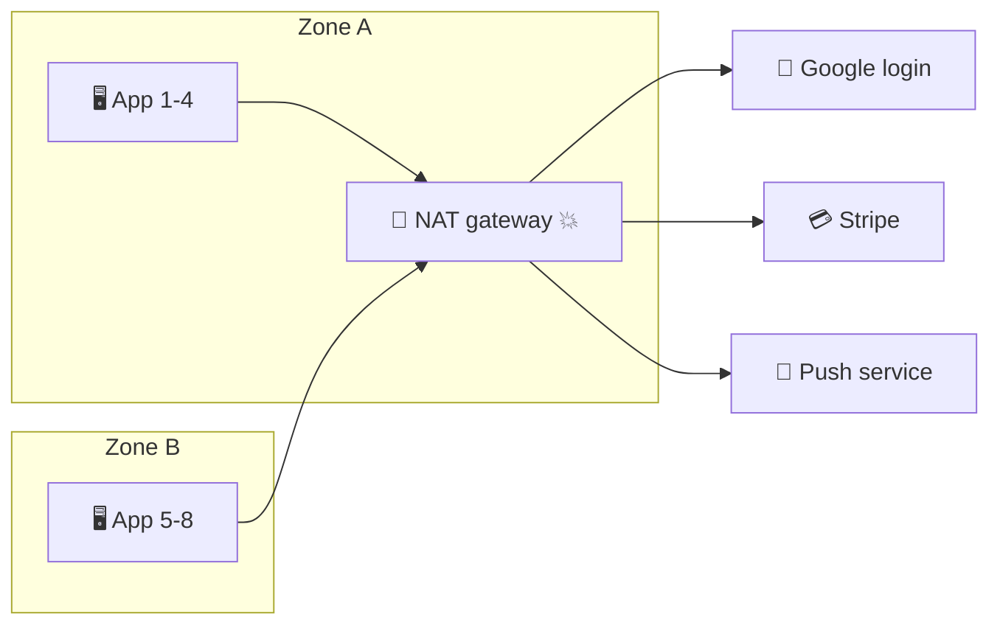
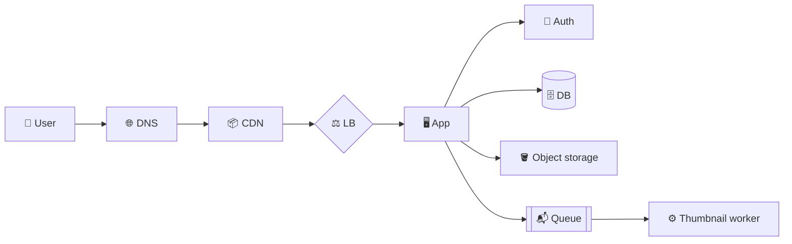
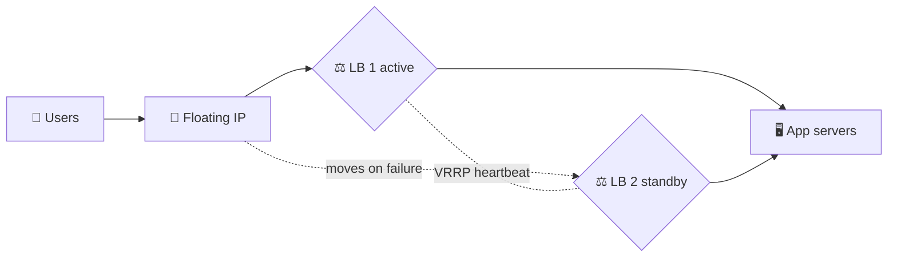
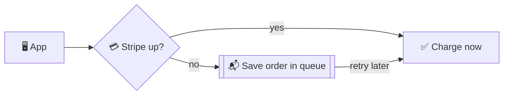
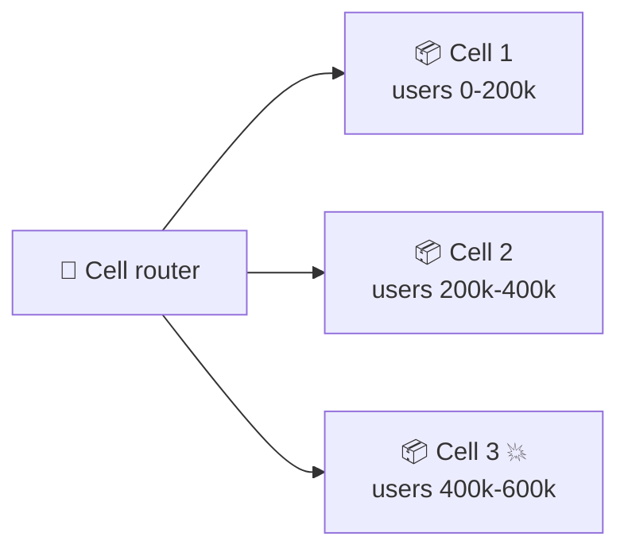
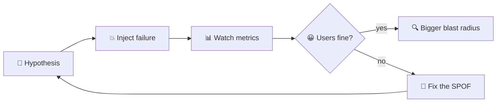

# 04 · Single Point of Failure

> [!info] Topic info
> **Subject:** System Design · **Priority:** 🔥 High · **Status:** ✅ done · **Last reviewed:** 2026-11-19
>
> [← Back to Core Concepts](README.md) · [Interview questions →](questions/04-single-point-of-failure-qa.md)

> [!abstract] In one line
> A **single point of failure (SPOF)** is any one part — a server, a service, a provider, a person — whose failure **takes the whole system down**. We find them by **walking every path and asking "what if this dies?"**, and remove them with **redundancy that fails independently**, when the **risk is worth the cost**.

---

## 1. The problem

Our social media app from the [Reliability](03-reliability.md) note now has **2 million users**. We did everything right: 8 app servers, a load balancer pair, a primary + standby database across two zones, idempotent payments. ✅

Then on a Monday morning, the app breaks for **50 minutes**:

- 🔐 Login with Google fails.
- 💳 Premium checkout fails.
- 🔔 No push notifications go out.
- But the feed still loads for people already logged in. 🤔

The cause? All 8 app servers reach the internet through **one NAT gateway** (the box that lets private servers make outgoing calls). It lived in zone A. Zone A had a network problem, and every outgoing call — Google login, Stripe, Apple push — died with it.

We had **two of everything we could see**. The thing that killed us was the one box nobody drew on the diagram.

> [!tip] 🎤 Say it like this
> "A single point of failure is any one component whose failure brings the whole system down. The obvious ones — one database, one load balancer — are easy to spot. The dangerous ones are the hidden ones: a single NAT gateway, an expiring certificate, one cron box, or one person who knows how to deploy."

---

## 2. What makes something a SPOF

A component is a SPOF if **both** are true:

1. There is **only one** of it (or all copies fail together).
2. A **critical** user action can't work without it.

So a single **analytics** server isn't a SPOF for the app — if it dies, users don't notice. A single **auth** service is — nobody can log in.

### The critical path

The **critical path** is the chain of components a request must pass through to succeed. As we saw in [Availability](02-availability.md) (section 5), parts in a chain **multiply**:

`99.9% × 99.9% × 99.9% × 99.9% ≈ 99.6%`

Any **one** box in that chain with no backup sets a ceiling on the whole system. A single NAT gateway at 99.9% means the app can **never** be better than 99.9%, no matter how many app servers we add.

### Blast radius

**Blast radius** = how much breaks when one thing fails.

| Failure | Blast radius |
|---|---|
| One app server dies | ~0 — LB routes around it |
| Recommendations service dies | Feed is less personal, still works |
| Auth service dies | Nobody can log in — **everyone** |
| Region dies | Every user in that region |

A SPOF is just a component with a **100% blast radius** for some important feature.

> [!note] SPOF depends on the scope
> Two servers in one rack are redundant against **a server** dying, but the **rack** is still a SPOF. Multi-AZ fixes the rack, but the **region** is a SPOF. Always ask: "a SPOF **at which level**?"

---

## 3. How to find SPOFs

You don't find SPOFs by staring at the architecture diagram. You find them by **tracing what actually happens**.

### Step 1 — Walk every request path

Pick a real user action ("post a photo") and follow it hop by hop, writing down **every** thing it touches:

Then repeat for the other paths that people forget:

- **Write path** and **read path** — often different.
- **Background jobs** — cron, workers, scheduled emails.
- **Deploy path** — CI server, container registry, secrets store.
- **Recovery path** — can you fail over if the tool that does failover is down?

### Step 2 — Build a dependency map

List every dependency, including **external** ones and the **dependencies of dependencies**. Your auth service may depend on Redis, which depends on DNS, which depends on one provider.

### Step 3 — Ask "what if this dies?"

For each box, answer three questions:

| Question | Example: Redis session store |
|---|---|
| **How many are there?** | 1 node |
| **What breaks if it dies?** | Every logged-in user is logged out, login fails |
| **How fast do we recover?** | Manual restart, ~15 min, sessions lost |

If the answers are "1", "something critical" and "slowly" — it's a SPOF.

> [!tip] 🎤 Say it like this
> "To find SPOFs I trace each important user flow end to end — read path, write path, background jobs, even the deploy path — and list every component and external dependency it touches. Then for each one I ask how many there are, what breaks if it dies, and how fast we recover. Anything with one copy and a big blast radius is a SPOF."

---

## 4. SPOFs at every layer

Every layer of the stack can hide one. Here's our app, top to bottom:

| Layer | SPOF example | What breaks | Fix |
|---|---|---|---|
| **DNS** | One DNS provider | Nobody can find the app | Two providers, or one with a 100% SLA and anycast |
| **CDN / edge** | One CDN | Images and JS fail to load | Multi-CDN with DNS switching |
| **Load balancer** | One LB box | All traffic stops | LB pair with floating IP, or managed LB |
| **App servers** | One server | Everything | 2+ stateless servers behind the LB |
| **Database** | One primary, no standby | All writes and most reads | Replication + auto failover — see [Availability](02-availability.md) |
| **Cache** | One Redis node | DB gets 5x load, may fall over | Redis replica + Sentinel, or cluster |
| **Message queue** | One Kafka broker | Posts don't reach feeds, no notifications | 3+ brokers, replication factor 3 |
| **Coordination** | One ZooKeeper / etcd node | Leader election and config stop | 3 or 5 node ensemble |
| **Shared services** | One auth or config service | Every other service fails | Redundant instances + cache results |
| **Network** | One NAT gateway, one link | No outgoing or incoming traffic | One per zone, two links from different carriers |
| **Zone / region** | Everything in one AZ | Whole app | Multi-AZ, then multi-region if needed |
| **Third-party APIs** | One payment provider | No revenue 💸 | Second provider, or queue and retry later |

> [!warning] Third parties are your SPOFs too
> If Stripe is down for 30 minutes, **your** checkout is down for 30 minutes. Users don't care whose fault it is. Their SLA is now part of **your** availability math.

---

## 5. Hidden SPOFs — the ones that actually bite

The obvious SPOFs get fixed in the first design review. The outages come from the sneaky ones.

### 🔒 Certificates and secrets that expire

A TLS certificate that expires at midnight takes down **every** server at once — redundancy doesn't help when all copies use the same expired cert. Same for API keys, OAuth secrets, and domain names.

**Fix:** auto-renew (Let's Encrypt, cloud cert managers), and **alert 30 days before** expiry.

### ⏰ The cron job on one box

`send-daily-digest` runs on `worker-3` only. Nobody notices for a week when `worker-3` dies — and 2 million users get no digest.

**Fix:** run scheduled jobs on a scheduler that picks **any healthy node** (Kubernetes CronJob, a distributed lock), and alert if a job **didn't run**.

### 👑 Leader nodes

Many systems have one **leader** that does the writes or coordination — a DB primary, a Kafka controller, a scheduler. While it's being replaced, that work **stops**.

**Fix:** automatic **leader election** with a quorum (section 6), and keep the election time short (seconds, not minutes).

### 🌐 DNS TTLs

**TTL** (Time To Live) = how long clients cache a DNS answer. If the TTL is **24 hours** and you move traffic to a new IP during an outage, some users keep hitting the dead IP for a day.

**Fix:** short TTLs (**30–60 s**) on records you might need to fail over.

### 🧑‍💻 One person's knowledge — the bus factor

**Bus factor** = how many people would need to disappear before a project is stuck. If only Priya knows how to restore the database, Priya is a SPOF. She'll be on a flight the day you need her.

**Fix:** runbooks, pairing, on-call rotation, and **practice** restores done by different people.

### 📚 Shared library or base image

Every service uses the same logging library. One bad version ships, and **all** services crash on startup together.

**Fix:** roll out shared code like any other change — canary first, one service at a time.

### ☁️ One cloud account

All production lives in one AWS account. A billing problem, a leaked root key, or an account lock means **everything** is gone — including backups stored in the same account.

**Fix:** separate accounts for prod, backups, and security; keep backups in a **different account**.

### 🔌 The tools you use to fix things

During the big Facebook outage in 2021, the network problem also broke the **internal tools and even the door badges** engineers needed to fix it. Your recovery path can be a SPOF too.

**Fix:** "break glass" access that doesn't depend on the system that's down — offline runbooks, a separate status page provider, out-of-band access.

> [!example] Quick checklist of hidden SPOFs
> Certificates · cron box · leader node · DNS TTL · NAT gateway · single network link · shared library · one cloud account · one region for backups · one person · the monitoring system itself · the CI/CD pipeline · a feature-flag service everyone calls on every request

> [!tip] 🎤 Say it like this
> "Beyond the obvious ones, I look for hidden SPOFs: certificates and secrets that expire, cron jobs pinned to one box, leader nodes, long DNS TTLs, a single NAT gateway, one cloud account, and the bus factor — one person who knows how to fix things. These cause more real outages than a dead database does."

---

## 6. Removing SPOFs — the toolbox

### Redundancy with headroom — N+1 and N+2

If peak traffic needs **N** servers, run **N+1** so you survive one failure. Run **N+2** so you can survive one failure **while** another is down for patching.

- Peak = 40,000 req/s, one server handles 10,000 → **N = 4**.
- **N+1 = 5** servers → lose one, the other 4 still cover peak.
- **N+2 = 6** servers → safe during a deploy **and** a crash.

> [!note] Make it stateless first
> Redundancy is easy for **stateless** servers — any copy can answer any request. Move state out (sessions to Redis, files to object storage), and app servers become cheap to duplicate. The hard SPOFs are always the **stateful** ones: databases, queues, leaders.

### Load balancer pairs — floating IP and VRRP

The load balancer protects app servers — but who protects the load balancer? Run **two**, sharing one **floating IP** (a virtual IP that can move between machines).

- **VRRP** (Virtual Router Redundancy Protocol), often via **keepalived**, sends heartbeats between the two.
- Heartbeats stop → LB 2 claims the floating IP in **1–3 seconds**.
- In the cloud, a **managed LB** (AWS ALB, GCP LB) does this for you across zones.

### Database replication and failover

Primary + hot standby in another zone, with automatic promotion. The details — sync vs async, split brain, RPO/RTO — are in [Availability](02-availability.md) (sections 8–9).

### Leader election with a quorum

When a system **needs** one leader, don't make it a fixed machine. Let a group of nodes **vote**, and the winner leads. If it dies, they vote again. Tools: **Raft** (etcd, Consul), **ZooKeeper**, Kafka's KRaft.

A **quorum** = a majority. You need a majority alive to elect a leader, which stops two leaders (split brain).

| Nodes | Majority needed | Can lose |
|---|---|---|
| 1 | 1 | 0 — it's a SPOF |
| 2 | 2 | 0 — **no better than 1!** |
| 3 | 2 | **1** |
| 5 | 3 | **2** |

> [!warning] Use odd numbers
> 2 nodes can't tolerate any failure (1 of 2 is not a majority), and 4 tolerates the same as 3. That's why clusters use **3 or 5**, spread across **3 zones**.

### Spread across zones and regions

Copies in the **same** zone die together. Put at least one copy in each of **2–3 AZs**. Go multi-region only if the business needs to survive a region outage.

### Multiple providers

For external dependencies with a big blast radius:

- **DNS:** two providers (e.g. Route 53 + Cloudflare). The 2016 Dyn DDoS took down sites that used only Dyn.
- **Payments:** a backup provider, or **accept the order and charge later** from a queue.
- **Push / SMS / email:** a second vendor behind the same interface.

### Cache the answers of dependencies

If the config service is down, use the **last known good config**. If auth is down, keep accepting **already-issued tokens** (JWTs can be verified locally with a public key). The dependency becomes **"nice to have"** for a while instead of **"must have right now"**.

### Graceful degradation

If you can't remove a SPOF, make sure its failure only breaks **its own feature**. Payment provider down → show "Premium checkout is temporarily unavailable", but the feed, posts and chat keep working.

> [!tip] 🎤 Say it like this
> "To remove a SPOF I first make the component stateless if I can, then run N+1 copies spread across zones. For load balancers I use a pair with a floating IP or a managed LB; for databases, replication with automatic failover; for anything that needs a leader, a 3 or 5 node quorum with leader election. For external providers I add a second one or degrade gracefully — queue the payment and retry."

---

## 7. Correlated failures — when redundancy is fake

Redundancy only works if the copies fail **independently**. Two copies that die **together** are really just one.

The availability math from [Availability](02-availability.md) says two 99% servers give 99.99%. That's only true if one dying doesn't make the other more likely to die. In real life, copies share a lot:

| Shared thing | How both copies die together | Fix |
|---|---|---|
| **Same rack / power / switch** | One power supply fails | Anti-affinity — spread across racks and zones |
| **Same zone** | Data center loses network | Multi-AZ |
| **Same software bug** | Leap-second bug crashes every node at 00:00 | Staggered rollouts, canaries |
| **Same deploy** | Bad config pushed to all servers at once | Canary → 10% → 50% → 100% |
| **Same dependency** | Both replicas call the same auth service | Cache results, fallback |
| **Same certificate / key** | Expires for all at the same second | Auto-renew + expiry alerts |
| **Same capacity** | One dies, the other gets 2x load and dies too | N+1 headroom — keep under ~60–70% |

> [!example] Real-world correlated failure
> In July 2024, one bad CrowdStrike update crashed **millions** of Windows machines at once — airlines, banks, hospitals. Every machine was "redundant", but they all ran the **same software** and got the **same update** at the same time.

### Cell-based architecture

One strong fix: split the system into **cells** — independent copies of the full stack, each serving a slice of users (e.g. 10 cells × 200,000 users each). A bad deploy or a poison request kills **one cell**, not everyone. Blast radius = **10%**.

> [!important] Golden rule
> **Two copies that share a failure cause are one copy.** For every redundant pair, ask: "what single event could kill both?"

---

## 8. Not every SPOF is worth removing

Removing a SPOF costs money, complexity, and engineering time. Sometimes the right answer is: **accept it, and recover fast**.

Think like a risk table: **risk = likelihood × impact**, and compare it with the **cost** of the fix.

| SPOF | Likelihood | Impact | Cost to fix | Decision |
|---|---|---|---|---|
| Single NAT gateway | Medium | Login + payments down | ~$35/month for a 2nd | ✅ Fix now — cheap |
| Single DB primary | Medium | Whole app down | Standby = 2x DB cost | ✅ Fix — critical |
| Single region | Low | Whole app down for hours | 2x infra + data sync work | ⚠️ Only if SLA demands it |
| Single payment provider | Low | No new subscriptions | Months of integration | ⚠️ Queue + retry instead |
| Single analytics DB | Medium | Dashboards late | Replica cost | ❌ Accept — users don't see it |
| Single cloud provider | Very low | Everything | Huge — 2 of every service | ❌ Accept for most companies |

When you **accept** a SPOF, don't just ignore it:

- Write it down — a known risk, not a surprise.
- Have **backups** and a **tested runbook** to restore it.
- **Monitor** it closely so MTTR is small.

> [!example] Quick worked example
> Our app makes ~$2,000/hour from Premium. A single-region outage might happen once in 3 years and last 6 hours → ~$12,000 lost. Going multi-region costs ~$15,000/**month**. Not worth it — yet. When revenue is 50x, the answer changes.

> [!tip] 🎤 Say it like this
> "I don't remove every SPOF blindly. I weigh likelihood times impact against the cost of the fix. A second NAT gateway costs almost nothing, so I fix it. Going multi-cloud costs a fortune and protects against a very rare event, so I accept that risk and make sure we can recover quickly instead."

---

## 9. Testing for SPOFs

Your diagram says there's no SPOF. The only way to **know** is to break things on purpose.

### Chaos engineering

Run **controlled experiments** that inject failures and check the system survives:

1. **Define steady state** — e.g. "≥ 99.9% of posts succeed, p99 < 500 ms".
2. **Form a hypothesis** — "if one Redis node dies, steady state holds".
3. **Inject the failure** — kill the node, add 2 s latency, block the NAT gateway.
4. **Watch the metrics** — did users notice?
5. **Start small** — one server in staging, then one in prod, then a whole zone.

Netflix's tools grow in size: **Chaos Monkey** kills single servers, **Chaos Kong** takes out a whole region.

### Game days and DR drills

A **game day** is a planned session where the team breaks something real (in staging or carefully in prod) and practises the response.

- "Primary DB fails at 2 PM — go." Does failover take 30 s or 30 min?
- "Priya is on holiday — someone else restores the backup." Tests the **bus factor**.
- "Zone A is gone." Does zone B have enough capacity?

> [!failure] Mistakes to avoid
> - Testing failover **once** at launch and never again — configs drift.
> - Running chaos experiments with **no abort button** and no monitoring.
> - Only testing **servers** dying — not slow dependencies, expired certs, or DNS.
> - Assuming the cloud provider's "multi-AZ" checkbox means you're safe — test it.

---

## 10. Talking about SPOFs in an interview

After you draw your design, interviewers almost always ask: **"Where are the single points of failure?"** Have a routine ready:

1. Go **box by box** along the request path, left to right.
2. For each, say how many copies there are and what happens if it dies.
3. Name the fix **and** its cost.
4. Mention **one or two hidden** SPOFs (certs, NAT, leader, bus factor) — it shows real experience.
5. Say which SPOFs you'd **accept** and why.

> [!question] Questions to ask the interviewer
> - What availability target do we need — does a zone outage need to be invisible to users?
> - Which features are critical (login, posting) and which can degrade (recommendations)?
> - Are we allowed to depend on third parties for critical paths, like payments or login?
> - What's the budget — is multi-region on the table?

---

## Summary

| Step | Fixes this problem |
|---|---|
| 1️⃣ Walk every path + dependency map | Not knowing where the SPOFs are |
| 2️⃣ Check every layer, DNS to third parties | Missing SPOFs outside the app servers |
| 3️⃣ Hunt hidden SPOFs | Certs, cron boxes, NAT, leaders, one person |
| 4️⃣ Stateless + N+1 / N+2 | One server dying = outage |
| 5️⃣ LB pair with floating IP, DB failover | The "protectors" being SPOFs themselves |
| 6️⃣ Quorum + leader election | One leader node stopping all writes |
| 7️⃣ Multi-AZ, multiple providers, cached dependencies | Whole zones or vendors failing |
| 8️⃣ Anti-affinity, staggered deploys, cells | Fake redundancy from correlated failures |
| 9️⃣ Risk = likelihood × impact vs cost | Overspending on rare risks |
| 🔟 Chaos engineering + game days | Believing the diagram instead of testing it |

> [!success] Key takeaway
> **Anything you have only one of — or many of that fail together — will eventually take you down.** Trace every path, look past the obvious boxes, make copies that fail independently, accept only the SPOFs you've consciously priced, and break things on purpose to prove it.

---

## References

- [AWS Well-Architected — Reliability Pillar](https://docs.aws.amazon.com/wellarchitected/latest/reliability-pillar/welcome.html)
- [AWS — Reducing the scope of impact with cell-based architecture](https://docs.aws.amazon.com/wellarchitected/latest/reducing-scope-of-impact-with-cell-based-architecture/reducing-scope-of-impact-with-cell-based-architecture.html)
- [Principles of Chaos Engineering](https://principlesofchaos.org/)
- [Google SRE Book — Managing Critical State: Distributed Consensus](https://sre.google/sre-book/managing-critical-state/)
- *Designing Data-Intensive Applications* — Martin Kleppmann, Ch. 1, 5, 9
