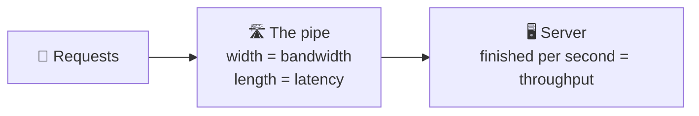
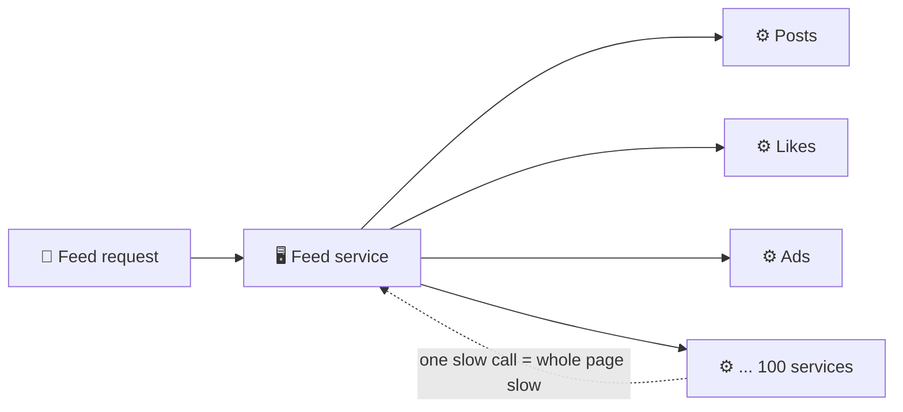

# 05 · Latency vs Throughput vs Bandwidth

> [!info] Topic info
> **Subject:** System Design · **Priority:** 🔥 High · **Status:** ✅ done · **Last reviewed:** 2026-11-19
>
> [← Back to Core Concepts](README.md) · [Interview questions →](questions/05-latency-throughput-bandwidth-qa.md)

> [!abstract] In one line
> **Latency** is how **long** one request takes, **throughput** is how **many** requests (or bytes) we actually finish per second, and **bandwidth** is the **maximum** the pipe could carry. They are related, but **independent** — improving one doesn't automatically improve the others.

---

## 1. The problem

Our social media app is now scalable, available, and reliable. But the performance complaints keep coming:

- 🇮🇳 "The feed takes **3 seconds** to load in Mumbai. My friend in New York says it's instant."
- 🎥 "Uploading a 1 GB video took **15 minutes**."
- 🌙 "Every evening at 9 PM the app gets **slow**, even though nothing is down."
- 📊 The dashboard says **average latency is 120 ms**. Everything looks green. Users still say it's slow.

These are four **different** problems. One is distance, one is pipe size, one is overload, and one is a lying metric.

> [!tip] 🎤 Say it like this
> "When someone says 'the system is slow', I first ask: slow for one request, or slow because it can't keep up with many requests? The first is latency, the second is throughput. And bandwidth is the ceiling on how much data can move at all."

---

## 2. Three words, one highway

The easiest way to keep them apart is a **highway**.

| Term | Highway version | System version | Unit |
|---|---|---|---|
| **Latency** | Time for **one car** to drive from A to B | Time for **one request** to get a response | ms |
| **Bandwidth** | **Number of lanes** — the most cars that could pass | **Max data** the link can carry per second | Mbps, Gbps |
| **Throughput** | Cars that **actually** pass per hour | Requests or bytes we **actually** handle per second | req/s, MB/s |

> [!example] Water pipe analogy
> - **Bandwidth** = how **wide** the pipe is.
> - **Latency** = how **long** the pipe is — time for the first drop to reach the end.
> - **Throughput** = how much water **actually** comes out per second (maybe less, if a valve is half-closed).

### Two more definitions

- **Latency** strictly means time **waiting** — the delay before work starts or data arrives.
- **Throughput** for a server is usually **requests per second (RPS)** or **queries per second (QPS)**. For a network, it's **bytes per second**.

---

## 3. How they relate

### Bandwidth ≥ throughput, always

Bandwidth is the **ceiling**. Throughput is what you **actually get**, and it's always lower because of protocol overhead, packet loss, slow servers, or small TCP windows.

A 1 Gbps link usually gives you around **600–900 Mbps** of real throughput.

### They are independent

You can have any combination:

| Example | Latency | Bandwidth |
|---|---|---|
| **Fiber in the same city** | ✅ Low (~2 ms) | ✅ High (1 Gbps) |
| **Geostationary satellite internet** | ❌ High (~600 ms round trip) | ✅ High (100 Mbps) |
| **Old 2G phone** | ❌ High | ❌ Low |
| **A truck full of hard drives** | ❌ Days | ✅ Petabytes — huge |

> [!example] The truck of hard drives
> AWS literally sold a truck (Snowmobile) to move 100 PB of data. The **latency** is days of driving. The **bandwidth** beats any internet link. "Never underestimate the bandwidth of a truck full of disks."

### Latency and throughput pull on each other

- **Lower latency can raise throughput** — if each request finishes faster, the same server can do more per second.
- **Pushing throughput too high raises latency** — requests start waiting in queues (section 10).
- Some tricks **trade** one for the other — batching raises throughput but adds latency (section 14).

> [!tip] 🎤 Say it like this
> "Bandwidth is the max capacity of the pipe, throughput is what we actually push through it, and latency is how long one request takes end to end. They're independent — a satellite link has huge bandwidth but terrible latency. And as throughput approaches capacity, latency goes up because requests start queuing."

---

## 4. Units — and the bits vs bytes trap

| Thing | Common units |
|---|---|
| **Latency** | ns, µs (microseconds), **ms** (milliseconds), s |
| **Throughput (server)** | **req/s**, QPS, TPS (transactions per second) |
| **Throughput (data)** | MB/s, GB/s |
| **Bandwidth (network)** | **Mbps**, Gbps — **bits** per second |

> [!warning] Bits vs bytes
> Networks are sold in **bits** (small **b**). Files are measured in **bytes** (big **B**). 1 byte = 8 bits.
>
> - **100 Mbps** internet = **12.5 MB/s** download.
> - A **1 GB** video at 100 Mbps takes about **80 seconds**, not 10.
> - On a **10 Mbps** upload link (common on home broadband), the same video takes **~13 minutes**. That's our "15-minute upload" complaint.

> [!example] Quick math
> **Time = size ÷ throughput.** Convert to the same unit first. 500 MB ÷ 12.5 MB/s = 40 s.

---

## 5. Latency vs response time vs processing time

People mix these up. Interviewers notice.

- **Processing time (service time)** — time the server spends **actually working** on the request.
- **Latency** — time the request spends **waiting**: on the network, in queues.
- **Response time** — what the **user feels**: everything, end to end.

**Response time = network latency + queue wait + processing time + network back.**

> [!note] In practice
> Most people (and most dashboards) say "latency" when they mean **response time**. That's fine in an interview — just show you know the parts. If processing is 20 ms but response time is 900 ms, the problem is **not** your code.

---

## 6. Where latency comes from

Our Mumbai user's feed takes 3 seconds. Let's break it down. There are four kinds of delay on every network hop.

| Delay | What it is | Example |
|---|---|---|
| **Propagation** | Signal travelling the distance — limited by the speed of light | Mumbai → US East ≈ **100 ms one way** |
| **Transmission** | Pushing all the bits onto the wire | 10 MB on a 10 Mbps link = **8 s** |
| **Processing** | Routers, load balancers, your server doing work | 1 ms to 200 ms |
| **Queuing** | Waiting in line behind other packets or requests | 0 to seconds under load |

### Speed of light is a hard limit

Light in fiber travels about **200 km per millisecond**. Mumbai to Virginia is ~13,000 km, so the **best possible** round trip (RTT) is ~130 ms. Real routes are longer, so it's usually **~200 ms**.

No code optimisation can beat physics. The only fix is to **move the server closer** or **make fewer round trips**.

### Handshakes multiply the round trips

Before a single byte of the feed arrives, a **new** HTTPS connection needs:

At **200 ms RTT**, that's **4–5 round trips ≈ 800 ms–1 s** before the first byte. Then the app makes 3 more API calls one after another... and we're at 3 seconds. 😬

> [!tip] 🎤 Say it like this
> "Latency has four parts: propagation, transmission, processing, and queuing. Propagation is physics — about 200 km per ms in fiber — so a user far from the data center pays it on every round trip. A new HTTPS connection needs DNS, TCP and TLS handshakes first, so I cut latency by moving content closer with a CDN, reusing connections, and reducing the number of round trips."

> [!note] Newer protocols help
> **TLS 1.3** needs 1 round trip instead of 2. **HTTP/3 (QUIC)** combines the transport and TLS handshakes, and can resume with **0-RTT** for returning users.

---

## 7. Latency numbers every engineer should know

You don't need exact numbers — you need the **order of magnitude**. These are rounded and approximate.

| Operation | Time | Feels like, if 1 ns = 1 second |
|---|---|---|
| **L1 cache read** | ~1 ns | 1 second |
| **Main memory (RAM) read** | ~100 ns | 2 minutes |
| **Read 1 MB from RAM** | ~10 µs | 3 hours |
| **SSD random read** | ~100 µs | 1 day |
| **Round trip in the same data center** | ~0.5 ms | 6 days |
| **Redis GET over the network** | ~1 ms | 12 days |
| **Read 1 MB from SSD** | ~1 ms | 12 days |
| **HDD disk seek** | ~10 ms | 4 months |
| **Simple indexed DB query** | ~1–10 ms | weeks to months |
| **Round trip US ↔ Europe** | ~80–150 ms | 3–5 years |
| **Round trip Mumbai ↔ US East** | ~200 ms | 6 years |

> [!example] What to take away
> - **Memory is ~1,000x faster than SSD**, SSD is **~100x faster** than a spinning disk seek.
> - A network call inside the data center (~0.5 ms) is **cheap**. A cross-continent call (~200 ms) is **400x** more expensive.
> - That's why a cache hit (~1 ms) vs a cross-region DB call (~200 ms) is such a big win.

> [!tip] 🎤 Say it like this
> "I keep rough numbers in my head: RAM is about 100 nanoseconds, SSD about 100 microseconds, a round trip in the same data center about half a millisecond, and a cross-continent round trip 100 to 200 milliseconds. So I avoid cross-region calls on the hot path and serve from memory whenever I can."

---

## 8. Percentiles and tail latency

Back to the dashboard: **average 120 ms**, but users say it's slow. Why?

### Averages lie

Say 100 requests: 95 take **50 ms**, 5 take **1.5 s**. The average is ~**125 ms** — looks great. But **5 users in every 100** waited 1.5 seconds.

Averages hide the slow requests. Use **percentiles** instead.

| Percentile | Meaning |
|---|---|
| **p50 (median)** | Half the requests are faster than this — the "typical" user |
| **p95** | 95% are faster; 1 in 20 is slower |
| **p99** | 99% are faster; **1 in 100** is slower |
| **p99.9** | 1 in 1,000 is slower |

The slow end (p99 and above) is called **tail latency**.

> [!note] Tail users matter most
> The slowest requests often belong to your **most valuable** users — they have the biggest feeds, the most followers, the most data. Amazon famously tracks **p99.9** for this reason.

### Fan-out makes the tail everyone's problem

Our feed page calls **100 backend services** in parallel (posts, likes, ads, friends...). It's only as fast as the **slowest** one.

If each service is slow just **1% of the time** (its p99):

- Chance **all 100** are fast = 0.99¹⁰⁰ ≈ **37%**.
- So **~63%** of feed loads hit at least one slow call. 😱

That's **tail amplification**: one service's rare p99 becomes the **common** experience at the top.

**Fixes:**
- **Hedged requests** — if a call hasn't answered by its p95, send a second copy to another replica; take whichever wins.
- **Timeouts + partial results** — skip the ads if they're late; show the feed anyway.
- **Fewer fan-out calls** — pre-compute the feed, batch lookups.

> [!tip] 🎤 Say it like this
> "I look at p50, p95 and p99, never just the average, because the average hides the slow tail. With fan-out, tail latency gets amplified — if a page calls 100 services and each is slow 1% of the time, most page loads hit a slow call. So I use timeouts, hedged requests, and partial results to protect the tail."

---

## 9. Little's Law — the one formula to remember

Little's Law connects all three ideas:

> [!important] Little's Law
> **Concurrency = Throughput × Latency**
> (requests in flight = requests per second × seconds per request)

### Worked example

Our feed API gets **2,000 req/s** at peak. Each request takes **200 ms** (0.2 s).

- In-flight requests = 2,000 × 0.2 = **400 at any moment**.
- If one server can handle **50 concurrent** requests (threads / connections), we need **400 ÷ 50 = 8 servers**, plus headroom → ~**11 servers**.

Now a slow DB pushes latency to **1 s**:

- In-flight = 2,000 × 1 = **2,000** requests.
- Now we'd need **40 servers** for the same traffic. Same load, **5x** the resources — just because latency went up.

> [!example] Use it backwards too
> A DB connection pool of **100** connections, each query takes **10 ms** → max throughput = 100 ÷ 0.01 = **10,000 queries/s**. If queries slow to 50 ms, the pool tops out at **2,000/s** and requests start waiting.

> [!tip] 🎤 Say it like this
> "Little's Law says concurrency equals throughput times latency. At 2,000 requests per second and 200 ms each, I have 400 requests in flight, which tells me how many threads, connections, or servers I need. It also shows why a latency spike is dangerous — the same traffic suddenly needs far more capacity, and thread pools run out."

---

## 10. Queuing — why latency explodes near 100%

Our 9 PM slowdown. Nothing is broken — the servers are just **busy**.

When a server is busy, new requests **wait in a queue**. The busier it is, the longer the line. And the curve is not a straight line — it's a **hockey stick**.

Say one request takes **10 ms** of work. In a simple queue model, response time ≈ work time ÷ (1 − utilization):

| CPU utilization | Response time | vs idle |
|---|---|---|
| **50%** | ~20 ms | 2x |
| **70%** | ~33 ms | 3x |
| **80%** | ~50 ms | 5x |
| **90%** | ~100 ms | 10x |
| **95%** | ~200 ms | 20x |
| **99%** | ~1,000 ms | 100x |

Going from 50% to 90% busy only adds **40% more throughput**, but latency gets **5x worse**.

> [!example] Supermarket checkout
> One cashier, customers arrive randomly. At half-busy, you rarely wait. At 95% busy, any small burst creates a long line that takes ages to clear.

> [!important] Golden rule
> Don't run servers near 100%. Keep **~60–70% utilization** at normal peak so there's room for bursts. Auto-scale on CPU or queue length **before** you hit the knee of the curve. See [Scalability](01-scalability.md).

> [!warning] Unbounded queues hide the problem
> A queue that grows forever means requests wait seconds, then time out — after you did the work anyway. Use **bounded queues**, **timeouts**, and **load shedding** (reject early with 429/503) so you serve some users fast instead of all users slowly.

---

## 11. How to improve latency

Goal: make **each request** faster.

| Technique | Why it helps | Our app |
|---|---|---|
| **CDN** | Content served from a city near the user | Images, videos, JS from Mumbai edge, not Virginia |
| **Caching** | RAM (~1 ms) instead of DB (~10–100 ms) | Cache the feed in Redis |
| **Closer regions** | Less propagation delay | Add an India region for Indian users |
| **Fewer round trips** | Each RTT costs ~200 ms far away | One `/feed` call instead of 3 sequential calls; GraphQL / BFF |
| **Connection reuse** | Skip DNS, TCP, TLS every time | Keep-alive, connection pools, HTTP/2 |
| **Parallel calls** | Wait for the slowest, not the sum | Fetch posts, likes, ads at the same time |
| **Async work** | Don't make the user wait for side work | Send notifications through a queue |
| **DB indexes, better queries** | Scan 1 row instead of 10M | Index on `(user_id, created_at)` |
| **Pre-compute** | Do the work before it's asked | Build the feed on write (fan-out on write) |

> [!tip] 🎤 Say it like this
> "To cut latency I bring data closer to the user and do less work per request: CDN and caching for reads, a nearby region for far-away users, fewer and parallel round trips, reused connections, and indexes. Anything the user doesn't need to wait for goes async on a queue."

---

## 12. How to improve throughput

Goal: handle **more requests per second** in total.

| Technique | Why it helps |
|---|---|
| **Horizontal scaling** | More servers = more requests in parallel ([Scalability](01-scalability.md)) |
| **Remove the bottleneck** | Throughput is capped by the **slowest** stage — often the DB |
| **Batching** | 1 insert of 500 rows instead of 500 inserts — far less overhead |
| **Parallelism / concurrency** | Async I/O, more workers, more partitions |
| **Queues** | Absorb spikes; workers drain at a steady max rate |
| **Caching** | Fewer requests reach the expensive backend |
| **Efficient code** | Less CPU per request = more requests per core |

> [!note] Throughput is set by the bottleneck
> If app servers can do 20,000 req/s but the DB can do 5,000 queries/s, the system does **5,000**. Adding app servers changes nothing.

---

## 13. How to save bandwidth

Our 1 GB video upload, and users on slow mobile data. Goal: **move fewer bytes**.

| Technique | Saving |
|---|---|
| **Compression** (gzip, Brotli) | JSON/HTML/JS shrink **70–90%** |
| **Modern image formats** (WebP, AVIF) | **25–50%** smaller than JPEG |
| **Right-sized images** | Send a 400 px thumbnail, not a 4,000 px original |
| **Video: adaptive bitrate** (HLS/DASH) | Phone on 4G gets 480p, laptop on fiber gets 1080p |
| **Pagination** | 20 posts per page, not 2,000 |
| **Smaller payloads** | Return only needed fields; Protobuf instead of JSON for internal calls |
| **CDN offload** | Media bytes come from the CDN, not your origin's bandwidth |
| **Delta / resumable uploads** | Upload the video in chunks; resume from chunk 37 after a drop |

> [!tip] Our video upload
> Compress on the device, upload in **5–10 MB chunks in parallel** directly to object storage (S3 multipart / presigned URL), and resume on failure. More parallel streams also fill the pipe better (see below).

### Big pipe, far away — bandwidth-delay product

**Bandwidth-delay product (BDP) = bandwidth × RTT** — how much data must be "in flight" to keep the pipe full.

- 1 Gbps × 200 ms = 200 Mbit ≈ **25 MB** in flight.
- If TCP only allows **64 KB** unacknowledged at a time, throughput ≈ 64 KB ÷ 0.2 s ≈ **320 KB/s** — on a 1 Gbps link! 😬

That's why a far-away transfer can be slow even on a fat pipe. Fixes: **TCP window scaling**, **parallel streams**, or **moving closer**.

> [!tip] 🎤 Say it like this
> "To save bandwidth I send fewer bytes: compression, modern image formats, right-sized media, adaptive video bitrate, pagination, and only the fields the client needs. Static and media bytes go through the CDN. For big uploads I use chunked, parallel, resumable uploads straight to object storage."

---

## 14. Trade-offs — when they fight

| Choice | Helps | Hurts |
|---|---|---|
| **Batching** (wait 50 ms to collect 500 writes) | ✅ Throughput | ❌ Latency — each item waits for the batch |
| **Compression** | ✅ Bandwidth, transfer time on slow links | ❌ CPU, a few ms of latency |
| **Running servers hot** (90% CPU) | ✅ Cost, throughput per server | ❌ Latency explodes (section 10) |
| **Hedged requests** | ✅ Tail latency | ❌ Extra load, ~5% more requests |
| **Sync replication** | ✅ Durability | ❌ Write latency |
| **Bigger pages / prefetching** | ✅ Fewer round trips | ❌ Bandwidth, wasted data |

> [!example] Kafka's knobs
> Kafka producers have `linger.ms` and `batch.size`. Set `linger.ms = 0` → lowest latency. Set it to 20 ms → much bigger batches and **far higher** throughput. Same system, you pick the trade-off.

> [!question] Questions to ask the interviewer
> - Is this **latency-sensitive** (chat, search, checkout) or **throughput-oriented** (analytics, video processing, log ingestion)?
> - What's the latency target — and at which percentile? (e.g. **p99 < 300 ms**)
> - Where are the users? One country or global?
> - What's the peak req/s and the average payload size?

---

## 15. Measuring it

You can't fix what you don't measure — and you must measure the **right** thing.

### Google's four golden signals

| Signal | What to watch |
|---|---|
| **Latency** | p50 / p95 / p99 — separate **successful** and **failed** requests (fast errors make latency look good) |
| **Traffic** | req/s, MB/s — your throughput |
| **Errors** | % of failed requests, timeouts |
| **Saturation** | How "full" you are: CPU, memory, connection pool, **queue length** |

### Tools

- **Load testing** — k6, JMeter, Locust, Gatling. Ramp up req/s until p99 crosses your target. That point is your **real** max throughput, not the point where it crashes.
- **APM and tracing** — Datadog, New Relic, OpenTelemetry + Jaeger. A trace shows where the 3 seconds went: 800 ms handshakes, 1.2 s DB query, etc.
- **Real User Monitoring (RUM)** — measure from actual phones and browsers, not just from inside the data center. Your server may say 50 ms while a Mumbai user sees 2 s.
- **Network tools** — `ping` (RTT), `traceroute` (path), `iperf` (bandwidth / throughput).

> [!failure] Mistakes to avoid
> - Looking only at the **average**.
> - Load testing from the **same data center** — you miss the real network latency.
> - Reporting max throughput at **100% CPU** — at that point p99 is terrible.
> - Measuring only server time and ignoring **client-side** time (DNS, TLS, rendering).

---

## Summary

| Step | Fixes this problem |
|---|---|
| 1️⃣ Separate the three terms | "It's slow" — but slow how? |
| 2️⃣ Bits vs bytes math | Wrong upload-time estimates |
| 3️⃣ Break down response time | Optimising code when the network is the problem |
| 4️⃣ CDN, closer regions, fewer round trips | Far-away users paying 200 ms per RTT |
| 5️⃣ Percentiles, not averages | A green dashboard while users suffer |
| 6️⃣ Timeouts, hedging, partial results | Tail amplification with fan-out |
| 7️⃣ Little's Law | Sizing servers, threads, and connection pools |
| 8️⃣ Keep utilization ~70% + load shedding | Evening slowdown from queuing |
| 9️⃣ Scale out, batch, parallelize | Not enough throughput |
| 🔟 Compression, smaller payloads, chunked uploads | Bandwidth limits and slow uploads |

> [!success] Key takeaway
> **Latency = how long, throughput = how many, bandwidth = how much at most.** Measure p99 not averages, remember that physics sets a floor on latency, use Little's Law to size capacity, and never run near 100% — that's where latency falls off a cliff.

---

## References

- *Designing Data-Intensive Applications* — Martin Kleppmann, Ch. 1 (Describing Performance)
- [Google SRE Book — Monitoring Distributed Systems (the four golden signals)](https://sre.google/sre-book/monitoring-distributed-systems/)
- [Jeff Dean & Peter Norvig — Latency numbers every programmer should know](https://gist.github.com/jboner/2841832)
- [The Tail at Scale — Dean & Barroso, CACM 2013](https://research.google/pubs/the-tail-at-scale/)
- [High Performance Browser Networking — Ilya Grigorik](https://hpbn.co/)
- [System Design Primer — Latency vs throughput](https://github.com/donnemartin/system-design-primer#latency-vs-throughput)
