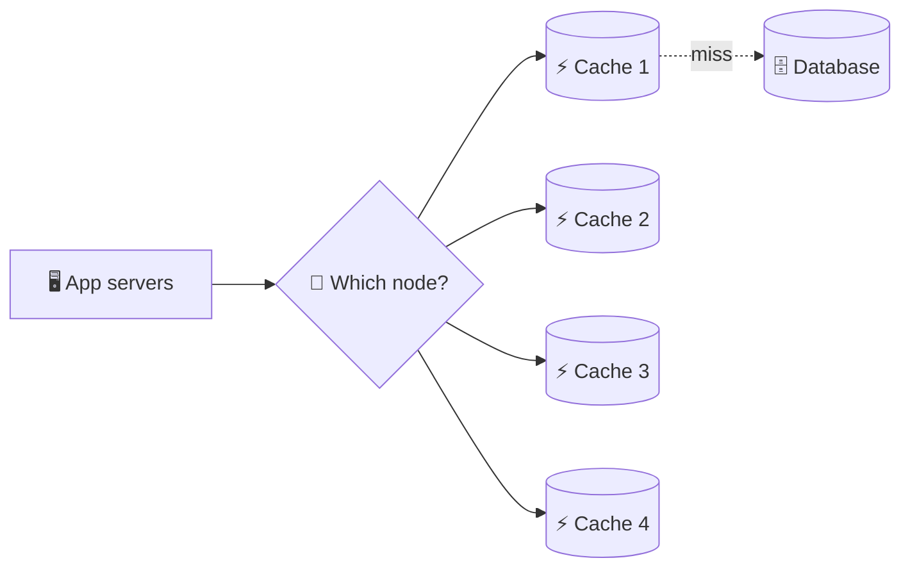
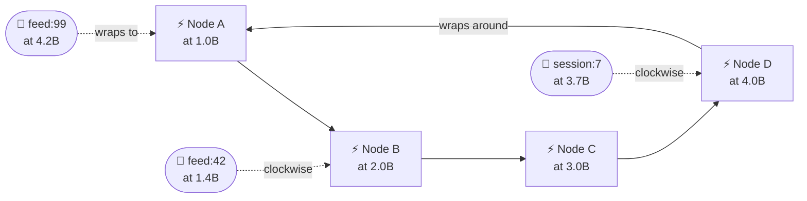
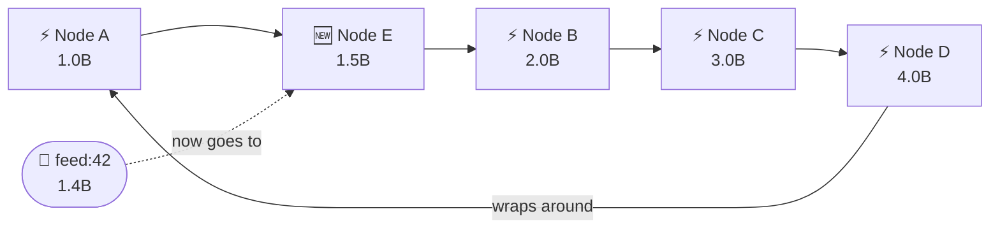
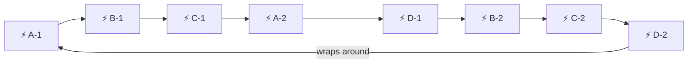
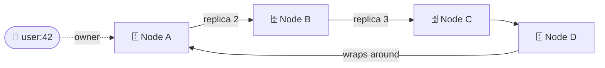

# 06 · Consistent Hashing

> [!info] Topic info
> **Subject:** System Design · **Priority:** 🔥 High · **Status:** ✅ done · **Last reviewed:** 2026-11-19
>
> [← Back to Core Concepts](README.md) · [Interview questions →](questions/06-consistent-hashing-qa.md)

> [!abstract] In one line
> **Consistent hashing** places both **servers and keys on a hash ring**, and each key goes to the **next server clockwise** — so adding or removing a server moves only **about 1/N of the keys**, not almost all of them.

---

## 1. The problem

Our social media app from [Scalability](01-scalability.md) now caches **user sessions and feeds** in Redis. One Redis box isn't enough, so we run a **cluster of 4 cache nodes** holding **10 million keys**.

The app needs a rule: "for key `feed:42`, which of the 4 nodes do I ask?" Every app server must use the **same** rule, or they'll look in different places.



Friday evening, traffic is up, so we add a **5th node**. Within seconds the database CPU hits 100% and the app falls over. 😱

Adding capacity made things **worse**. Why? Because of how we picked the node.

> [!tip] 🎤 Say it like this
> "When I spread keys across N cache or database nodes, I need a mapping from key to node that every client agrees on. The naive mapping breaks badly when N changes, so I use consistent hashing, which only moves a small fraction of keys when nodes join or leave."

---

## 2. The naive way — `hash(key) % N`

The obvious rule is modulo hashing:

```
node = hash(key) % N
```

Hash the key to a big number, divide by the number of nodes, take the remainder. It's simple, fast, and spreads keys evenly. With N = 4, a key with hash 42 goes to node `42 % 4 = 2`.

**The catch: N is part of the formula.** Change N and almost every answer changes.

### Worked example — going from 4 to 5 nodes

| Key hash | `% 4` (before) | `% 5` (after) | Moved? |
|---|---|---|---|
| **10** | 2 | 0 | ❌ moved |
| **11** | 3 | 1 | ❌ moved |
| **12** | 0 | 2 | ❌ moved |
| **13** | 1 | 3 | ❌ moved |
| **20** | 0 | 0 | ✅ stays |
| **21** | 1 | 1 | ✅ stays |

A key stays only if `h % 4 == h % 5`. That happens for just **4 out of every 20** numbers — so **80% of keys move**.

In general, going from N to N+1 nodes moves about **N/(N+1)** of the keys. From 100 to 101 nodes, **99%** move. 🤯

### What that means for our cache

- 10M keys × 80% = **8 million keys** now "live" on a different node.
- Those nodes don't have them → **8 million cache misses** at once.
- All of them fall through to the database → a **cache miss storm** (also called a thundering herd).

The same thing happens when a node **crashes** (4 → 3) — exactly when you can least afford it.

> [!warning] It's even worse for databases
> For a cache, a moved key is "just" a miss. For a sharded **database**, every moved key is real data you must **copy over the network**. Moving 80% of a 20 TB dataset to add one server is not an option.

---

## 3. The idea — a hash ring

Instead of dividing by N, imagine the hash output as a **circle**. A 32-bit hash gives numbers from **0 to 2³² − 1** (about 4.3 billion), and we wrap the end back to the start.

Two steps:

1. **Hash each server** (e.g. its name or IP) to a point on the ring.
2. **Hash each key** to a point on the ring, then **walk clockwise** until you hit a server. That server owns the key.

Mermaid can't draw a real circle, so read the arrows below as "clockwise":



So each node owns the **arc between the previous node and itself**. Node B owns everything from 1.0B to 2.0B.

**N is no longer in the formula.** A key's owner only depends on its **neighbours** on the ring.

> [!example] Analogy — bus stops on a circular route
> Servers are bus stops on a ring road. Each passenger (key) walks clockwise to the next stop. Open a new stop, and only the passengers just before it change stops. Everyone else keeps using the same one.

> [!tip] 🎤 Say it like this
> "I hash both servers and keys onto the same ring, say 0 to 2 to the 32. A key belongs to the first server clockwise from its position. Because the number of servers isn't in the formula, adding or removing one only affects the keys in that one arc."

---

## 4. Adding and removing nodes

### Adding Node E

We add **Node E** at position **1.5B**, between A (1.0B) and B (2.0B).



- Keys between **1.0B and 1.5B** used to belong to B. Now they belong to **E**.
- **Every other key stays exactly where it was.**

With 5 evenly placed nodes, E takes about **1/5 = 20%** of the keys. Compare:

| Change | `hash % N` | Consistent hashing |
|---|---|---|
| **4 → 5 nodes** | ~80% of keys move | ~20% move |
| **100 → 101 nodes** | ~99% move | ~1% move |
| **Cache misses (10M keys, 4 → 5)** | ~8M | ~2M |

That 20% is the **minimum possible** — the new node has to get its share from somewhere.

### Removing (or losing) Node B

If B crashes, its keys simply move to the **next node clockwise** — C. Keys on A, D and E don't move at all.

> [!important] Golden rule
> With consistent hashing, adding or removing one node moves only about **K/N keys** (K = total keys, N = nodes). With modulo hashing, it moves almost **all K**.

> [!note] You still have to move the data
> Consistent hashing tells you **which** keys move — it doesn't move them for you. A cache just takes misses and refills. A database (Cassandra, Dynamo) **streams** that arc of data from the old owner to the new node before switching over.

---

## 5. Problem — uneven distribution

With only 4 or 5 points on a huge ring, positions are **random**. You might get:

- Node A owns **45%** of the ring
- Node C owns only **8%**

Node A runs out of memory and gets hammered while C sits idle.

There's a second problem. When B dies, **all** of B's load goes to **one** neighbour, C. C now has double load, might fall over too, and then its load goes to D… a **cascading failure**. 💥

---

## 6. The fix — virtual nodes

Instead of one point per server, put **many points per server** on the ring. Each point is a **virtual node** (vnode).

Hash `"A-1"`, `"A-2"`, … `"A-200"` → 200 points for server A. Same for B, C, D.



Now each server owns **hundreds of small arcs** scattered around the ring instead of one big one.

**✅ What vnodes fix**
- **Even spread** — with ~100–200 vnodes per server, each server's share is usually within a few % of the average.
- **Failure spreads out** — when B dies, its 200 small arcs go to many different neighbours, so A, C and D each take a bit. No single node doubles.
- **Joining spreads out** — a new node takes a small slice from **every** existing node, not a big slice from one.
- **Weighting** — a server with 2× the RAM gets **2× the vnodes** (say 400 instead of 200) and so roughly 2× the keys.

**❌ What they cost**
- **More memory for the ring** — 100 servers × 200 vnodes = 20,000 entries. Still tiny (a few hundred KB).
- **Slightly slower lookups** — binary search over 20,000 entries is ~15 steps. Still microseconds.
- **More pieces to track** when rebalancing or repairing data.

> [!note] Real numbers
> Older **Cassandra** versions defaulted to **256 vnodes** (tokens) per node. Newer versions use **16** plus a smarter token-allocation algorithm that keeps balance with fewer pieces.

> [!tip] 🎤 Say it like this
> "With only one point per server, the ring is lumpy and a dead node dumps all its load on one neighbour. So I use virtual nodes — each server gets 100 to 200 points on the ring. That evens out the load, spreads a failed node's keys across many servers, and lets me give bigger machines more vnodes."

---

## 7. Replication on the ring

Our cache can lose data, but a database can't. Systems like **Amazon Dynamo** and **Cassandra** use the ring for replication too.

With replication factor **R = 3**: store the key on the owner **and the next 2 distinct physical nodes** clockwise.



This list of nodes for a key is called its **preference list**.

> [!warning] Skip vnodes of the same server
> With vnodes, the next 2 points clockwise might be `A-7` and `A-8` — the **same physical server**. Then all 3 copies die together. Walk clockwise and **skip** any server you already picked. Better still, also skip servers in the **same rack or availability zone**.

When a node dies, reads and writes go to the other replicas, and the next node clockwise temporarily takes over its role. (See [Availability](02-availability.md) for failover and [Reliability](03-reliability.md) for keeping copies correct.)

> [!tip] 🎤 Say it like this
> "For replication, I store each key on the first R distinct physical nodes clockwise from it — Dynamo and Cassandra call this the preference list. I skip vnodes that belong to a server or zone I've already used, so one machine or AZ failure can't take out every copy."

---

## 8. Hot keys — what consistent hashing does NOT fix

A celebrity with **50 million followers** posts. Millions of users load `post:9001` in the same minute.

Consistent hashing spreads **keys** evenly. It does **nothing** for one key that gets 100,000 req/s. That key lives on **one** node, and that node melts. 🔥

> [!failure] Mistake to avoid
> Saying "consistent hashing gives us even load". It gives **even key distribution**. Load per key can still be wildly uneven.

**Mitigations for hot keys**

| Fix | How |
|---|---|
| **Local in-memory cache** | Each app server keeps hot keys in its own memory for a few seconds. Most requests never reach Redis. |
| **Split the key** | Store copies as `post:9001#1` … `post:9001#10`. Each hashes to a different node; readers pick one at random. |
| **Read from replicas** | Spread reads for that key across all R replicas, not just the owner. |
| **Request coalescing** | If 1,000 requests miss the same key at once, only **one** goes to the DB; the rest wait for its answer. |
| **Detect and react** | Track top keys per node; when a key goes hot, apply one of the fixes above automatically. |

Hot **write** keys (like a live like-counter) need different tricks: shard the counter into 10 sub-counters and sum them on read.

---

## 9. How the lookup actually works

No real circle exists in code. The ring is just a **sorted array** of vnode hashes.

```python
# ring = sorted list of (hash, server) for every vnode
def get_node(key):
    h = hash(key)
    i = bisect_left(ring_hashes, h)   # first vnode hash >= h
    if i == len(ring_hashes):         # past the end? wrap to the start
        i = 0
    return ring[i].server
```

- **Lookup:** binary search → **O(log V)**, where V = total vnodes. 20,000 vnodes ≈ 15 comparisons.
- **Add / remove a server:** insert or delete its vnodes and re-sort → O(V log V), but that's rare.
- **Hash function:** needs to be **fast and evenly spread**, not secure. MurmurHash, xxHash or MD5 are common choices.

> [!note] Everyone must see the same ring
> If two app servers have different server lists, they'll send the same key to different nodes. The ring membership must be shared — via a **config service** (ZooKeeper, etcd), a **gossip protocol** (Cassandra), or a **cluster proxy** that does routing for everyone.

---

## 10. Where it's used in real life

| System | How it uses consistent hashing |
|---|---|
| **Amazon Dynamo / DynamoDB** | Ring with vnodes + preference lists for partitioning and replication |
| **Apache Cassandra** | Token ring; each node owns token ranges, replicas walk clockwise |
| **Riak** | Dynamo-style ring split into a fixed number of partitions |
| **Memcached clients (ketama)** | Client-side ring so adding a cache server doesn't flush everything |
| **Discord** | Routes each server (guild) to the process that handles it |
| **Load balancers (Google Maglev, Envoy, NGINX)** | Same client or connection goes to the same backend, even as backends change |
| **CDNs (Akamai)** | Same URL goes to the same cache server, so content isn't cached many times |

> [!success] In real life
> You rarely write the ring yourself. Cassandra, DynamoDB, and good cache clients do it for you. But interviewers expect you to explain **why** it's there and what vnodes and replication on the ring look like.

---

## 11. Alternatives worth knowing

### Rendezvous hashing (HRW — highest random weight)

For each key, compute a score for **every** server: `score = hash(key + server)`. The server with the **highest score** wins.

- Remove a server → only its keys move, each to its own second-best server. Very even, no vnodes needed.
- Lookup is **O(N)** per key — fine for 10–50 servers, slow for thousands.

### Jump consistent hash (Google, 2014)

A tiny function that maps a key to a bucket number `0..N-1` with **no memory** and near-perfect balance.

- Catch: buckets are numbered, so you can only add or remove at the **end**. You can't remove "server 3" from the middle. Good for storage shards, not for servers that die at random.

### Redis Cluster — fixed hash slots

Redis Cluster does **not** use a ring. It has a **fixed 16,384 slots**: `slot = CRC16(key) % 16384`. Each node is assigned a range of slots.

- The number of slots **never changes**, so the key → slot mapping is stable.
- Adding a node = **moving some slots** to it (e.g. ~3,277 slots each for 5 nodes). Only keys in those slots move.
- Clients keep a **slot → node map** and get a `MOVED` reply if it's out of date.

> [!example] Why this counts as "different"
> The ring decides ownership by **position** — add a node and the boundary moves automatically. Fixed slots decide ownership by an **explicit table** — an admin or tool reassigns slots. Same goal (move only a little data), but more control and easier to reason about. Cassandra-style rings and Redis slots both avoid the `% N` trap.

| | Hash ring + vnodes | Rendezvous (HRW) | Jump hash | Fixed slots (Redis) |
|---|---|---|---|---|
| **Lookup** | O(log V) | O(N) | O(log N), no memory | O(1) table lookup |
| **Remove any node** | ✅ | ✅ | ❌ only the last | ✅ reassign its slots |
| **Weights** | More vnodes | Weighted score | ❌ | Give it more slots |
| **Used by** | Dynamo, Cassandra | Some CDNs, small clusters | Storage sharding | Redis Cluster, Couchbase |

---

## 12. Trade-offs

**✅ Pros**
- Adding or removing a node moves only **~1/N** of the keys.
- No central lookup table needed — any client with the server list can compute the owner.
- Works naturally with **replication** (next R nodes) and **weights** (more vnodes).

**❌ Cons**
- **Uneven** without vnodes; vnodes add bookkeeping.
- **Doesn't fix hot keys** — one popular key still lands on one node.
- Every client must have the **same view** of the ring, so you need membership / gossip.
- **Range queries are hard** — keys are scattered by hash, so "users 1 to 1,000" hits every node. (Same trade-off as hash vs range sharding in [Scalability](01-scalability.md), section 11.)

> [!question] Questions to ask the interviewer
> - How often do nodes join or leave — autoscaling every hour, or rarely?
> - Is it a cache (misses are OK) or a database (data must be streamed safely)?
> - Are there known hot keys, like celebrity accounts?
> - Do we need range queries on the key?

---

## Summary

| Step | Fixes this problem |
|---|---|
| 1️⃣ `hash(key) % N` | Need a shared rule for key → node, but ~80% of keys move when N changes |
| 2️⃣ Hash ring | Adding/removing a node moves only ~1/N of keys |
| 3️⃣ Virtual nodes | Uneven arcs and one neighbour taking all of a dead node's load |
| 4️⃣ Weighted vnodes | Servers of different sizes |
| 5️⃣ Replicate to next R distinct nodes | Losing data when a node dies |
| 6️⃣ Local cache, key splitting, coalescing | Hot keys that hashing can't spread |
| 7️⃣ Sorted array + binary search | Fast O(log V) lookups |
| 8️⃣ Shared membership (gossip / etcd) | Clients disagreeing on who owns a key |

> [!success] Key takeaway
> **Never use `hash % N` when N can change.** Put servers and keys on a ring, use ~100–200 vnodes per server for balance, replicate to the next R distinct nodes, and remember: consistent hashing balances **keys**, not **traffic** — hot keys still need their own fix.

---

## References

- [Karger et al. — Consistent Hashing and Random Trees (1997)](https://www.cs.princeton.edu/courses/archive/fall09/cos518/papers/chash.pdf)
- [Amazon — Dynamo: Highly Available Key-value Store (2007)](https://www.allthingsdistributed.com/files/amazon-dynamo-sosp2007.pdf)
- [Lamping & Veach — A Fast, Minimal Memory, Consistent Hash Algorithm (Jump hash)](https://arxiv.org/abs/1406.2294)
- [Google — Maglev: A Fast and Reliable Software Network Load Balancer](https://research.google/pubs/maglev-a-fast-and-reliable-software-network-load-balancer/)
- [Redis — Cluster specification (hash slots)](https://redis.io/docs/latest/operate/oss_and_stack/reference/cluster-spec/)
- *System Design Interview* — Alex Xu, Vol. 1, Ch. 5
- *Designing Data-Intensive Applications* — Martin Kleppmann, Ch. 6 (Partitioning)
