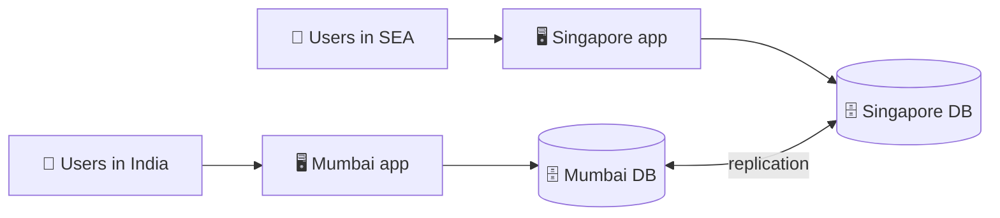
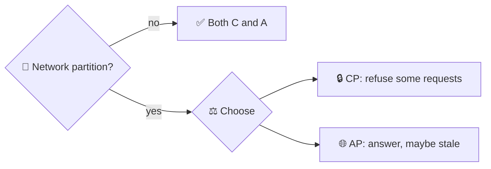
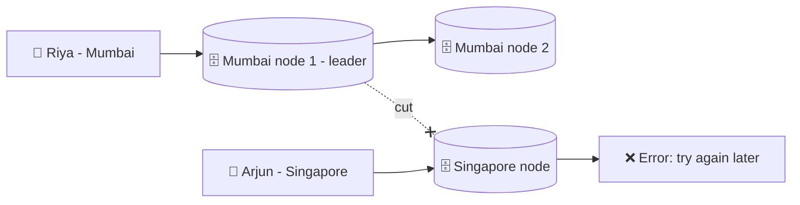
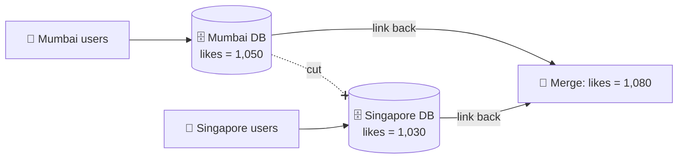
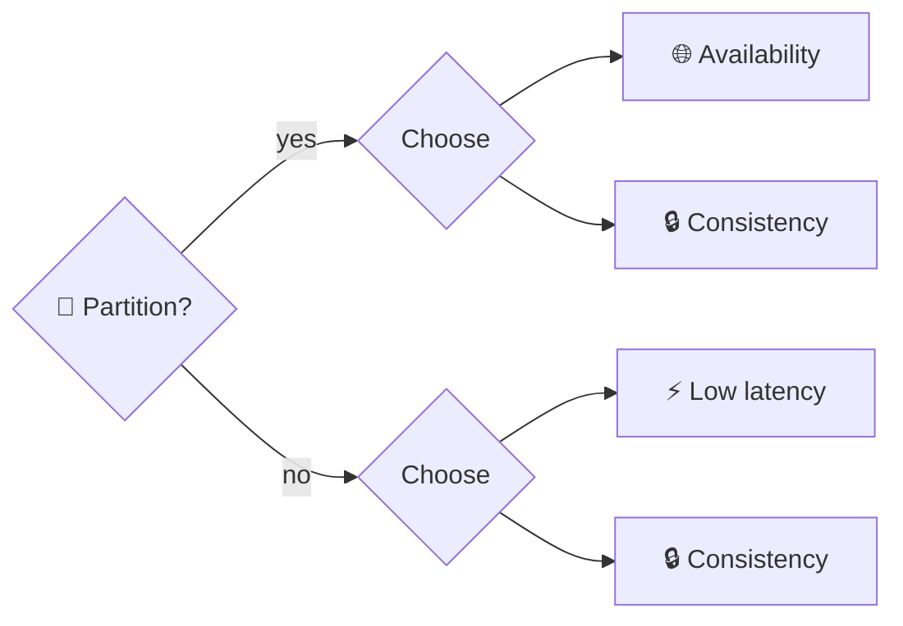

# 07 · CAP Theorem

> [!info] Topic info
> **Subject:** System Design · **Priority:** 🔥 High · **Status:** ✅ done · **Last reviewed:** 2026-11-19
>
> [← Back to Core Concepts](README.md) · [Interview questions →](questions/07-cap-theorem-qa.md)

> [!abstract] In one line
> The **CAP theorem** says that when the network between your servers **breaks (Partition)**, a distributed system must choose: stay **Consistent** (refuse some requests) or stay **Available** (answer, maybe with stale or conflicting data) — it **cannot do both**.

---

## 1. The problem

Our social media app is now **reliable** (see [Reliability](03-reliability.md)) and has **10 million users** across India and Southeast Asia. To keep things fast, we run in **two regions**: **Mumbai** and **Singapore**.

Each region has its own app servers and its own copy of the database. Writes in one region are **replicated** to the other, usually in **~60 ms**.



One afternoon, an undersea cable issue **cuts the link** between Mumbai and Singapore. Both regions are still **up**. Users can still reach them. But the two databases **can't talk to each other**.

Now Riya in Mumbai changes her username to `riya_codes`. At the same moment, Arjun in Singapore tries to take `riya_codes` too. What should the system do?

> [!tip] 🎤 Say it like this
> "CAP is about what a distributed system does when the network between its nodes breaks. At that moment, you can either keep every copy consistent by refusing some requests, or keep answering everyone and accept that the copies may disagree for a while. You can't have both during a partition."

---

## 2. The three letters — precise meanings

CAP sounds simple, but interviewers check if you know what each letter **actually** means. They're stricter than the everyday words.

### C — Consistency

Every read sees the **latest write**, as if there's only **one copy** of the data. The formal name is **linearizability**.

If Riya posts at 10:00:00 and gets "success", then **any** read after that — from any region — must show the post. No stale reads, ever.

> [!warning] CAP's C ≠ ACID's C
> In **ACID** (database transactions), **C** means "the data follows the rules" — like `balance >= 0` or foreign keys are valid.
> In **CAP**, **C** means "all copies agree and you always read the latest value". Same letter, completely different idea.

### A — Availability

Every request to a **non-failed node** gets a **non-error response** — eventually. It doesn't have to be the latest data, but it can't be "sorry, try later".

> [!note] CAP availability ≠ "nines"
> In [Availability](02-availability.md) we talked about 99.99% uptime. That's **operational** availability.
> CAP availability is a stricter, all-or-nothing idea: **every** working node must answer **every** request, even when cut off from the others. A system can be "CP" in CAP terms and still hit 99.99% uptime in practice.

### P — Partition tolerance

The system **keeps working** even when messages between nodes are **lost or delayed**. A **partition** is when nodes are alive but can't reach each other — like our cut cable.

From a node's point of view, a **slow** network and a **broken** network look the same. If Mumbai hasn't heard from Singapore in 5 seconds, it can't tell if Singapore is dead, slow, or cut off.

> [!example] Analogy — two bank branches
> Two branches share one account ledger by phone. The phone line goes dead.
> - **CP:** "Sorry, we can't process withdrawals until the line is back." Safe, but customers are annoyed.
> - **AP:** "Sure, here's your money." Fast, but you might withdraw ₹10,000 from **both** branches when you only had ₹10,000.

---

## 3. The real choice — C or A, during a partition

The famous line is "pick **2 of 3**". That's misleading.

In any system that runs on more than one machine, **partitions will happen**: cables get cut, switches fail, a GC pause makes a node silent for 10 seconds. You don't get to "choose" no partitions.

So P is **not optional**. The real question is:

> [!important] Golden rule
> **When a partition happens, do you give up Consistency or Availability?**
> When there's **no** partition, you can have both C and A.

### What about "CA"?

A **CA** system means "consistent and available, but not partition tolerant". That only really exists on a **single machine** — like one PostgreSQL server with no replicas.

The moment you add a second node over a network, you must handle partitions. Calling a distributed system "CA" just means "we haven't thought about what happens when the network breaks".



> [!tip] 🎤 Say it like this
> "In a distributed system, partitions aren't optional — networks do fail. So CAP really says: when a partition happens, you choose between consistency and availability. When the network is healthy, you can have both. CA only makes sense for a single-node system."

---

## 4. Walkthrough — the CP choice

Say our username service is **CP**. Usernames must be **unique**, so it uses a **leader** (one node that owns writes) plus a **majority vote** (quorum).

We have **3** database nodes: **2 in Mumbai**, **1 in Singapore**. A write needs **2 of 3** to agree.



What happens when the cable breaks:

- **Mumbai side** has 2 of 3 nodes = **majority**. Riya's change goes through ✅.
- **Singapore side** has 1 of 3 = **minority**. It can't reach a majority, so it **rejects** Arjun's write ❌ (or times out).
- Singapore may also **refuse reads** (or say "data may be stale") so nobody sees an old value.

Result: no duplicate username, ever. But Singapore users get **errors** for writes until the link is back.

**✅ Pros**
- Data is always correct — no conflicts to clean up later
- Simple mental model for developers

**❌ Cons**
- The minority side is **down** for writes during the partition
- Higher latency — every write waits for a majority, maybe across regions (~60–100 ms extra)

---

## 5. Walkthrough — the AP choice

Now say the **likes** service is **AP**. Both regions accept writes **independently** and sync up when they can.



During the partition:

- A post had **1,000** likes. Mumbai gets **50** more, Singapore gets **30** more.
- Mumbai users see **1,050**, Singapore users see **1,030**. Both are a bit **wrong**, but everyone gets an answer ✅.
- When the link comes back, the two sides **reconcile** to **1,080**.

This is called **eventual consistency**: if writes stop, all copies will **eventually** agree.

**✅ Pros**
- Every region keeps working — no errors for users
- Low latency — writes are local, no cross-region wait

**❌ Cons**
- Users may see **stale** or different data for a while
- You must **resolve conflicts** (see section 9) — and some data types make that hard

> [!warning] AP for usernames would be a disaster
> If the username service were AP, both Riya and Arjun would get `riya_codes`. When the link heals, one of them loses their username — or worse, both log into the same account.

---

## 6. Pick per feature, not per app

CAP isn't a label for your whole app. It's a choice **per operation** or **per piece of data**. One app usually mixes both.

| Feature | Choice | Why |
|---|---|---|
| **❤️ Likes, view counts** | AP | Being off by 20 for a minute hurts no one |
| **📰 News feed** | AP | A slightly old feed is better than an error page |
| **💬 Comments, posts** | AP | Shows up a few seconds late — fine |
| **🔔 Notifications** | AP | A late notification beats no notification |
| **💰 Payments, wallet balance** | CP | Double-spending = real money lost |
| **🆔 Username / email uniqueness** | CP | Two users can't own the same name |
| **📦 Inventory, e.g. last ticket** | CP | Can't sell the same seat twice |
| **🔐 Password change, account ban** | CP | A banned user must not keep posting from another region |

> [!tip] 🎤 Say it like this
> "I don't pick CP or AP for the whole system — I pick per feature. For likes and the feed, I go AP: stale for a few seconds is fine. For payments, wallet balance and unique usernames, I go CP: I'd rather return an error than double-charge or give two people the same name."

---

## 7. How real databases lean

Most databases have a **default** lean, but many are **tunable**.

| System | Leans | How it behaves in a partition |
|---|---|---|
| **ZooKeeper, etcd** | CP | Uses a consensus protocol (Raft / Zab). Minority side stops accepting writes. |
| **HBase** | CP | Each piece of data has one owner server; if it's unreachable, that data is unavailable. |
| **MongoDB** *(default)* | CP | Single primary per replica set. Minority side can't elect a primary, so no writes. |
| **Google Spanner** | CP | Consensus + atomic clocks. Stays consistent across the globe; minority loses writes. |
| **Cassandra** | AP | Any replica accepts writes. Conflicts resolved by last-write-wins. Tunable. |
| **DynamoDB** | AP | Eventually consistent reads by default. Strongly consistent reads optional. |
| **Riak, CouchDB** | AP | Accept writes everywhere, keep conflicting versions, merge later. |

### Tunable consistency — quorums

Cassandra and Dynamo-style systems let you choose **per query**. With **N** copies of the data:

- **W** = how many copies must confirm a **write**
- **R** = how many copies you **read** from

If **R + W > N**, every read overlaps with at least one copy that has the latest write.

> [!example] Quorum math with N = 3
> - **W = 2, R = 2** → 2 + 2 = 4 > 3 → reads see the latest write. Leans **CP**.
> - **W = 1, R = 1** → 1 + 1 = 2, not > 3 → fast, but reads can be stale. Leans **AP**.
> - **W = 3, R = 1** → fast reads, but a write fails if **any** one node is down.

> [!note] Quorum isn't magic
> Even with R + W > N, edge cases (sloppy quorums, clock skew with last-write-wins) can still give stale reads. It's "strong-ish", not perfectly linearizable. Good to mention if the interviewer pushes.

---

## 8. The consistency spectrum

Consistency isn't just "strong" or "eventual". There's a **spectrum** in between — and the middle options are often exactly what users need.

| Model | Promise | App example |
|---|---|---|
| **Strong (linearizable)** | Every read sees the latest write | Wallet balance |
| **Causal** | If B happened because of A, everyone sees A before B | A reply never shows before the comment it answers |
| **Read-your-writes** | **You** always see your own changes | You edit your bio, refresh, see the new bio |
| **Monotonic reads** | You never go **back in time** | Your like count doesn't jump 120 → 98 → 120 on refresh |
| **Eventual** | If writes stop, copies will agree eventually | View counts |

Stronger = more correct, but **slower** and **less available**. Weaker = faster and more available, but more surprises for users.

> [!example] Cheap fixes that feel "consistent"
> - **Read-your-writes:** after a user writes, send **their** reads to the leader for the next ~10 seconds.
> - **Monotonic reads:** stick each user to **one replica** (e.g. hash user ID → replica).
>
> Users feel the app is consistent, even though it's AP underneath.

---

## 9. Conflict resolution in AP systems

If both sides accept writes, the same data can be changed in two places. When the link comes back, someone has to decide **who wins**.

### Last-write-wins (LWW)

Each write gets a **timestamp**. The newest one wins, the other is **thrown away**.

Simple, and Cassandra uses it by default. But it's **dangerous**:

- Clocks on different servers drift — a write that happened **later** can have an **earlier** timestamp and lose.
- Riya updates her bio in Mumbai, Arjun (an admin) fixes a typo in it in Singapore. One change **silently disappears**.

> [!warning] LWW = silent data loss
> Nobody gets an error. The data is just gone. Use LWW only when losing a concurrent write is OK — like "last seen online at".

### Vector clocks

Each copy keeps a small **counter per node**, like `{Mumbai: 3, Singapore: 2}`. By comparing counters, the system can tell:

- One write **came after** the other → keep the newer one.
- They happened **at the same time** (concurrent) → keep **both** and let the app or user merge them.

Amazon's original shopping cart did this: if two versions conflicted, it **merged** them, so you never lost an item (but a deleted item might come back).

### CRDTs

**CRDTs** (Conflict-free Replicated Data Types) are data structures that are **designed to merge automatically**, with no conflicts.

For likes, instead of storing one number, each region keeps **its own counter**:

```
Mumbai:    +50
Singapore: +30
Total = 1,000 + 50 + 30 = 1,080  ✅ no lost likes
```

Other CRDTs: sets where adds and removes merge cleanly, collaborative text (like Google Docs-style editing).

| Method | ✅ Good | ❌ Bad |
|---|---|---|
| **Last-write-wins** | Dead simple | Silently loses writes |
| **Vector clocks** | Detects real conflicts | App must merge; extra metadata |
| **CRDTs** | Auto-merge, no data loss | Only for certain data types; more complex |

> [!tip] 🎤 Say it like this
> "If I go AP, I have to plan for conflicts. Last-write-wins is simple but silently drops data, so I only use it where that's fine. For counters like likes, I'd use a CRDT counter so both sides' updates add up correctly. Vector clocks help detect true conflicts when the app needs to merge them itself."

---

## 10. PACELC — what CAP doesn't tell you

CAP only talks about the time **during** a partition. But partitions are rare — maybe a few minutes a year. What about the **other 99.99%** of the time?

**PACELC** fills that gap:

> If there's a **P**artition, choose **A** or **C**.
> **E**lse (normal operation), choose **L**atency or **C**onsistency.

Why is there a trade-off with no partition? Because staying strongly consistent means **waiting** for other replicas to confirm. Mumbai → Singapore and back is **~60 ms**. Every strongly consistent write pays that.



| System | PACELC | Meaning |
|---|---|---|
| **DynamoDB, Cassandra** | **PA/EL** | Partition → stay available. Normally → favour speed. |
| **Google Spanner** | **PC/EC** | Always consistent, pays latency for it. |
| **MongoDB** *(default)* | **PC/EC** | Consistent primary; reads from secondaries trade that for latency. |
| **Cosmos DB** | Tunable | 5 consistency levels you choose from. |

> [!tip] 🎤 Say it like this
> "CAP only covers partitions, which are rare. PACELC adds the everyday trade-off: even with a healthy network, strong consistency costs latency because you wait for replicas. DynamoDB is PA/EL — available and fast. Spanner is PC/EC — always consistent, and you pay in latency."

---

## 11. Common misconceptions

> [!failure] Mistakes to avoid
> - **"Pick any 2 of 3."** — You can't drop P in a distributed system. The choice is C vs A **during a partition**.
> - **"Our system is CA."** — Only true for a single node. Over a network, it's not a real option.
> - **"CAP availability = 99.99% uptime."** — No. CAP's A is about every non-failed node answering during a partition. A CP system can still have great uptime.
> - **"CAP's C = ACID's C."** — No. CAP's C is linearizability; ACID's C is data rules and constraints.
> - **"The whole system is either CP or AP."** — It's per operation. Payments can be CP while likes are AP in the same app.
> - **"AP means no consistency."** — AP means **eventually** consistent, often with read-your-writes or causal guarantees on top.
> - **"CP means it goes down."** — Only the **minority** side refuses writes. The majority side keeps working.

---

## 12. How to answer CAP in an interview

When CAP comes up — or when you're designing anything with replicas — walk through it like this:

1. **Say what it really is.** "During a network partition, I have to choose consistency or availability."
2. **Split the data by feature.** Name what can be stale and what can't.
3. **Pick per feature.** AP for likes and feed, CP for payments and unique usernames.
4. **Explain the partition behaviour.** "On the minority side, payment writes return an error; likes keep working and merge later."
5. **Name the conflict strategy** for AP data — CRDT counters, LWW where loss is OK.
6. **Mention PACELC** — the normal-day latency cost of strong consistency.
7. **Name real tech.** "Wallet in Spanner or a Postgres primary; likes in Cassandra or DynamoDB."

> [!question] Questions to ask the interviewer
> - Is the app **multi-region**? Where are the users?
> - Which data **must never** be wrong — money, inventory, unique IDs?
> - How stale can the feed or counts be — 1 second? 1 minute?
> - During a region outage, is it better to show **errors** or **old data**?

> [!tip] 🎤 Say it like this
> "Since this is multi-region, I'll make the CAP choice per feature. Likes, views and the feed are AP — eventually consistent, merged with CRDT counters. Payments and usernames are CP using a consensus-based store — during a partition the minority region returns errors for those writes. And even without partitions, I'll keep strong consistency only where needed, because cross-region consensus adds 60–100 ms per write."

---

## Summary

| Step | What it fixes / teaches |
|---|---|
| 1️⃣ Know the real C, A, P | Avoids confusing CAP's C with ACID or A with uptime |
| 2️⃣ Accept that partitions happen | "CA" isn't real for distributed systems |
| 3️⃣ CP for critical data | No double-spend, no duplicate usernames, no oversold seats |
| 4️⃣ AP for social data | Likes, feed, views stay up during a split |
| 5️⃣ Tunable quorums R + W > N | Choose consistency per query |
| 6️⃣ In-between models | Read-your-writes, monotonic reads make AP feel consistent |
| 7️⃣ Conflict resolution | LWW, vector clocks, CRDTs to merge after a split |
| 8️⃣ PACELC | The everyday latency vs consistency trade-off |

> [!success] Key takeaway
> **Partitions will happen — decide in advance what each feature does when they do.** Money and uniqueness go **CP** (error beats wrong answer); social data goes **AP** (stale beats error). And remember PACELC: even on a good day, strong consistency costs **latency**.

---

## References

- [AlgoMaster — CAP Theorem](https://algomaster.io/learn/system-design/cap-theorem)
- [System Design Primer — CAP Theorem](https://github.com/donnemartin/system-design-primer#cap-theorem)
- *Designing Data-Intensive Applications* — Ch. 5 (Replication), Ch. 9 (Consistency and Consensus)
- [Eric Brewer — CAP Twelve Years Later](https://www.infoq.com/articles/cap-twelve-years-later-how-the-rules-have-changed/)
- [Daniel Abadi — PACELC](https://www.cs.umd.edu/~abadi/papers/abadi-pacelc.pdf)
- [Martin Kleppmann — Please stop calling databases CP or AP](https://martin.kleppmann.com/2015/05/11/please-stop-calling-databases-cp-or-ap.html)
- [Amazon Dynamo paper (2007)](https://www.allthingsdistributed.com/files/amazon-dynamo-sosp2007.pdf)
