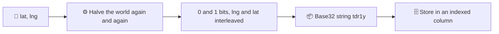
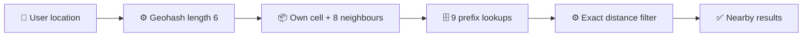

# 01 · Geohash

> [!info] Topic info
> **Subject:** System Design · **Chapter:** Data Structures for Scale · **Priority:** 🔥 High · **Status:** ✅ done · **Last reviewed:** 2026-11-19
>
> [← Back to Data Structures for Scale](README.md) · [Interview questions →](questions/data-structures-qa.md)

> [!abstract] In one line
> **Geohash** encodes a latitude/longitude into a short **string**, where a **shared prefix means nearby** — so "find things close to me" becomes a fast **prefix lookup** on a normal index.

---

## 1. The problem

Our social media app adds **"Posts near you"**. We have 50 million geotagged posts. A user at (12.97, 77.59) wants posts within 2 km.

The naive query is `WHERE lat BETWEEN … AND lng BETWEEN …`. A normal B-tree index helps with **one** column, not two at once. So the database still scans millions of rows. With 10,000 req/s, that's dead.

We need a way to index **2D location** with a **1D key**.

---

## 2. How it works

Think of it as **"20 questions" on the map**:

1. Is the longitude in the left half or right half of the world? → write `0` or `1`.
2. Is the latitude in the bottom half or top half? → `0` or `1`.
3. Repeat, each time halving the box you're in, **alternating** lng and lat bits.
4. Group every 5 bits into one **base32** character → e.g. `tdr1y`.

Every extra character zooms in to a box **32× smaller**.

### Precision cheat sheet

| Length | Cell size (approx) | Good for |
|---|---|---|
| **4** | ~39 km × 20 km | City |
| **5** | ~4.9 km × 4.9 km | "Within a few km" |
| **6** | ~1.2 km × 0.6 km | Neighbourhood, nearby drivers |
| **7** | ~150 m × 150 m | Street block |

> [!important] The key property
> Two places with the **same prefix** are in the same box, so they're close. `tdr1y` and `tdr1v` share `tdr1` → same ~20 km cell.

---

## 3. Querying "nearby"

1. Compute the user's geohash at the right length (say 6 chars, ~1 km cells).
2. Query `WHERE geohash LIKE 'tdr1yk%'` — a plain **B-tree prefix scan**. Fast.
3. Filter the results by exact distance in code.

### The edge problem

Two people can stand **1 metre apart** on either side of a cell border and get **totally different** prefixes. Querying only your own cell misses them.

**Fix:** always query your cell **plus its 8 neighbours** (a 3×3 grid). Neighbour hashes are cheap to compute.

> [!tip] 🎤 Say it like this
> "I'd geohash every driver's location and store it in an indexed column or in Redis. To find nearby drivers, I compute the user's geohash, look up that cell and its 8 neighbours with a prefix query, then filter by exact distance. Prefix length controls the radius — 6 characters is roughly 1 km."

---

## 4. Real-world use

- **Redis GEO** (`GEOADD`, `GEOSEARCH`) stores a 52-bit geohash as the score in a **sorted set**. Great for live driver locations.
- **Elasticsearch, DynamoDB** geo libraries use geohash-style keys.
- Also works as a **shard key** — all posts from one city land on the same shard. (Careful: hot cities → hot shards. See [Sharding](../database-scaling/04-sharding.md).)

**✅ Pros**
- Works with **any** normal index — B-tree, Redis, key-value store.
- Simple, easy to explain, easy to cache by cell.

**❌ Cons**
- **Fixed grid** — a cell in Manhattan may hold 100,000 drivers, one in a desert holds zero.
- Cells are **not equal size** — they get narrower towards the poles.
- Edge problem → you always need the neighbour lookups.

> [!failure] Interview traps
> - Querying only the user's own cell — forgets the **edge problem**. Always say "cell + 8 neighbours".
> - Thinking geohash gives exact distance. It gives **candidates**; you still filter by real distance.
> - Ignoring uneven density. If the interviewer pushes on crowded cities, move to a [Quadtree](02-quad-trees.md).

---

## Summary

| Idea | What it gives you |
|---|---|
| **Interleave lat/lng bits → base32** | 2D point becomes a 1D string |
| **Shared prefix = nearby** | "Nearby" = prefix scan on a normal index |
| **Longer hash = smaller cell** | Pick length to match search radius |
| **Cell + 8 neighbours** | Fixes the border problem |

> [!success] Key takeaway
> Geohash is the **simplest** answer to "find nearby X". Start with it; switch to Quadtree or H3 only when uneven density or equal-size cells matter.
