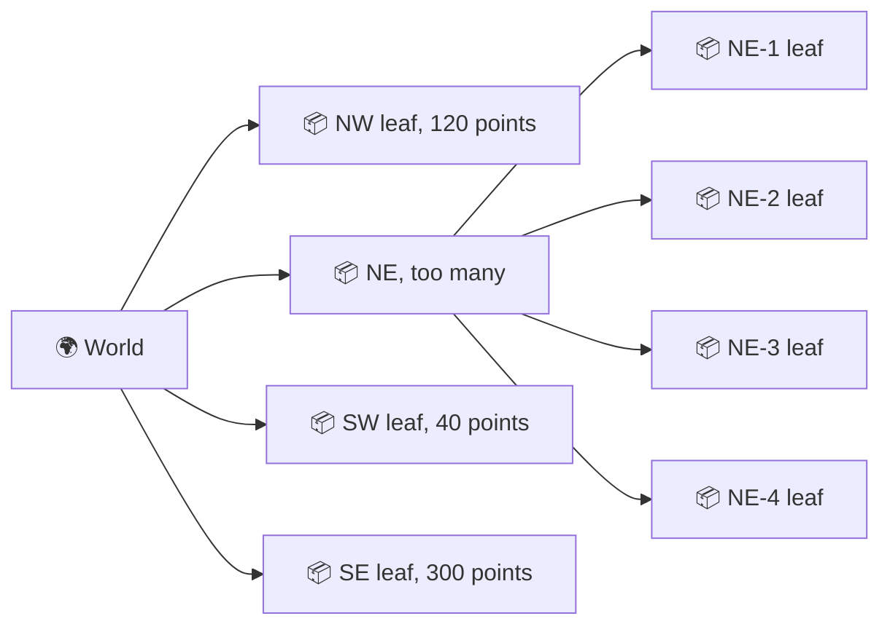

# 02 · Quad Trees

> [!info] Topic info
> **Subject:** System Design · **Chapter:** Data Structures for Scale · **Priority:** ⚡ Medium · **Status:** ✅ done · **Last reviewed:** 2026-11-19
>
> [← Back to Data Structures for Scale](README.md) · [Interview questions →](questions/data-structures-qa.md)

> [!abstract] In one line
> A **quadtree** splits the map into **4 boxes**, and keeps splitting a box **only when it gets too crowded** — so busy cities get tiny cells and empty areas stay as one big cell.

---

## 1. The problem

With [Geohash](01-geohash.md), every cell is the same size. In downtown Manhattan one 1 km cell can have **50,000 posts**; in the Sahara, zero.

A "nearby" query in Manhattan returns way too much. In the desert you have to widen the search again and again. We want cells that **adapt to density**.

---

## 2. How it works

1. Start with **one box** = the whole world.
2. If a box holds more than **N** points (say 500), split it into **4 children**: NW, NE, SW, SE.
3. Repeat. Crowded areas go deep; empty areas stay shallow.
4. Points live only in **leaf** nodes.

### Finding nearby places

- Walk down from the root to the **leaf** that contains the user. That's `O(log n)` levels.
- If that leaf doesn't have enough results, also check **neighbouring leaves**.
- Filter by exact distance.

> [!example] Sizing it (Yelp-style design)
> 200M places, max 500 per leaf → ~400K leaves. Each place needs ~24 bytes (id + lat + lng) → **~5 GB**. Fits in RAM on one big server; replicate it for reads.

> [!tip] 🎤 Say it like this
> "A quadtree recursively splits the map into four quadrants, but only where the data is dense. So each leaf has a bounded number of places, say 500, whether it's downtown or countryside. I'd keep it in memory, build it at startup from the database, and replicate it across servers for read traffic."

---

## 3. Static vs moving data

**Restaurants (Yelp)** barely move → quadtree is perfect. Build once, update rarely.

**Drivers (Uber)** move every 4 seconds → constantly moving points between leaves, splitting and merging. That's costly and needs locking.

> [!note] Common fix for moving data
> Use a quadtree (or geohash/H3 cells) for **static** places, and a simple **cell → driver list** map in Redis for **moving** things, updated every few seconds.

**✅ Pros**
- **Adapts to density** — every leaf has a similar number of points.
- Fast in-memory lookups.

**❌ Cons**
- Lives **in memory** — needs rebuild on restart, and replication logic.
- Frequent updates (moving drivers) are expensive.
- Not a built-in DB index type — you usually build it yourself.

> [!failure] Interview traps
> - Splitting on a fixed depth instead of on **point count** — that's just a grid.
> - Using a quadtree for live driver locations without discussing update cost.
> - Forgetting to check neighbouring leaves near cell borders.

---

## Summary

- Splits a region into 4 **only when it's crowded** → cells adapt to density.
- Search = walk to the leaf, then check neighbours, then filter by distance.
- Best for **mostly static** points (restaurants, shops). Moving points need a cheaper update path.

> [!success] Key takeaway
> Geohash = fixed grid. Quadtree = **adaptive** grid. Mention it when the interviewer asks "what about dense cities?"
