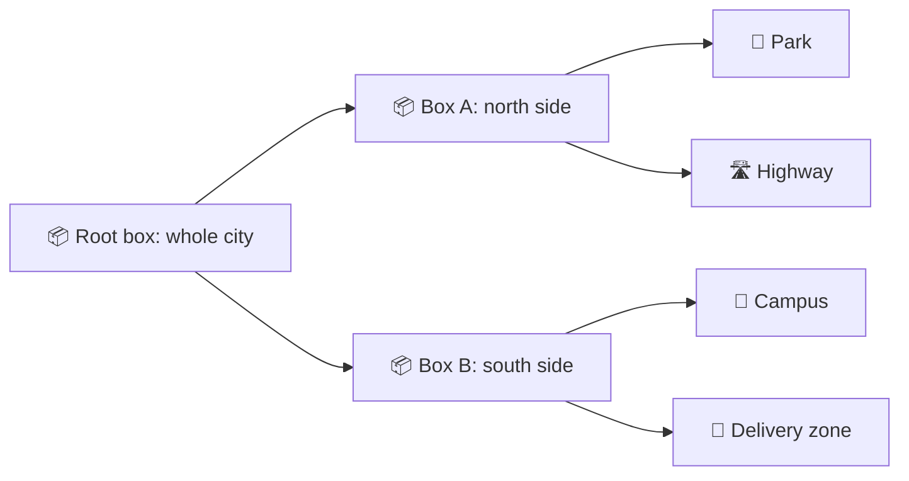

# 03 · R-Trees

> [!info] Topic info
> **Subject:** System Design · **Chapter:** Data Structures for Scale · **Priority:** ⚡ Medium · **Status:** ✅ done · **Last reviewed:** 2026-11-19
>
> [← Back to Data Structures for Scale](README.md) · [Interview questions →](questions/data-structures-qa.md)

> [!abstract] In one line
> An **R-tree** groups nearby objects into **bounding rectangles**, nested like boxes inside boxes — so a database can quickly find **shapes** (roads, parks, delivery zones) that overlap or are near a point.

---

## 1. The problem

[Geohash](01-geohash.md) and [Quadtrees](02-quad-trees.md) are great for **points** — a driver, a restaurant.

But what about **shapes**? "Which delivery zone is this address in?" "Which roads cross this area?" A park or a city boundary isn't a point; it covers an area. We need an index for **areas**.

---

## 2. How it works

Every object gets a **minimum bounding rectangle (MBR)** — the smallest box that fully covers it.

1. Nearby MBRs are grouped under a **parent rectangle** that covers all of them.
2. Parents are grouped again, up to a single **root**.
3. Like a [B-tree](../databases/04-b-trees.md), it's **balanced** and each node holds many entries, so it works well on **disk**.

### Searching

Query: "what is at this point?"
- At each level, **only go into boxes that contain the point**. Skip the rest.
- At the leaves, do the exact shape check.

> [!warning] Boxes can overlap
> Unlike a quadtree, sibling boxes in an R-tree **can overlap**. A query may need to go down **several** branches. Good insert algorithms (like the R*-tree variant) try to keep overlap small.

> [!tip] 🎤 Say it like this
> "An R-tree indexes shapes by their bounding boxes, nested into a balanced tree. A search only descends into boxes that overlap the query, so it skips most of the data. It's what PostGIS and most spatial databases use under the hood, so in practice I'd just create a spatial index rather than build one."

---

## 3. Where you see it

- **PostGIS** (Postgres) — spatial indexes via GiST, which works R-tree style.
- **MySQL / SQLite** spatial indexes.
- Map apps: "which zone / region contains this point?", "shapes inside the visible map window".

| | Quadtree | R-tree |
|---|---|---|
| **Splits by** | Space (fixed 4 quadrants) | Data (groups nearby objects) |
| **Best for** | Points, in memory | Shapes and points, on disk |
| **Overlap** | No | Yes, boxes can overlap |
| **Typical home** | Custom in-memory service | Database spatial index |

**✅ Pros** — handles **shapes**; balanced; disk-friendly; built into real databases.
**❌ Cons** — overlapping boxes slow some queries; heavy update rate (moving cars) causes lots of re-balancing.

> [!failure] Interview traps
> - Saying "I'll build an R-tree" — usually just say "**Postgres + PostGIS spatial index**".
> - Using an R-tree for millions of fast-moving drivers — too many updates. Use cells in Redis.

---

## Summary

- Objects → bounding rectangles → nested into a balanced tree.
- Search skips every box that doesn't overlap the query.
- The standard index for **geometry in databases** (PostGIS, MySQL spatial).

> [!success] Key takeaway
> Points and live data → geohash / quadtree / H3. **Shapes and areas** in a database → R-tree (spatial index).
