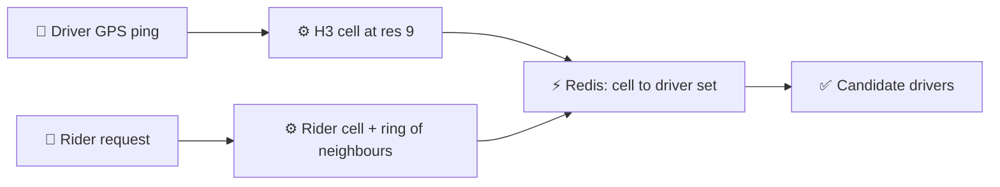

# 04 · S2 and H3

> [!info] Topic info
> **Subject:** System Design · **Chapter:** Data Structures for Scale · **Priority:** ⚡ Medium · **Status:** ✅ done · **Last reviewed:** 2026-11-19
>
> [← Back to Data Structures for Scale](README.md) · [Interview questions →](questions/data-structures-qa.md)

> [!abstract] In one line
> **S2** (Google) and **H3** (Uber) are libraries that cut the **whole globe** into hierarchical cells with **64-bit IDs** — S2 uses **squares** on a sphere, H3 uses **hexagons** — fixing geohash's distortion and edge problems.

---

## 1. The problem

[Geohash](01-geohash.md) treats the Earth as a **flat rectangle**. So cells get thinner near the poles, and cells far apart in the world can be next to each other in the string order.

For a global ride-sharing app, we want cells that are **roughly equal in size everywhere**, have **clean neighbours**, and are cheap to store as a single integer.

---

## 2. S2 — squares on a sphere

1. Put the Earth inside a **cube** and project it onto the cube's 6 faces.
2. Split each face into a quadtree of squares — **30 levels**, from a whole face down to ~1 cm².
3. Walk the cells in a **Hilbert curve** order — a space-filling line that keeps nearby cells close in number.
4. Each cell = one **64-bit integer** ID.

The Hilbert order means a region becomes a few **ranges of cell IDs** → easy range scans in any key-value store.

- Used by **Google Maps**, and in many geo databases.
- Great for **covering any shape** ("give me the cells that cover this polygon").

---

## 3. H3 — hexagons

1. Start from an icosahedron (20-sided shape) around the Earth.
2. Tile it with **hexagons** at **16 resolutions** (0 = huge, 15 = ~1 m²). Each step is ~7× smaller.
3. Each cell = one **64-bit integer** ID.

Why hexagons? A hexagon's **6 neighbours are all the same distance** from its centre. A square has 4 side neighbours and 4 corner neighbours at different distances.

- Built by **Uber** for surge pricing, demand heatmaps, and driver matching.
- "**k-ring**" = all cells within k steps → a neat, near-circular search area.

> [!warning] Hexagons don't nest perfectly
> 7 small hexagons don't exactly fill one big hexagon, so parent/child is **approximate**. S2 squares nest exactly. Also, H3 has 12 pentagons on the globe (math can't avoid them).

> [!tip] 🎤 Say it like this
> "For a global system I'd use H3 or S2 instead of raw geohash. Both give every cell a 64-bit ID with consistent sizes worldwide. H3's hexagons are nice for 'search in a ring around me' and for aggregating demand, which is why Uber uses it. S2 is great when you need exact hierarchy or to cover arbitrary polygons."

---

## 4. Geo structures compared

| | Geohash | Quadtree | R-tree | S2 | H3 |
|---|---|---|---|---|---|
| **Cell shape** | Rectangle | Square, adaptive | Bounding boxes | Square on sphere | Hexagon |
| **Adapts to density** | ❌ | ✅ | ✅ | ❌ fixed levels | ❌ fixed levels |
| **Key type** | String prefix | In-memory tree | DB index | 64-bit int | 64-bit int |
| **Neighbours** | 8, uneven | Tree walk | Tree walk | 8, uneven | 6, equal distance |
| **Shapes / polygons** | Weak | Weak | ✅ Best | ✅ Good covering | OK |
| **Best for** | Simple "nearby" in Redis / DB | Dense static places, Yelp | Shapes in Postgres | Global maps, polygons | Ride-sharing, heatmaps |

> [!failure] Interview traps
> - Saying S2/H3 "replace" the database. They just turn locations into **cell IDs**; you still store and look them up somewhere.
> - Forgetting neighbours again — with H3 you still query a **k-ring**, not one cell.
> - Picking a resolution without tying it to a radius. Say it: "res 9 ≈ 0.1 km² cells".

---

## Summary

- **S2:** cube → squares → Hilbert curve → 64-bit IDs. Exact hierarchy, good for polygons.
- **H3:** hexagons, 16 resolutions, equal-distance neighbours. Uber's choice.
- Both fix geohash's **pole distortion**; both are just a **key** you index.

> [!success] Key takeaway
> In interviews: start with **geohash**, mention **quadtree** for density, and say "at global scale I'd use **H3 / S2** cell IDs". That covers 95% of location questions.
