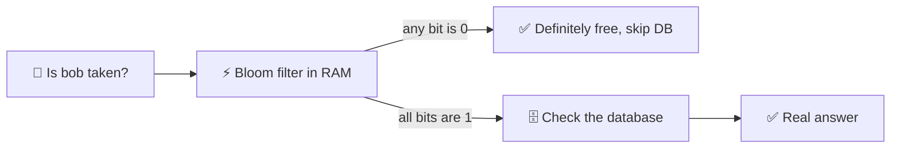

# 05 · Bloom Filters

> [!info] Topic info
> **Subject:** System Design · **Chapter:** Data Structures for Scale · **Priority:** 🔥 High · **Status:** ✅ done · **Last reviewed:** 2026-11-19
>
> [← Back to Data Structures for Scale](README.md) · [Interview questions →](questions/data-structures-qa.md)

> [!abstract] In one line
> A **Bloom filter** is a tiny bit array that answers "is X in the set?" with either **"definitely not"** or **"probably yes"** — **no false negatives**, a small chance of **false positives**, and a fraction of the memory of storing the items.

---

## 1. The problem

Our social media app has **1 billion usernames**. On every sign-up keystroke, the UI asks "is `bharat_dev` taken?"

Hitting the database every time is slow. Keeping all usernames in a Redis set costs ~**20+ GB** of RAM. Most checks are for names that **don't exist** — we'd love a cheap way to say "nope" without touching the DB.

---

## 2. How it works

A Bloom filter is a **bit array** of size `m` (all 0s) plus `k` hash functions.

**Add "alice":** run it through all `k` hashes → get `k` positions → set those bits to 1.

**Check "bob":** hash it the same way and look at those `k` bits.
- Any bit is **0** → bob was **definitely never added**. ✅ 100% sure.
- All bits are **1** → **probably** added. Could be other items that happened to set the same bits.

> [!important] Golden rule
> **No false negatives. Maybe false positives.** "No" is always right. "Yes" means "go check for real".

---

## 3. The trade-off: memory vs accuracy

More bits per item → fewer false positives.

| False positive rate | Bits per item | 1 billion items |
|---|---|---|
| **10%** | ~4.8 | ~600 MB |
| **1%** | ~9.6 | ~1.2 GB |
| **0.1%** | ~14.4 | ~1.8 GB |

Rule of thumb: **~10 bits per item → ~1% false positives**, with about 7 hash functions. Compare that to storing the actual strings.

> [!warning] Things that get harder
> - **Can't delete** — clearing a bit might also "remove" other items that share it. Use a [Cuckoo filter](06-cuckoo-filter.md) or rebuild.
> - **Can't list items** — it only answers yes/maybe, it doesn't store the data.
> - **Fills up** — if you add more items than planned, the false positive rate shoots up. Size it for future growth.

---

## 4. Classic use cases

| Use case | How the filter helps |
|---|---|
| **LSM databases** (Cassandra, RocksDB, HBase) | Each on-disk file (SSTable) has a Bloom filter. Skip files that definitely don't have the key → far fewer disk reads. See [LSM Trees](../databases/05-lsm-trees.md). |
| **Web crawler** | "Have I already crawled this URL?" across billions of URLs. |
| **Username / email taken** | Fast "free" answer; only maybes hit the DB. |
| **Feed / recommendations** | "Has this user already seen this post?" — a false positive just hides one post, harmless. |
| **Cache penetration** | Block requests for keys that don't exist before they hammer the DB. |
| **Malicious URL check** | Browser checks a local filter first; only maybes go to the server. |

> [!tip] 🎤 Say it like this
> "A Bloom filter is a bit array with a few hash functions. It can tell me for sure that something is not in the set, and 'maybe' if it is. At about 10 bits per item I get a 1% false positive rate, so a billion usernames fit in about 1.2 GB. I use it in front of the database so most 'not found' checks never touch disk."

**✅ Pros**
- Tiny memory, constant-time checks (just `k` hashes).
- Perfect for "skip expensive work when the answer is no".

**❌ Cons**
- False positives — must be OK for your use case.
- No deletes, no listing, must be sized up front.

> [!failure] Interview traps
> - Saying it has false **negatives**. It **never** does.
> - Using it where a false positive is dangerous with no fallback check (e.g. "payment already processed").
> - Forgetting deletes — if users can **free up** usernames, a plain Bloom filter can't handle that.

---

## Summary

- Bit array + `k` hashes. "No" = certain, "yes" = probably.
- ~10 bits/item → ~1% false positives.
- Put it **in front of** an expensive lookup (disk, DB, network) to skip the misses.
- No delete → Cuckoo filter or periodic rebuild.

> [!success] Key takeaway
> Whenever the interviewer says "check if we've seen this before" at billion scale — say **Bloom filter**, then say "with a real lookup behind it for the maybes".
