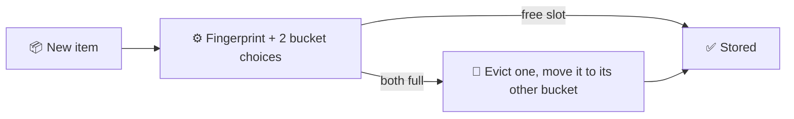

# 06 · Cuckoo Filter

> [!info] Topic info
> **Subject:** System Design · **Chapter:** Data Structures for Scale · **Priority:** 💤 Low · **Status:** ✅ done · **Last reviewed:** 2026-11-19
>
> [← Back to Data Structures for Scale](README.md) · [Interview questions →](questions/data-structures-qa.md)

> [!abstract] In one line
> A **Cuckoo filter** does the same job as a [Bloom filter](05-bloom-filters.md) — "definitely not / probably yes" — but stores small **fingerprints** in a table, so it **supports delete**.

---

## 1. The problem

Our username Bloom filter works great — until users **delete accounts** and their names should become free again. A Bloom filter **can't remove** items, so those names stay "maybe taken" forever.

---

## 2. How it works

- Each item is turned into a short **fingerprint** (e.g. 8–16 bits of its hash).
- The table has **buckets**. Every item has exactly **2 possible buckets**.
- **Insert:** put the fingerprint in either bucket. If both are full, **kick out** an existing fingerprint and move it to *its* other bucket — like a cuckoo bird pushing eggs out of a nest. Repeat a few times.
- **Lookup:** check the 2 buckets for the fingerprint.
- **Delete:** find the fingerprint in one of the 2 buckets and remove it.

> [!tip] 🎤 Say it like this
> "A cuckoo filter is a Bloom filter alternative that stores small fingerprints in one of two buckets. Because the fingerprint is actually stored, I can delete it. It's also a bit more space-efficient when I need low false positive rates, like under 3%."

---

## 3. Bloom vs Cuckoo

| | Bloom filter | Cuckoo filter |
|---|---|---|
| **Delete** | ❌ No | ✅ Yes |
| **Lookup cost** | `k` bit checks | 2 bucket checks |
| **Space at low error (<3%)** | Good | Better |
| **When full** | Still works, just more errors | Inserts start **failing** (~95% load) |

> [!failure] Interview traps
> - Deleting something that was **never added** — can remove another item's matching fingerprint and cause a false negative. Only delete items you know are in.
> - Forgetting that inserts can fail when the table is nearly full — size it with headroom or resize.

---

## Summary

- Fingerprints in buckets, 2 choices per item, evict-and-move on collision.
- Same "no / maybe" answers as Bloom, **plus delete**.

> [!success] Key takeaway
> Need a Bloom filter **with deletes**? Say **Cuckoo filter** (Redis Stack has both).
