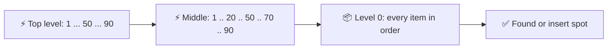

# 07 · Skip Lists

> [!info] Topic info
> **Subject:** System Design · **Chapter:** Data Structures for Scale · **Priority:** ⚡ Medium · **Status:** ✅ done · **Last reviewed:** 2026-11-19
>
> [← Back to Data Structures for Scale](README.md) · [Interview questions →](questions/data-structures-qa.md)

> [!abstract] In one line
> A **skip list** is a sorted linked list with extra **"express lane"** levels on top, giving **O(log n)** search, insert, and **range queries** — it's what powers **Redis sorted sets** (leaderboards).

---

## 1. The problem

Our app launches a **creator leaderboard**: 10 million creators ranked by followers. We need to:
- update a score every time someone gets a follower,
- get the **top 100**, and
- find "**what rank am I?**"

A sorted array makes inserts O(n). A plain linked list makes search O(n). A balanced tree works, but is tricky to write and to make concurrent.

---

## 2. How it works

Think of a **metro line**: the local train stops everywhere, the express stops only at big stations.

1. **Level 0** is a normal sorted linked list with **all** items.
2. Each item is also promoted to level 1 with a **50% coin flip**, to level 2 with another flip, and so on.
3. **Search:** start at the top (fewest stops), move right while the next value is smaller, then drop down a level. Repeat.

Because each level has about **half** the items of the level below, there are about `log n` levels → **O(log n)** on average.

**Range query** ("top 100", "scores between 500 and 1000"): find the start in O(log n), then just **walk level 0**. That's why it's great for rankings.

> [!tip] 🎤 Say it like this
> "A skip list is a sorted linked list with random express lanes on top. Search, insert, and delete are O(log n) on average, and range scans are just a walk along the bottom list. Redis sorted sets use a skip list plus a hash map, which is why ZADD and ZRANGE are fast enough for real-time leaderboards."

---

## 3. Where it's used

- **Redis sorted sets** (`ZADD`, `ZRANGE`, `ZRANK`): skip list for ordering + **hash map** for O(1) "what's this member's score?".
- **LSM memtables** — LevelDB/RocksDB keep recent writes in an in-memory skip list. See [LSM Trees](../databases/05-lsm-trees.md).
- **Java `ConcurrentSkipListMap`** — easier to make lock-free than a balanced tree.

| | Balanced tree (red-black, AVL) | Skip list |
|---|---|---|
| **Search / insert** | O(log n) guaranteed | O(log n) on average |
| **Balancing** | Rotations, complex | Coin flips, simple |
| **Range scan** | In-order walk | Walk the bottom list |
| **Concurrency** | Hard | Easier — local pointer changes |

**✅ Pros** — simple code, fast range queries, concurrency-friendly.
**❌ Cons** — extra pointers use more memory; worst case is O(n) (just very unlikely).

> [!failure] Interview traps
> - Saying "Redis leaderboard uses a heap" — it's a **skip list + hash map**.
> - Claiming O(log n) is guaranteed. It's **expected / average**, thanks to randomness.
> - One giant sorted set for 1 billion users on one Redis node — mention **sharding** or approximate ranks.

---

## Summary

- Sorted linked list + random express lanes → O(log n) average.
- Range queries are cheap → perfect for **leaderboards** and "top N".
- Used in **Redis sorted sets** and **LSM memtables**.

> [!success] Key takeaway
> "Leaderboard" in an interview → **Redis sorted set**, which is a **skip list** under the hood.
