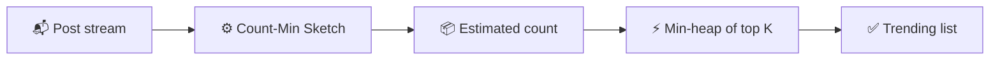

# 08 · Count-Min Sketch

> [!info] Topic info
> **Subject:** System Design · **Chapter:** Data Structures for Scale · **Priority:** 💤 Low · **Status:** ✅ done · **Last reviewed:** 2026-11-19
>
> [← Back to Data Structures for Scale](README.md) · [Interview questions →](questions/data-structures-qa.md)

> [!abstract] In one line
> A **Count-Min Sketch** is a small grid of counters that estimates **how many times** each item appeared in a huge stream — it may **overcount**, but **never undercounts** — the go-to tool for **top-K / trending**.

---

## 1. The problem

Our app wants **trending hashtags** for the last hour. There are **50,000 posts/sec** and millions of distinct hashtags.

A hash map with an exact counter per hashtag grows without limit and is huge to keep per time window. We only care about the **heavy hitters** — rough counts are fine.

---

## 2. How it works

- A grid with `d` **rows** (e.g. 5) and `w` **columns** (e.g. 10,000) of counters. Each row has its own hash function.
- **Add `#worldcup`:** in every row, hash it to one column and **+1** that counter.
- **Count `#worldcup`:** read its counter in each row and take the **minimum**.

Why minimum? Other hashtags may collide into the same counters and inflate them. The smallest one has the **least noise**.

### Top-K with a heap

For every hashtag seen, get its estimated count. Keep a **min-heap of size K** (say 10). If the new count beats the smallest in the heap, swap it in. Memory = sketch + K items.

> [!tip] 🎤 Say it like this
> "For trending hashtags I'd use a Count-Min Sketch: a few rows of counters, each with its own hash. I increment one counter per row and read back the minimum, so it can overcount but never undercounts. I pair it with a min-heap of size K to keep the top hashtags, and keep one sketch per minute so I can roll up a sliding window."

**Trade-off:** more columns → fewer collisions → smaller error. More rows → more confidence. Still just **KBs to a few MB**, no matter how many distinct items.

> [!failure] Interview traps
> - Using it for **rare** items — the collision noise can be bigger than their real count. It's for **heavy hitters**.
> - Forgetting time windows — you need a sketch per time bucket (e.g. per minute) and merge them; sketches add up cell by cell.

---

## Summary

- `d` rows × `w` counters, one hash per row, read the **min**.
- Overcounts, never undercounts. Fixed tiny memory.
- **Sketch + min-heap = approximate top-K** (trending hashtags, most-viewed videos, heavy-hitter IPs).

> [!success] Key takeaway
> "Top-K / trending at huge scale" → **Count-Min Sketch + heap**, with exact counts computed later in batch if needed.
