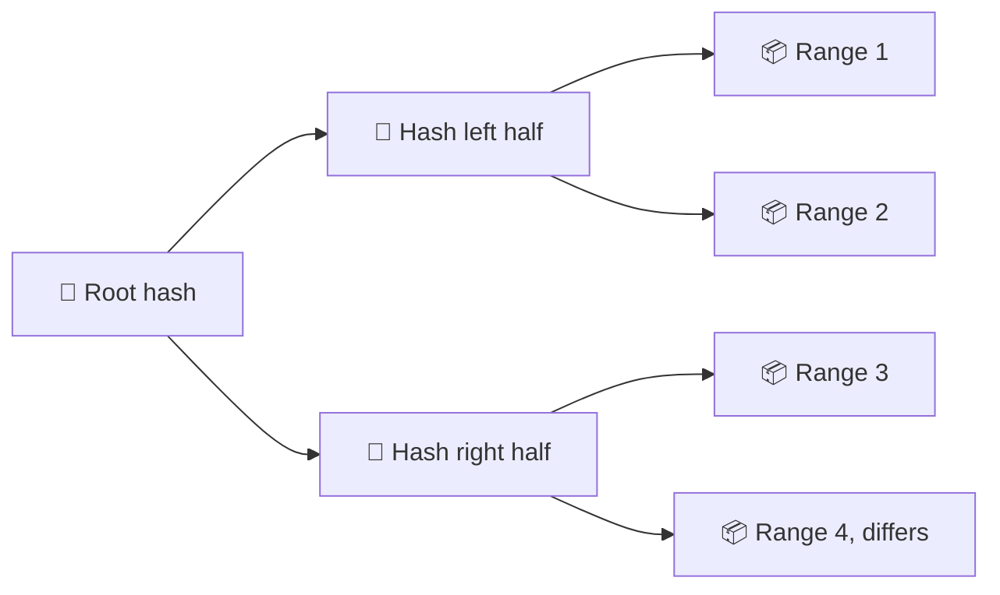

# 10 · Merkle Trees

> [!info] Topic info
> **Subject:** System Design · **Chapter:** Data Structures for Scale · **Priority:** ⚡ Medium · **Status:** ✅ done · **Last reviewed:** 2026-11-19
>
> [← Back to Data Structures for Scale](README.md) · [Interview questions →](questions/data-structures-qa.md)

> [!abstract] In one line
> A **Merkle tree** is a **tree of hashes**: leaves hash the data, each parent hashes its children, so one **root hash** fingerprints everything — and two copies can find exactly **which parts differ** by comparing only a few hashes.

---

## 1. The problem

Our posts database keeps **3 replicas** (see [Replication](../database-scaling/03-replication.md)). After a network blip, replica B missed some writes. Each replica holds **1 billion** rows.

How do A and B find the few rows that differ? Sending all 1 billion rows over the network to compare is way too slow and costly.

---

## 2. How it works

1. Split the data into ranges (e.g. by key range). Hash each range → **leaves**.
2. Each parent = hash of its two children's hashes.
3. Keep going up until one **root hash**.

**Comparing two replicas:**
- Compare root hashes. **Same → everything matches**, done with one hash.
- Different → compare the two children. Only go down into the side that **differs**.
- At the leaves, you find the exact ranges that are out of sync. Only sync those.

With a million leaves, finding one bad range takes about **20 levels** of comparison instead of a million.

> [!tip] 🎤 Say it like this
> "A Merkle tree hashes data into leaves and then hashes pairs of hashes up to one root. Two replicas compare roots first; if they differ, they walk down only the branches that differ, so they find out-of-sync ranges in log n steps instead of comparing everything. Cassandra and Dynamo use this for anti-entropy repair."

---

## 3. Where it's used

| System | Use |
|---|---|
| **Dynamo / Cassandra / Riak** | **Anti-entropy** — background repair between replicas (Cassandra's `nodetool repair`) |
| **Git** | Every file, folder, and commit is identified by a hash of its content — same idea. Changing one file changes the hashes up to the commit. |
| **Bitcoin / blockchains** | Prove a transaction is in a block with just `log n` hashes |
| **File sync / backup, IPFS** | Find which chunks changed and send only those |

**✅ Pros** — find differences with very little data sent; also **proves integrity** (any change changes the root).
**❌ Cons** — building trees costs CPU; frequent writes mean frequent re-hashing of parts of the tree.

> [!failure] Interview traps
> - Saying Merkle trees **fix** inconsistency. They only **find** what differs; you still copy the data and decide which version wins (see [CAP](../core-concepts/07-cap-theorem.md) — LWW, vector clocks).
> - Mixing it up with a [hash ring](../core-concepts/06-consistent-hashing.md). Hash ring = **where** data lives; Merkle tree = **is it the same** on both copies.

---

## Summary

- Leaves = hashes of data; parents = hash of children; root = fingerprint of everything.
- Compare top-down → find differences in **O(log n)**.
- Used for **replica repair** (Dynamo, Cassandra), **Git**, **blockchains**, **file sync**.

> [!success] Key takeaway
> "How do replicas detect drift without shipping everything?" → **Merkle trees (anti-entropy)**, often next to [gossip](../distributed-systems/16-gossip-protocol.md) and read repair.
