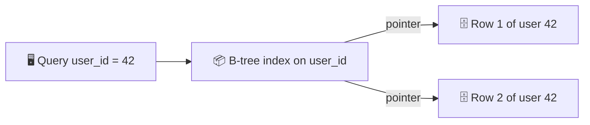

# 01 · Indexing

> [!info] Topic info
> **Subject:** System Design · **Chapter:** Database Scaling · **Priority:** 🔥 High · **Status:** ✅ done · **Last reviewed:** 2026-11-19
>
> [← Back to Database Scaling](README.md) · [Interview questions →](questions/database-scaling-qa.md)

> [!abstract] In one line
> An **index** is a **sorted lookup structure** (usually a **B-tree**) that lets the database find rows **without scanning the whole table** — faster **reads** in exchange for slower **writes** and extra **storage**.

---

## 1. The problem

Our social media app has **50 million posts**. The profile page runs:

```sql
SELECT * FROM posts WHERE user_id = 42 ORDER BY created_at DESC LIMIT 20;
```

Without an index, the database reads **all 50M rows** to find user 42's posts — a **full table scan**. That's seconds per request. With 1,000 req/s, the database melts.

---

## 2. How it works

An index is like the index at the back of a book. Instead of reading every page, you look up the word, get the page number, and jump there.

The database keeps a separate **B-tree** sorted by the indexed column. Each entry stores the value + a pointer to the row. Finding one value takes about **3–4 page reads**, even for millions of rows. (How B-trees work: [B-Trees](../databases/04-b-trees.md).)



| | Full table scan | Index lookup |
|---|---|---|
| **Work** | Read every row — O(n) | Walk the tree — O(log n) |
| **50M rows** | Seconds | ~1 ms |

> [!tip] 🎤 Say it like this
> "An index is a sorted copy of one or more columns with pointers back to the rows, usually stored as a B-tree. It turns a full table scan into a log-time lookup. The cost is that every insert, update, and delete must also update the index, and it uses extra disk."

---

## 3. Types you should know

### Composite index + leftmost prefix rule

An index on **several columns**, e.g. `(user_id, created_at)`. Rows are sorted by `user_id` first, then by `created_at` inside each user.

That's perfect for our profile query — filter by user **and** already sorted by time. No extra sort step.

The **leftmost prefix rule**: the index helps only if the query uses the columns **from the left**.

| Query filters on | Uses `(user_id, created_at)`? |
|---|---|
| **`user_id`** | ✅ Yes |
| **`user_id` + `created_at`** | ✅ Yes |
| **`created_at` only** | ❌ No — like a phone book sorted by last name, searched by first name |

> [!important] Column order rule of thumb
> Put **equality** filters first (`user_id = 42`), then **range / sort** columns (`created_at > …`, `ORDER BY created_at`).

### Covering index

If the index holds **every column the query needs**, the database answers from the index alone — it never touches the table. This is called an **index-only scan**.

Example: index `(user_id, created_at, post_id)` fully covers `SELECT post_id FROM posts WHERE user_id = 42 ORDER BY created_at`.

### Other kinds (one line each)

- **Unique index** — also enforces "no duplicates" (e.g. `email`).
- **Primary / clustered index** — the table itself is stored in this order (InnoDB does this by primary key).
- **Secondary index** — any extra index; points back to the row or primary key.
- **Hash index** — great for `=`, useless for ranges and sorting.
- **Full-text / geo indexes** — special structures for text search and locations.

---

## 4. The cost of indexes

Indexes are not free:

- **Slower writes** — one insert into a table with 5 indexes = 6 writes.
- **More storage** — indexes can be as big as the table itself.
- **More memory** — hot indexes need to fit in RAM to be fast.

So index the columns you **actually query on**, not everything. Drop unused indexes.

**✅ Pros**
- Reads go from seconds to milliseconds
- Can avoid sorting (`ORDER BY` matches the index)
- Unique indexes enforce data rules

**❌ Cons**
- Every write is slower
- Extra disk and RAM
- Too many indexes confuse the planner and slow down writes

---

## 5. When the index is NOT used

The database's **query planner** decides whether to use an index. It skips it when:

- **Function on the column** — `WHERE LOWER(email) = 'a@b.com'` can't use an index on `email` (fix: index on the expression).
- **Leading wildcard** — `LIKE '%gmail.com'` can't use a sorted index; `LIKE 'bob%'` can.
- **Wrong column order** — breaks the leftmost prefix rule.
- **Low selectivity** — `WHERE is_active = true` matching 90% of rows. Scanning the table is cheaper than jumping around.
- **Type mismatch** — comparing a string column to a number forces a conversion.

Check with `EXPLAIN` — see [Query Optimization](05-query-optimization.md).

> [!failure] Interview traps
> - Saying "just add an index to every column" — kills write performance.
> - Forgetting the **leftmost prefix rule** for composite indexes.
> - Thinking an index always helps — on low-selectivity columns the planner ignores it.
> - Forgetting that indexes need to fit in **memory** to be fast.

---

## Summary

| Idea | Key point |
|---|---|
| **Index** | Sorted B-tree → O(log n) lookups instead of full scans |
| **Composite** | Multi-column; follows the leftmost prefix rule |
| **Covering** | Index has all needed columns → no table read |
| **Cost** | Slower writes, more disk and RAM |
| **Not used** | Functions, leading `%`, low selectivity, wrong order |

> [!success] Key takeaway
> Indexing is the **first and cheapest** fix for slow reads. Index what you filter and sort on, in the right order — and remember every index taxes your writes.
