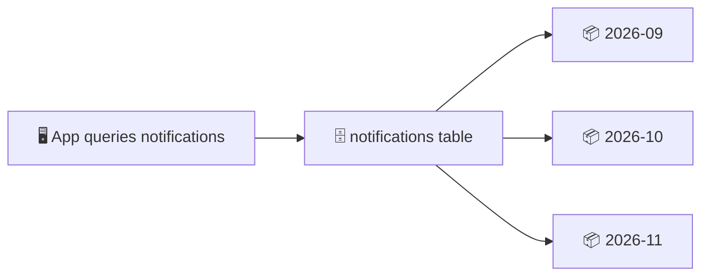

# 02 · Partitioning

> [!info] Topic info
> **Subject:** System Design · **Chapter:** Database Scaling · **Priority:** ⚡ Medium · **Status:** ✅ done · **Last reviewed:** 2026-11-19
>
> [← Back to Database Scaling](README.md) · [Interview questions →](questions/database-scaling-qa.md)

> [!abstract] In one line
> **Partitioning** splits one big table into **smaller pieces** (partitions) by a **partition key** — usually **inside the same database server** — so queries touch less data and old data is easy to drop.

---

## 1. The problem

Our app's `notifications` table has grown to **2 billion rows** (500 GB). Indexes are huge and don't fit in RAM. Queries for "this week's notifications" still wade through years of data.

Deleting old rows with `DELETE … WHERE created_at < '2024-01-01'` takes hours and locks the table.

---

## 2. How it works

We split the table by month. To the app it still looks like **one table**. Under the hood the database stores each month as a separate piece.

When a query says `WHERE created_at >= '2026-11-01'`, the database **skips** every other partition. This is called **partition pruning**.

Dropping a whole year? Just `DROP` those partitions — instant, no huge delete.

> [!tip] 🎤 Say it like this
> "Partitioning splits a large table into smaller pieces by a key, like month or region, usually on the same server. Queries that filter on the key only scan the relevant partition, indexes stay small, and old data can be dropped instantly. Sharding is the same idea but across multiple machines."

---

## 3. Horizontal vs vertical

| | Horizontal partitioning | Vertical partitioning |
|---|---|---|
| **Splits by** | **Rows** (Jan rows here, Feb rows there) | **Columns** (hot columns here, big rare ones there) |
| **Example** | `posts` by month | `users` core fields vs `users_profile` with bio, settings |
| **Helps with** | Huge row counts | Wide rows, rarely used big columns |

### Ways to pick the partition (horizontal)

- **Range** — by date or ID range. Great for time-series and archiving.
- **List** — by a fixed set of values, e.g. `country IN ('IN', 'US')`.
- **Hash** — `hash(user_id) % 8`. Spreads data evenly, but no range pruning.

---

## 4. Partitioning vs sharding

This is the classic interview question.

| | Partitioning | Sharding |
|---|---|---|
| **Where** | **Same** database server | **Different** servers |
| **Fixes** | Big tables, slow scans, archiving | Too much data/writes for **one machine** |
| **App changes** | None — still one DB | Usually needs routing logic |
| **Joins / transactions** | Still work normally | Hard across shards |

> [!note] Words get mixed up
> Many people (and some databases) use "partition" for sharding too. In an interview, say what you mean: "split inside one server" vs "split across servers". See [Sharding](04-sharding.md).

**✅ Pros**
- Faster queries via pruning; smaller indexes per partition
- Instant archival with `DROP PARTITION`
- No app changes

**❌ Cons**
- Queries **without** the partition key scan **all** partitions
- Too many partitions add planning overhead
- Doesn't add CPU, RAM, or disk — still one machine

> [!failure] Interview traps
> - Saying partitioning adds capacity — it doesn't; it's still one server.
> - Choosing a partition key your queries never filter on — no pruning, just overhead.
> - Mixing up partitioning and sharding without clarifying.

---

## Summary

- Partitioning = splitting a table into pieces **on one server**.
- Biggest wins: **partition pruning** and **cheap deletion** of old data.
- Range for time data, hash for even spread, list for categories.
- When one machine isn't enough anymore → **sharding**.

> [!success] Key takeaway
> Partition big, time-based tables early — it's cheap and invisible to the app. It's the step **before** sharding, not a replacement for it.
