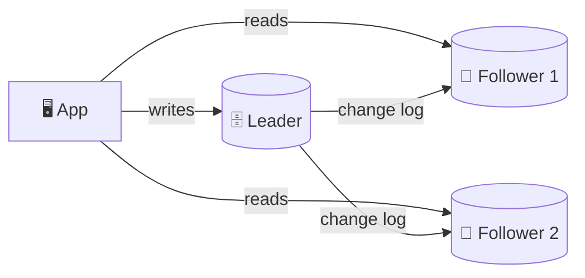
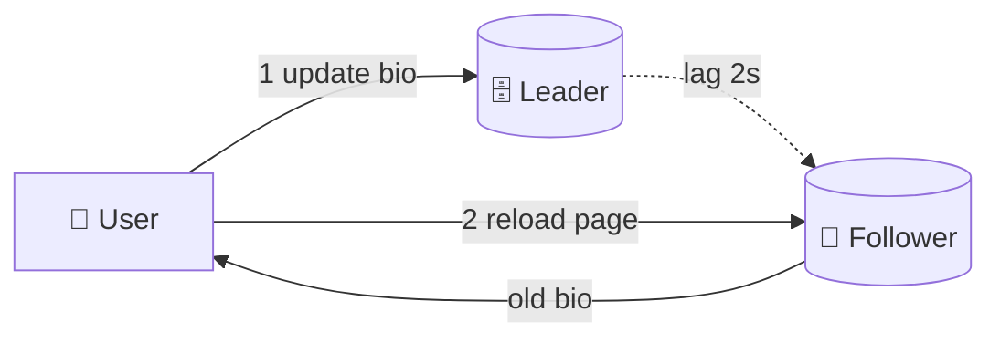

# 03 · Replication

> [!info] Topic info
> **Subject:** System Design · **Chapter:** Database Scaling · **Priority:** 🔥 High · **Status:** ✅ done · **Last reviewed:** 2026-11-19
>
> [← Back to Database Scaling](README.md) · [Interview questions →](questions/database-scaling-qa.md)

> [!abstract] In one line
> **Replication** keeps **copies of the same data on several machines** — for **more read capacity**, **high availability**, and **lower latency** — at the cost of **replication lag** and conflict handling.

---

## 1. The problem

Our app has one database. It handles writes fine, but the feed gets **20,000 reads/s** and the CPU is at 95%. And if this one machine dies, the whole app is down.

Quick recap: [Scalability](../core-concepts/01-scalability.md) introduced read replicas, and [Availability](../core-concepts/02-availability.md) covered sync vs async replication and failover. Here we go deeper: **the three replication models** and **the lag problems**.

---

## 2. Leader-follower (single leader)

The most common setup (MySQL, PostgreSQL, MongoDB by default).

- **One leader** (primary) takes **all writes**.
- It sends a **change log** to **followers** (replicas).
- Followers serve **reads**.

If the leader dies, a follower is **promoted** (failover). With async replication, the last few writes may be lost.

**✅ Pros** — simple, no write conflicts, reads scale by adding followers.
**❌ Cons** — writes still limited to **one** machine; failover can lose data or cause split brain.

---

## 3. Multi-leader

**Several leaders** accept writes — usually **one per region** or data center. Leaders sync with each other.

- ✅ Users write to the **nearest** region → low write latency; a region can fail independently.
- ❌ **Write conflicts**: two users edit the same post in two regions at the same time. Which wins?

Conflict fixes: **last-write-wins** (simple, loses data), merge logic, or CRDTs — see [CAP Theorem](../core-concepts/07-cap-theorem.md).

Use it for: multi-region apps, offline-first apps (each phone is like a leader — think Google Docs or notes apps).

---

## 4. Leaderless (quorum)

**No leader** — the client writes to and reads from **several nodes at once** (Cassandra, DynamoDB-style).

With **N** copies, write to **W** nodes and read from **R** nodes. If **W + R > N**, every read overlaps with at least one node that has the latest write.

> [!example] Quick math
> N = 3, W = 2, R = 2 → 2 + 2 = 4 > 3 ✅. Any 2 nodes you read include at least 1 with the newest value.
> N = 3, W = 1, R = 1 → fast, but you may read stale data.

Stale nodes catch up through **read repair** (fix on read) and background **anti-entropy** jobs.

- ✅ No failover needed — a dead node is just skipped; very high write availability.
- ❌ Weaker consistency; conflicts still possible; harder to reason about.

---

## 5. Comparing the three

| | Leader-follower | Multi-leader | Leaderless |
|---|---|---|---|
| **Writes go to** | One leader | Any leader | Several nodes |
| **Write conflicts** | None | Yes | Yes |
| **Failover** | Needed | Per region | Not needed |
| **Best for** | Most apps | Multi-region, offline | High write availability |

> [!tip] 🎤 Say it like this
> "By default I'd use single-leader replication: all writes go to one primary, and read replicas handle reads. If I need writes in many regions I'd consider multi-leader, but then I need a conflict resolution strategy. Leaderless systems like Cassandra use quorums, where W plus R greater than N gives you overlap with the latest write."

---

## 6. Replication lag problems

With async replication, followers are behind by **milliseconds to seconds** (minutes under heavy load). That causes real bugs:

### Read-your-writes

A user edits their bio, the page reloads, and the read hits a lagging replica — **old bio shows**. User thinks the save failed.

Fixes:
- Read **the user's own data** from the leader (e.g. own profile).
- After a write, read from the leader for **N seconds**.
- Track the write's log position; only read from a replica that has caught up.

### Monotonic reads

A user refreshes twice: first hits a fresh replica (sees a comment), then a stale one (comment **disappears**). Fix: **stick each user to one replica** (e.g. hash user_id).

> [!failure] Interview traps
> - Saying replicas help with **write** scaling — they don't; every replica applies every write.
> - Forgetting replication lag when you add read replicas — always mention read-your-writes.
> - Treating replication as a **backup** — a bad `DELETE` replicates too.
> - Saying W + R > N gives strong consistency in every case — edge cases like sloppy quorums break it.

---

## Summary

| Model | One line |
|---|---|
| **Leader-follower** | One writer, many readers — default choice |
| **Multi-leader** | Writes in many regions — needs conflict handling |
| **Leaderless** | Quorum reads/writes — W + R > N |
| **Lag fixes** | Read-your-writes from leader, sticky replicas |

> [!success] Key takeaway
> Replication scales **reads** and gives **availability**, not write capacity. The moment you add replicas, tell the interviewer how you handle **lag**.
