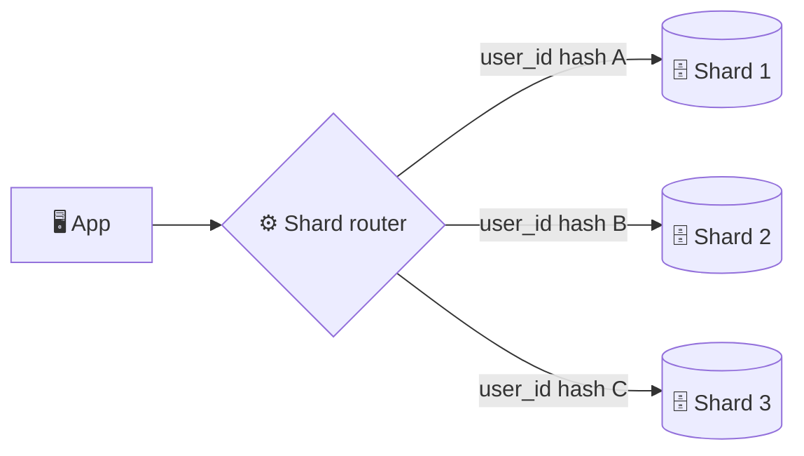

# 04 · Sharding

> [!info] Topic info
> **Subject:** System Design · **Chapter:** Database Scaling · **Priority:** 🔥 High · **Status:** ✅ done · **Last reviewed:** 2026-11-19
>
> [← Back to Database Scaling](README.md) · [Interview questions →](questions/database-scaling-qa.md)

> [!abstract] In one line
> **Sharding** splits data **across multiple database servers** by a **shard key**, so each server holds and writes only **part** of the data — the way to scale **writes and storage** past one machine.

---

## 1. The problem

Our app now gets **50,000 writes/s** (posts, likes, comments) and stores **20 TB**. We already have indexes, partitions, a bigger machine, and read replicas.

But replicas don't help writes — every replica still applies every write. One leader can't keep up. We need to **split the data itself**.

(Intro in [Scalability](../core-concepts/01-scalability.md). Here: how to choose the key, the strategies, and the pain points.)

---

## 2. How it works

Each shard is a **separate database** with the same schema but different rows. A **router** looks at the shard key and sends the query to the right shard.

The router can live in the app (a library), in a proxy (like Vitess for MySQL), or inside the database (MongoDB, Cassandra, CockroachDB do it for you).

Each shard usually has its **own replicas** too — sharding for writes, replication for availability.

> [!tip] 🎤 Say it like this
> "Sharding splits the data across many database servers by a shard key, so each server handles a fraction of the writes and storage. The key decision is the shard key — it should spread load evenly and keep data that's queried together on the same shard. The costs are cross-shard queries, no easy joins or transactions across shards, and resharding."

---

## 3. Choosing the shard key

The most important decision. A good key:

- Has **high cardinality** — many distinct values (`user_id`, not `country`).
- Spreads **load** evenly — not just data, but traffic.
- Matches the **main query** — "get user 42's posts" hits **one** shard.

For our app, `user_id` works well: a user's profile, posts, and settings live on one shard.

> [!warning] Bad keys
> - `created_at` → all new writes go to the **latest** shard (hot shard).
> - `country` → India's shard is huge, Iceland's is empty.
> - Something you rarely filter on → every query becomes a **scatter-gather** over all shards.

---

## 4. Sharding strategies

| | Range | Hash | Directory |
|---|---|---|---|
| **How** | `user_id` 1–1M → S1, 1M–2M → S2 | `hash(user_id) % N` | Lookup table: key → shard |
| **✅ Good** | Range queries are easy | Even spread | Full control, move single keys |
| **❌ Bad** | Hot spots on new ranges | Range queries hit all shards; changing N moves most data | Lookup table is a SPOF and extra hop |

**Hash + consistent hashing** fixes the resharding problem: adding a shard moves only ~1/N of the keys instead of almost all. See [Consistent Hashing](../core-concepts/06-consistent-hashing.md).

---

## 5. The hard parts

### Hot shards

A celebrity with 100M followers lives on one shard — that shard gets crushed. Fixes:
- Add a random suffix to hot keys (`celebrity_42#1..#10`) to spread them — reads must then gather from all 10.
- Give hot users a **dedicated** shard.
- **Cache** hot data in front of the shard.

### Resharding

Shards fill up, so you add more and **move data** while live traffic flows. Usual approach: copy data to new shards in the background, catch up via the change log, then switch the router. Avoid it by starting with **many logical shards** (e.g. 1,024) mapped onto a few machines — later just move logical shards to new machines.

### Cross-shard queries

"Top 10 trending posts globally" must ask **every** shard and merge (**scatter-gather**). Slow, and only as fast as the slowest shard.

Fixes: precompute in a separate store, denormalize, or use a search/analytics system for global queries.

### Joins and transactions

Joins across shards must happen in the app. Transactions across shards need 2PC or sagas — see [Distributed Transactions](../distributed-transactions/01-distributed-transactions-problem.md). Design so most operations stay on **one** shard.

**✅ Pros**
- Scales writes and storage nearly linearly
- Failure of one shard affects only part of users

**❌ Cons**
- Big app and ops complexity
- Cross-shard queries, joins, transactions get hard
- Resharding is risky
- Unique IDs need a global scheme (e.g. Snowflake IDs), not auto-increment

> [!failure] Interview traps
> - Sharding **too early** — exhaust indexing, caching, vertical scaling, and replicas first.
> - Picking a shard key by **data size** only, ignoring **traffic** patterns.
> - Using `hash % N` and forgetting that changing N reshuffles almost everything.
> - Forgetting that auto-increment IDs clash across shards.

---

## Summary

| Topic | Key point |
|---|---|
| **Why** | Writes and storage outgrow one machine |
| **Shard key** | High cardinality, even load, matches main query |
| **Strategies** | Range, hash with consistent hashing, directory |
| **Pain** | Hot shards, resharding, cross-shard queries and transactions |

> [!success] Key takeaway
> Shard **last**, and spend your time on the **shard key**. A good key keeps most requests on one shard; a bad one gives you hot shards and scatter-gather forever.
