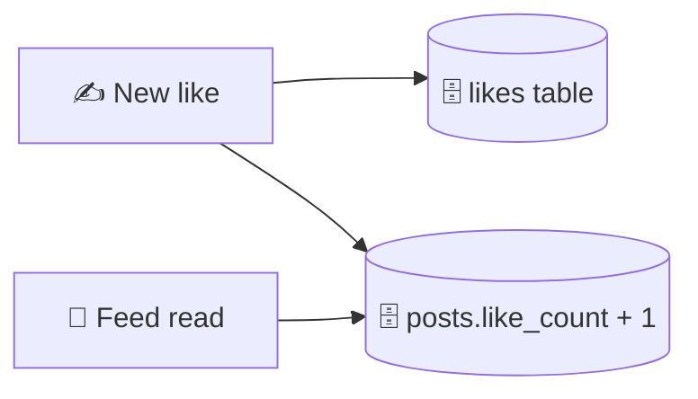

# 06 · Denormalization

> [!info] Topic info
> **Subject:** System Design · **Chapter:** Database Scaling · **Priority:** ⚡ Medium · **Status:** ✅ done · **Last reviewed:** 2026-11-19
>
> [← Back to Database Scaling](README.md) · [Interview questions →](questions/database-scaling-qa.md)

> [!abstract] In one line
> **Denormalization** means **storing duplicate or precomputed data on purpose** so reads need **fewer joins** — trading **faster reads** for **harder writes** and the risk of **inconsistent copies**.

---

## 1. The problem

Our feed shows each post with the author's name, avatar, and like count. In a clean (normalized) schema, that's:

```sql
SELECT p.*, u.name, u.avatar, COUNT(l.*)
FROM posts p JOIN users u ON ... LEFT JOIN likes l ON ...
GROUP BY p.id;
```

At 20,000 feed reads/s, that join + count on **millions of likes** is too slow. And after [sharding](04-sharding.md), `users` and `likes` may be on other shards — joins are not even possible.

---

## 2. Normalized vs denormalized

**Normalization** = store each fact **once** (name lives only in `users`). No duplicates, easy updates.

**Denormalization** = copy data where it's read:

- Store `author_name` and `author_avatar` **inside** each post row.
- Keep a `like_count` column on `posts` instead of counting every time.



Now a feed read is **one simple query** on one table.

| | Normalized | Denormalized |
|---|---|---|
| **Reads** | Joins, slower | One lookup, fast |
| **Writes** | One place | Many places to update |
| **Consistency** | Always correct | Copies can drift |
| **Storage** | Small | Bigger |
| **Best for** | Write-heavy, correctness-critical | Read-heavy, at scale |

> [!tip] 🎤 Say it like this
> "Denormalization means duplicating or precomputing data so reads avoid joins. For a read-heavy feed I'd store the like count and author name on the post. The trade-off is that writes must update every copy, so I need a way to keep them in sync — a transaction, an async event, or a periodic fix-up job."

---

## 3. Keeping copies in sync

When Alice changes her name, every post with `author_name = 'Alice'` is now stale. Options:

- **Same transaction** — update both together. Simple, only works when both are in one DB.
- **Async events** — publish `UserRenamed`, a worker updates the copies. Eventually consistent. Use the [outbox pattern](../distributed-transactions/05-outbox-pattern.md) so the event isn't lost.
- **Accept staleness** — an old name on a 3-year-old post is fine.
- **Reconcile** — a nightly job recomputes counts and fixes drift.

> [!warning] Counters under load
> `like_count = like_count + 1` on a viral post means thousands of writes to **one row** → lock contention. Fix: buffer likes in Redis or a queue and flush in batches, or split into several counter rows and sum them.

---

## 4. When to use it

- Read-heavy data where joins are the bottleneck (feeds, product pages).
- After sharding, when joins across shards aren't possible.
- In **NoSQL** (DynamoDB, Cassandra) — there are no joins, so you design tables **per query** from day one.

Don't start denormalized. Normalize first, then denormalize the **specific hot paths** you've measured.

**✅ Pros** — fast reads, no joins, works across shards.
**❌ Cons** — write amplification, data drift, more storage, more code.

> [!failure] Interview traps
> - Denormalizing everything up front — you'll pay in bugs and write cost.
> - Not saying **how** copies stay in sync.
> - Forgetting hot counter rows become a write bottleneck.

---

## Summary

- Normalize for correctness, denormalize hot read paths for speed.
- Common forms: copied fields, precomputed counts, per-query tables.
- Sync copies via transactions, events, or reconciliation jobs.
- For whole precomputed query results → [Materialized Views](07-materialized-views.md).

> [!success] Key takeaway
> Denormalization moves work from **read time** to **write time**. Worth it when reads vastly outnumber writes — as long as you have a plan for keeping copies in sync.
