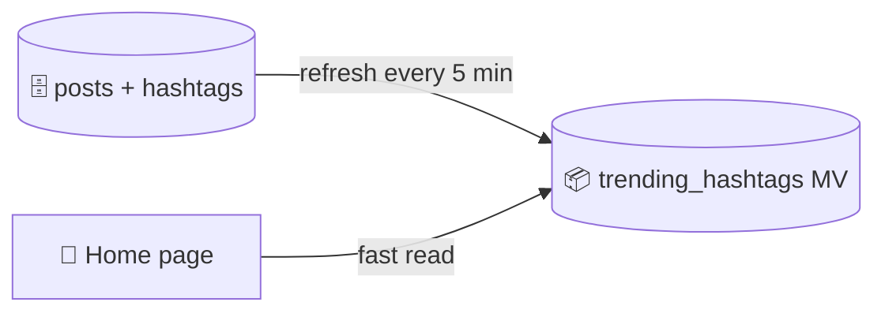

# 07 · Materialized Views

> [!info] Topic info
> **Subject:** System Design · **Chapter:** Database Scaling · **Priority:** ⚡ Medium · **Status:** ✅ done · **Last reviewed:** 2026-11-19
>
> [← Back to Database Scaling](README.md) · [Interview questions →](questions/database-scaling-qa.md)

> [!abstract] In one line
> A **materialized view** is a query whose **result is saved as a table** and **refreshed** later — so expensive reads become instant, at the cost of **stale data** between refreshes.

---

## 1. The problem

Our app has a "Trending hashtags in the last 24 hours" widget. The query groups and counts **50 million** post-hashtag rows and takes **8 seconds**.

It's shown on every home page load — 5,000 times a second. We can't run an 8-second query 5,000 times a second. But the answer only changes slowly.

---

## 2. View vs materialized view

- A normal **view** is a **saved query**. Every time you read it, the query **runs again**. It's a shortcut, not a speedup.
- A **materialized view** **runs the query once** and **stores the result**. Reads hit the stored result — milliseconds.



```sql
CREATE MATERIALIZED VIEW trending_hashtags AS
SELECT tag, COUNT(*) AS uses FROM post_tags
WHERE created_at > now() - interval '24 hours'
GROUP BY tag ORDER BY uses DESC LIMIT 50;

REFRESH MATERIALIZED VIEW trending_hashtags;  -- run on a schedule
```

You can add **indexes** on a materialized view, just like a table.

> [!tip] 🎤 Say it like this
> "A materialized view stores the result of an expensive query as a table, so reads are instant. The trade-off is freshness — it's only as fresh as the last refresh. I use it for dashboards, leaderboards, and aggregates where a few minutes of staleness is fine."

---

## 3. Refresh strategies

| Strategy | How | Trade-off |
|---|---|---|
| **Full refresh on a schedule** | Recompute everything every N minutes | Simple; stale between runs; costly on big data |
| **Incremental refresh** | Apply only the changes since last time | Fresher, cheaper; not every DB supports it |
| **On write / streaming** | Update the view as each change arrives (CDC, stream processors) | Near real-time; most complex |

> [!warning] Refresh can block reads
> In PostgreSQL a plain refresh **locks** the view. Use `REFRESH … CONCURRENTLY` (needs a unique index) so readers keep seeing the old data during the refresh.

---

## 4. Materialized view vs cache vs denormalization

| | Materialized view | Cache (Redis) | Denormalized column |
|---|---|---|---|
| **Lives in** | The database | Separate memory store | Inside the main table |
| **Built from** | A SQL query | App code | App code / triggers |
| **Freshness** | Until next refresh | Until TTL / invalidation | Updated on every write |
| **Good for** | Heavy aggregates, reports | Any hot read | Small per-row values |

The same idea scales up: **CQRS** read models are basically app-managed materialized views — see [CQRS](../architectural-patterns/08-cqrs.md).

**✅ Pros**
- Turns seconds-long queries into milliseconds
- Pure SQL, no extra infrastructure
- Can be indexed

**❌ Cons**
- Data is stale between refreshes
- Full refreshes are expensive on big tables
- Extra storage

> [!failure] Interview traps
> - Saying a normal view makes queries faster — it doesn't store anything.
> - Using one for data that must be **real-time** (bank balance).
> - Forgetting refresh cost and locking.

---

## Summary

- View = saved query; **materialized** view = saved **result**.
- Refresh: scheduled full, incremental, or streaming.
- Great for aggregates, dashboards, leaderboards.
- Trade-off: speed vs freshness.

> [!success] Key takeaway
> When an expensive query's answer changes slowly, **compute it once and read it many times**. Just tell the interviewer how stale it can be and how you refresh it.
