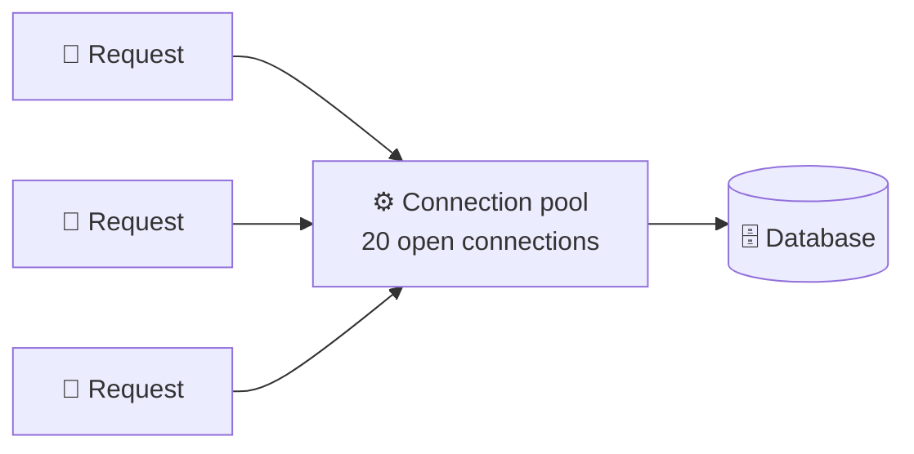

# 08 · Connection Pooling

> [!info] Topic info
> **Subject:** System Design · **Chapter:** Database Scaling · **Priority:** ⚡ Medium · **Status:** ✅ done · **Last reviewed:** 2026-11-19
>
> [← Back to Database Scaling](README.md) · [Interview questions →](questions/database-scaling-qa.md)

> [!abstract] In one line
> **Connection pooling** keeps a **small set of open database connections** and **reuses** them across requests — avoiding the cost of opening new ones and stopping the database from drowning in **too many connections**.

---

## 1. The problem

Our app runs **50 app servers**, each with 100 threads. If every request opens its own connection, the database sees up to **5,000 connections**.

But PostgreSQL starts struggling at a few hundred. Each connection is a whole process using **~5–10 MB RAM**. Opening one takes a TCP handshake, TLS, and auth — often **20–50 ms**, more than the query itself.

---

## 2. How it works

A **pool** opens, say, 20 connections at startup and keeps them alive. A request **borrows** one, runs its query, and **returns** it. If all are busy, the request **waits** in a queue (with a timeout).

Two places to put the pool:

- **In the app** — a library (HikariCP in Java, built into most ORMs). One pool per app instance.
- **External pooler** — a proxy like **PgBouncer** (Postgres) or ProxySQL (MySQL) between all apps and the DB. Thousands of app connections share a few dozen real DB connections.

> [!tip] 🎤 Say it like this
> "Database connections are expensive to open and each one uses memory on the server, so we keep a pool of open connections and reuse them. With many app instances or serverless functions, I'd add an external pooler like PgBouncer so thousands of clients share a small number of real database connections."

---

## 3. PgBouncer modes

| Mode | Connection is returned after | Notes |
|---|---|---|
| **Session** | Client disconnects | Safest, least sharing |
| **Transaction** | Each transaction ends | Most common; best sharing |
| **Statement** | Each statement | Rare; no multi-statement transactions |

> [!warning] Transaction mode catch
> Session-level features (session variables, some prepared statements, advisory locks, `LISTEN`) may break because your next transaction can land on a different connection.

---

## 4. Pool sizing

Bigger is **not** better. A database with 8 CPU cores can only truly run ~8 queries at once. 500 active connections just fight over CPU, locks, and memory — everything gets slower.

> [!example] Starting point
> A common rule of thumb: **pool size ≈ (CPU cores × 2) + disks**. For an 8-core DB → around **20** connections. Then load test and tune.

Don't forget the multiplication:
**total connections = app instances × pool size per instance**. 50 instances × 20 = **1,000** — too many. Shrink per-instance pools or add PgBouncer.

Also set a **max wait timeout** so requests fail fast instead of hanging when the pool is empty.

---

## 5. Serverless connection storms

With AWS Lambda-style functions, a traffic spike can start **1,000 function instances** in seconds. Each opens its own connection → the database hits `max_connections` and **rejects everyone**.

Fixes:
- Put a **proxy pooler** in front (PgBouncer, RDS Proxy).
- Reuse the connection across invocations (create it outside the handler).
- Cap function **concurrency**.
- Or use an HTTP-based / serverless-friendly database.

See [Serverless](../architectural-patterns/04-serverless.md).

**✅ Pros** — fast requests (no connect cost), protects the DB, predictable load.
**❌ Cons** — pool exhaustion if queries are slow or connections leak; one more component with a pooler.

> [!failure] Interview traps
> - "Just raise `max_connections`" — more connections usually make the DB **slower**.
> - Forgetting pools multiply across app instances.
> - Leaking connections (not returning them on error) → pool exhausted → app hangs.
> - Ignoring serverless — every function instance is a new client.

---

## Summary

- Connections are expensive: handshake + auth + RAM per connection.
- Pool and reuse them; add PgBouncer when there are many clients.
- Size pools small (~cores × 2), and remember instances × pool size.
- Serverless needs a proxy pooler to avoid connection storms.

> [!success] Key takeaway
> The database can only do so much at once. A small, well-sized pool **queues** work in front of it instead of letting thousands of connections overwhelm it.
