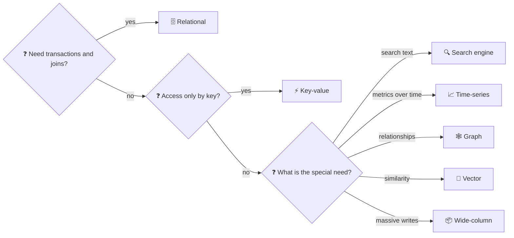

# 01 · Database Types

> [!info] Topic info
> **Subject:** System Design · **Chapter:** Databases · **Priority:** 🔥 High · **Status:** ✅ done · **Last reviewed:** 2026-11-19
>
> [← Back to Databases](README.md) · [Interview questions →](questions/databases-qa.md)

> [!abstract] In one line
> There is **no best database** — each type is built around one **data model** and one **access pattern**, so you pick the one that matches **how your data is read and written**.

---

## 1. The problem

Our social media app stores users, posts, likes, sessions, search, metrics, and a "people you may know" feature.

Putting all of that in one Postgres works at 10K users. At 50M users, some parts start to hurt: search is slow, the likes counter melts, metrics fill the disk. Different data needs different tools.

---

## 2. The map

This page is a **map**. Each type has its own note — click through for details.

| Type | Data model | Great at | Examples | Social app use |
|---|---|---|---|---|
| **[Relational](06-relational-databases.md)** | Tables, rows, joins | Transactions, complex queries, integrity | Postgres, MySQL | Users, follows, payments |
| **[Document](07-document-databases.md)** | JSON documents | Flexible, nested records read as one unit | MongoDB, Firestore | User profiles, settings |
| **[Key-value](08-key-value-stores.md)** | key → value | Super fast get/put by key | Redis, DynamoDB | Sessions, cache, counters |
| **[Wide-column](10-wide-column-databases.md)** | Partition key + sorted rows | Huge write volume, known queries | Cassandra, ScyllaDB | Feeds, messages, activity log |
| **[Full-text search](09-full-text-search.md)** | Inverted index | Keyword search, ranking, fuzzy match | Elasticsearch, OpenSearch | Search posts and users |
| **[Time-series](11-time-series-databases.md)** | (time, tags, value) | Metrics ingest, rollups, retention | InfluxDB, TimescaleDB, Prometheus | App metrics, analytics |
| **[Graph](12-graph-databases.md)** | Nodes and edges | Multi-hop relationship queries | Neo4j, Neptune | Friends-of-friends, fraud |
| **[Vector](13-vector-databases.md)** | Embeddings (number arrays) | "Find similar" search | pgvector, Pinecone | Recommendations, semantic search |

> [!note] Also worth knowing
> **Object storage** (S3) for photos and videos — see [Object Storage](../storage-systems/03-object-storage.md). **Data warehouses** (BigQuery, Snowflake) for analytics — see [Data Warehousing](../big-data/06-data-warehousing.md).

---

## 3. How to choose

Ask these questions, in order:

1. **What does the data look like?** Structured with relations → SQL. Nested blobs → document.
2. **How is it read?** By key only? By range? By text? By similarity?
3. **Read-heavy or write-heavy?** Write-heavy at huge scale → LSM-based stores like Cassandra.
4. **How strict is consistency?** Money → ACID. Like counts → eventual is fine.

> [!important] Default rule
> **Start with Postgres.** Add a specialized store only when a real access pattern needs it. Every extra database is another thing to run, back up, and keep in sync.

---

## 4. Polyglot persistence

Big apps use **several databases**, each for what it does best. This is called **polyglot persistence**.

Postgres stays the **source of truth**. Other stores (Elasticsearch, Redis) are often **copies** kept in sync via [Change Data Capture](../big-data/02-change-data-capture.md) or events.

> [!tip] 🎤 Say it like this
> "I'd start with Postgres as the source of truth for users, posts, and follows because we need transactions and joins. Then I'd add Redis for sessions and hot counters, Elasticsearch for search, and maybe Cassandra for the feed if writes outgrow Postgres. Each extra store is fed from the main one through CDC."

> [!failure] Interview traps
> - Saying "NoSQL because it scales" without naming the **access pattern**.
> - Picking 5 databases for an MVP — every store adds ops cost.
> - Treating search or cache as the source of truth — they're **derived copies**.

---

## Summary

- Each database type = one **data model** + one **access pattern** it's fast at.
- Choose by: data shape → read pattern → read/write ratio → consistency need.
- Default to **relational**, add specialized stores for specific needs.

> [!success] Key takeaway
> Don't ask "which database is best?" Ask "**how will this data be read and written?**" — the answer picks the database.
