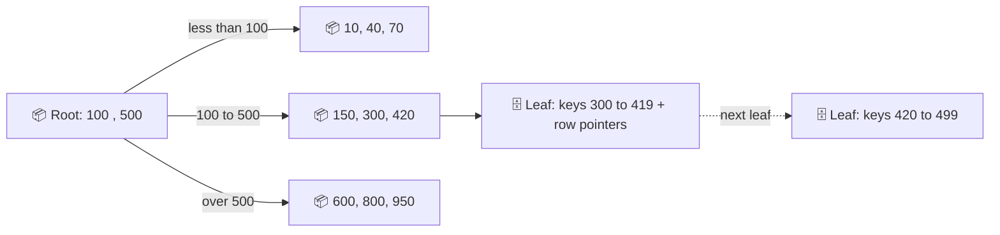

# 04 · B-Trees

> [!info] Topic info
> **Subject:** System Design · **Chapter:** Databases · **Priority:** ⚡ Medium · **Status:** ✅ done · **Last reviewed:** 2026-11-19
>
> [← Back to Databases](README.md) · [Interview questions →](questions/databases-qa.md)

> [!abstract] In one line
> A **B-tree** is a short, wide, **sorted tree of disk pages** that finds any key in **3–4 disk reads** and updates data **in place** — it's the **read-optimized** engine behind Postgres, MySQL, and most SQL indexes.

---

## 1. The problem

Our `users` table has 100M rows. Finding `email = 'bob@x.com'` by scanning every row reads gigabytes from disk — seconds per query.

We need a structure that jumps to the right row in a few disk reads, and also supports **range queries** like "posts between Jan 1 and Jan 7".

---

## 2. How it works

Disks read in **pages** (blocks of ~4–16 KB). A B-tree stores one **node per page**, and each node holds **hundreds of sorted keys** with pointers to children.

- **Lookup:** start at root, pick the right child, repeat until the leaf. 
- **Branching factor** ~500 means 4 levels hold 500⁴ ≈ **60 billion keys**. Top levels stay cached in RAM, so a lookup is often **1–2 real disk reads**.
- **Range scan:** find the start key, then walk leaves left to right (leaves are linked — this variant is the **B+ tree**, what DBs actually use).

### Writes

- Find the leaf, **overwrite the page in place**.
- If the page is full, **split** it into two and push a key up to the parent.
- To survive crashes mid-split, every change is first written to the **WAL** (write-ahead log).

---

## 3. Trade-offs

**✅ Pros**
- Fast, predictable reads — O(log n), few disk seeks.
- Great for **range queries** and `ORDER BY` (data is sorted).
- Each key lives in exactly one place → easy locking and transactions.

**❌ Cons**
- **Random writes** — each insert may touch a different page on disk.
- **Write amplification** — changing a 100-byte row rewrites a whole 8 KB page (plus the WAL copy).
- Page splits leave pages half-empty → **fragmentation** over time.

> [!tip] 🎤 Say it like this
> "A B-tree keeps keys sorted in disk-page-sized nodes with a high branching factor, so even billions of rows are only 3–4 levels deep. Reads and range scans are fast and predictable. The cost is random in-place writes, which is why write-heavy systems often prefer LSM trees instead."

> [!example] B-tree vs binary tree
> A binary tree has 2 children per node → 30+ levels for a billion keys → 30 disk reads. A B-tree has ~500 children → 4 levels. Same idea, built for **disks**.

> [!failure] Interview traps
> - Saying a DB index is a "hash table" — most are B+ trees (hash indexes can't do ranges).
> - Forgetting every index is **another B-tree to update** on each write — more indexes, slower inserts. See [Indexing](../database-scaling/01-indexing.md).
> - Random UUIDs as primary keys scatter inserts across pages; time-ordered IDs (UUIDv7, Snowflake) keep inserts at the "right edge".

---

## Summary

| Property | B-tree |
|---|---|
| **Optimized for** | Reads and range scans |
| **Write style** | Update in place (random I/O) |
| **Lookup cost** | O(log n), ~3–4 page reads |
| **Used by** | Postgres, MySQL InnoDB, SQL Server, Oracle, MongoDB (WiredTiger) |

> [!success] Key takeaway
> B-tree = **read-optimized**, sorted, update-in-place. Compare with [LSM Trees](05-lsm-trees.md) = write-optimized, append-and-compact.
