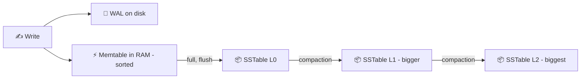

# 05 · LSM Trees

> [!info] Topic info
> **Subject:** System Design · **Chapter:** Databases · **Priority:** ⚡ Medium · **Status:** ✅ done · **Last reviewed:** 2026-11-19
>
> [← Back to Databases](README.md) · [Interview questions →](questions/databases-qa.md)

> [!abstract] In one line
> An **LSM tree** (Log-Structured Merge tree) turns every write into a fast **in-memory insert + sequential disk append**, then **merges files in the background (compaction)** — it's the **write-optimized** engine behind Cassandra, RocksDB, and HBase.

---

## 1. The problem

Our app logs every like, view, and message — **200K writes/sec**. A [B-tree](04-b-trees.md) does random in-place page writes, and the disk can't keep up.

Disks (even SSDs) are much faster at **sequential** writes than random ones. Can we make every write sequential?

---

## 2. How it works

1. **Write** → append to the **WAL** (for crash safety) and insert into the **memtable**, a sorted structure in RAM. Done — very fast.
2. When the memtable hits ~64 MB, **flush** it to disk as an **SSTable** (Sorted String Table) — an immutable, sorted file. One sequential write.
3. Updates and deletes never modify old files. A delete writes a **tombstone** marker.
4. **Compaction** runs in the background: merges SSTables, keeps the newest value per key, drops overwritten values and tombstones.

### Reads

Check memtable → newest SSTable → older ones, until the key is found. That could mean checking **many files**. Two tricks keep it fast:

- **Bloom filter** per SSTable — answers "is this key *definitely not* here?" in RAM, skipping most files. See [Bloom Filters](../data-structures/05-bloom-filters.md).
- **Sparse index** per SSTable — since keys are sorted, jump close to the key and scan a small block.

---

## 3. B-tree vs LSM tree

| | B-tree | LSM tree |
|---|---|---|
| **Optimized for** | Reads | Writes |
| **Write pattern** | Random, in place | Sequential, append-only |
| **Read cost** | One tree walk | May check several files (helped by bloom filters) |
| **Write amplification** | Whole page rewritten per small change | Data rewritten again on each compaction |
| **Space** | Fragmentation from page splits | Old versions wait for compaction |
| **Background work** | Little | Compaction uses CPU and disk I/O |
| **Examples** | Postgres, MySQL | Cassandra, RocksDB, HBase, ScyllaDB, LevelDB |

> [!note] Three amplifications
> **Write amp** = bytes written to disk ÷ bytes the app wrote. **Read amp** = files touched per read. **Space amp** = disk used ÷ real data size. LSM tuning is trading these three against each other.

> [!tip] 🎤 Say it like this
> "An LSM tree buffers writes in a sorted in-memory memtable, flushes it as an immutable sorted file, and merges those files in the background. Every disk write is sequential, so it handles huge write volumes. Reads may check several files, so it uses bloom filters to skip files that can't contain the key. That's why Cassandra and RocksDB use it for write-heavy workloads."

> [!warning] Compaction is not free
> If writes outpace compaction, SSTables pile up, reads slow down, and disk fills. Compaction can also cause **latency spikes** at p99.

> [!failure] Interview traps
> - Saying LSM writes go "straight to disk" — they go to RAM + WAL first.
> - Forgetting deletes are **writes** (tombstones) — mass deletes can slow reads until compaction.
> - Claiming LSM is always better for writes and worse for reads — with bloom filters and caching, point reads are often fine; **range scans** across many files hurt more.

---

## Summary

- Write → WAL + memtable → flush to SSTable → compact in background.
- Reads use **bloom filters** and sparse indexes to skip files.
- **Write-optimized**; pays with compaction work and some read cost.

> [!success] Key takeaway
> Write-heavy (logs, events, messages, metrics) → think **LSM**. Read-heavy with ranges and transactions → think **B-tree**.
