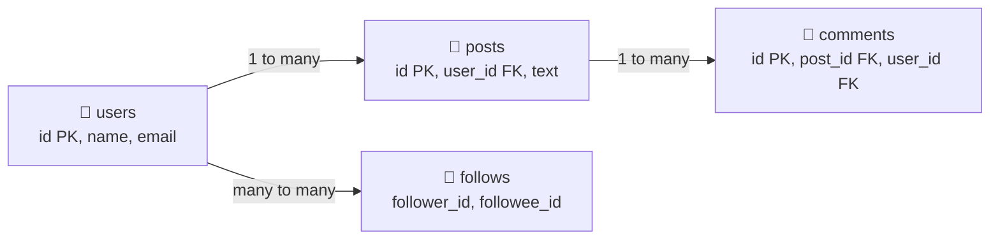

# 06 · Relational Databases

> [!info] Topic info
> **Subject:** System Design · **Chapter:** Databases · **Priority:** 🔥 High · **Status:** ✅ done · **Last reviewed:** 2026-11-19
>
> [← Back to Databases](README.md) · [Interview questions →](questions/databases-qa.md)

> [!abstract] In one line
> A **relational database** stores data in **tables** linked by **keys**, enforces a **schema and constraints**, and lets you ask **any question with SQL** inside **ACID transactions** — the safe default for most apps.

---

## 1. The problem

Our social app has users, posts, comments, likes, and follows. They're all **connected**: a comment belongs to a post, which belongs to a user.

We need to ask questions like "show posts from people I follow, with like counts" — and never end up with a comment pointing to a deleted post.

---

## 2. The data model

- **Table** = rows of the same shape. **Schema** = column names and types, enforced on every write.
- **Primary key (PK)** — unique ID of a row.
- **Foreign key (FK)** — a column pointing to another table's PK. The DB refuses orphans.
- **Join** — combine tables at query time: `posts JOIN users ON posts.user_id = users.id`.
- **Constraints** — `NOT NULL`, `UNIQUE`, `CHECK (balance >= 0)`.

---

## 3. Normalization (and when to break it)

**Normalization** = store each fact **once**. The user's name lives only in `users`, not copied into every post.

- ✅ Update in one place, no conflicting copies.
- ❌ Reads need joins, which get costly at very large scale.

**Denormalization** = deliberately copy data to avoid joins (e.g. store `like_count` on `posts`). Faster reads, but you must keep copies in sync. See [Denormalization](../database-scaling/06-denormalization.md).

> [!example] Rule of thumb
> Normalize by default. Denormalize a specific hot read path once you've **measured** it's slow.

---

## 4. When to use / when not

**✅ Use when**
- Data has relationships and integrity matters (users, orders, payments, inventory).
- You need multi-row **transactions** — see [ACID](03-acid-transactions.md).
- Query patterns are unknown or will change (admin dashboards, reports).

**❌ Avoid (or add something else) when**
- Write volume exceeds a single primary — e.g. 500K events/sec → [wide-column](10-wide-column-databases.md).
- You need full-text search with ranking → [search engine](09-full-text-search.md).
- Data has no fixed shape, or is huge blobs (videos → object storage).

### How it scales

1. Bigger machine ([vertical scaling](../core-concepts/01-scalability.md)) — a single Postgres can handle ~10K+ simple writes/sec.
2. [Indexes](../database-scaling/01-indexing.md) and [query tuning](../database-scaling/05-query-optimization.md).
3. [Read replicas](../database-scaling/03-replication.md) for read-heavy load.
4. [Connection pooling](../database-scaling/08-connection-pooling.md).
5. [Partitioning](../database-scaling/02-partitioning.md), then [sharding](../database-scaling/04-sharding.md) — last resort, as joins and transactions across shards get hard.

> [!tip] 🎤 Say it like this
> "I'd use Postgres as the main store: the data is relational, we need transactions for things like payments, and SQL lets us run any query later. It scales further than people think — with indexes, read replicas, and caching it handles millions of users. I'd only shard when a single primary can't take the write load."

| | Postgres | MySQL |
|---|---|---|
| **Strength** | Rich features: JSONB, extensions (PostGIS, pgvector), strong SQL | Simple, very common, huge ecosystem |
| **Default isolation** | Read Committed | Repeatable Read |
| **Typical pick** | New projects, complex queries | Classic web apps, existing tooling |

> [!failure] Interview traps
> - Jumping to sharding before indexes, replicas, and caching.
> - Forgetting the **N+1 query** problem — loading 50 posts then running 50 queries for authors. Use a join or batch fetch.
> - Saying relational "can't do JSON" — Postgres JSONB is indexable and widely used.

---

## Summary

- Tables + keys + joins + schema + constraints + ACID.
- Normalize first, denormalize measured hot paths.
- Scale: vertical → indexes → replicas → pooling → partitioning → sharding.

> [!success] Key takeaway
> Relational is the **default** for core business data. Pick something else only for a specific need it can't meet.
