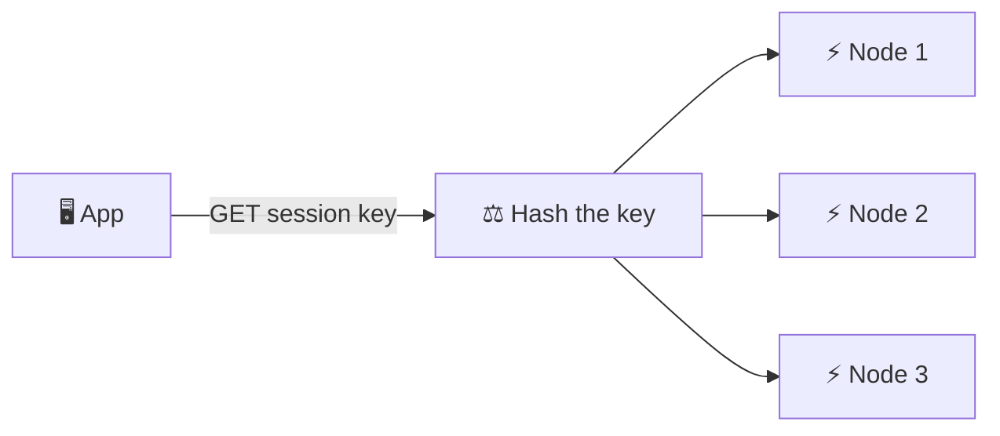

# 08 · Key-Value Stores

> [!info] Topic info
> **Subject:** System Design · **Chapter:** Databases · **Priority:** 🔥 High · **Status:** ✅ done · **Last reviewed:** 2026-11-19
>
> [← Back to Databases](README.md) · [Interview questions →](questions/databases-qa.md)

> [!abstract] In one line
> A **key-value store** is a giant **hash map**: you `GET`, `PUT`, and `DELETE` a value by its **key** in **sub-millisecond** time, and it scales almost linearly by **partitioning keys across nodes**.

---

## 1. The problem

Every request to our social app checks "is this session valid?" — that's **200K lookups/sec**. Each one is "give me the data for session `abc123`".

No joins, no filters. Running that through Postgres wastes its power and adds 5–10 ms each time.

---

## 2. How it works

- The DB only understands **key → value**. The value is opaque (string, JSON, bytes) or a simple type.
- **Hash the key** to pick a node — see [Consistent Hashing](../core-concepts/06-consistent-hashing.md). Add nodes → more capacity.
- Lookup is **O(1)**. No query planner, no joins.

### Two flavours

| | In-memory (Redis, Memcached) | Persistent, distributed (DynamoDB, Riak, etcd) |
|---|---|---|
| **Latency** | ~0.1–1 ms | ~1–10 ms |
| **Data size** | Limited by RAM (GBs to low TBs) | Practically unlimited |
| **Durability** | Optional (snapshots, append-only file) | Durable, replicated |
| **Typical use** | Cache, sessions, counters, rate limits, leaderboards | Primary DB for key-based access at huge scale |

> [!note] Redis is more than strings
> Redis has data structures: **lists**, **sets**, **sorted sets** (leaderboards), **hashes**, plus atomic `INCR`, TTLs, and pub/sub. That's why it's everywhere.

### DynamoDB-style keys

DynamoDB uses a **partition key** (decides the node) + optional **sort key** (orders items inside a partition). So `PK=user42, SK=post#2026-11-19` lets you fetch "user 42's latest posts" in one query.

---

## 3. When to use / when not

**✅ Use when**
- You always know the key: sessions, carts, user settings, feature flags.
- Caching DB results — see [Caching](../caching/01-what-is-caching.md).
- Counters and rate limits (`INCR` with TTL) — see [Rate Limiting](../api-fundamentals/08-rate-limiting.md).
- Massive scale with simple access (DynamoDB serving millions of req/sec).

**❌ Avoid when**
- You need to query by **value** ("all users in Delhi") — no secondary indexes or very limited ones.
- You need joins, ad-hoc queries, or multi-key transactions.
- Data must not be lost and you only run Redis without persistence.

> [!tip] 🎤 Say it like this
> "A key-value store is a distributed hash map — get and put by key in O(1), scaled out by hashing keys across nodes. I'd use Redis for sessions, caching, counters, and rate limiting because it's in-memory and sub-millisecond. If I needed a durable primary store with simple key access at huge scale, I'd use DynamoDB with a well-chosen partition key."

> [!warning] Hot keys
> If one key gets most traffic (a celebrity's post), one node melts while others idle. Fixes: cache it locally, or split it into `key#1…key#N` and combine on read.

> [!failure] Interview traps
> - Using Redis as the only copy of important data without persistence and replication.
> - Picking a low-cardinality partition key (like `country`) → a few giant hot partitions.
> - Storing huge values (10 MB blobs) — slows the whole node. Put blobs in object storage, keep the key-value small.

---

## Summary

| | Key-value store |
|---|---|
| **Model** | key → value |
| **Speed** | O(1), sub-ms (in-memory) |
| **Scales by** | Hash-partitioning keys |
| **Weak at** | Querying by value, joins, ranges (unless sort key) |
| **Examples** | Redis, Memcached, DynamoDB, etcd |

> [!success] Key takeaway
> If every read is "give me X by its ID", a key-value store is the fastest, simplest, most scalable choice. Choose the **key** carefully — it decides your scaling.
