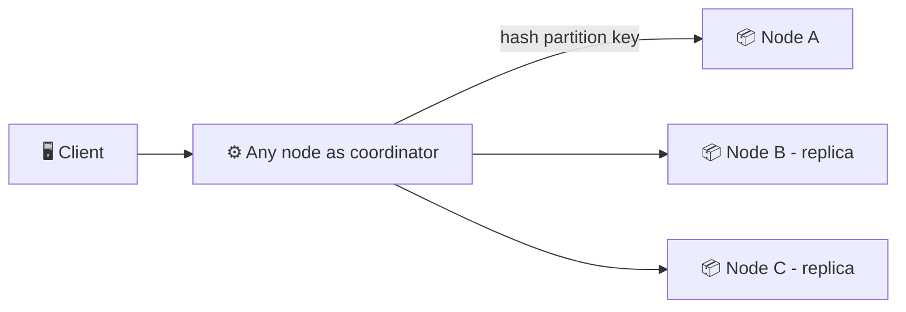

# 10 · Wide-Column Databases

> [!info] Topic info
> **Subject:** System Design · **Chapter:** Databases · **Priority:** ⚡ Medium · **Status:** ✅ done · **Last reviewed:** 2026-11-19
>
> [← Back to Databases](README.md) · [Interview questions →](questions/databases-qa.md)

> [!abstract] In one line
> A **wide-column database** groups rows by a **partition key** and keeps them **sorted by a clustering key** inside each partition, spread across many nodes with **no single leader** — built for **massive write volume** with **known queries** (Cassandra, ScyllaDB, HBase, Bigtable).

---

## 1. The problem

Our app's chat feature stores **5 billion messages a day** (~60K writes/sec average, peaks much higher). Reads are always "last 50 messages in conversation X".

A single Postgres primary can't take that write rate, and sharding it by hand is painful.

---

## 2. The data model

Think of it as a **two-level map**: `partition key → (sorted rows)`.

```sql
CREATE TABLE messages (
  conversation_id  uuid,      -- partition key: which node
  sent_at          timeuuid,  -- clustering key: sort order inside partition
  sender_id        uuid,
  text             text,
  PRIMARY KEY ((conversation_id), sent_at)
) WITH CLUSTERING ORDER BY (sent_at DESC);
```

- **Partition key** → hashed to pick the node(s). All messages of one conversation live together.
- **Clustering key** → rows sorted on disk, so "latest 50" is one fast sequential read.
- Rows in a partition can have different columns — hence "wide".

> [!important] Query-first design
> You design **one table per query**. Need "messages by sender" too? Create a second table and write to both. Duplication is normal here.

---

## 3. How it scales (Cassandra)



- **Leaderless**: any node accepts reads and writes. Data placed with [consistent hashing](../core-concepts/06-consistent-hashing.md), usually 3 replicas.
- Storage engine is an [LSM tree](05-lsm-trees.md) → very fast writes.
- **Tunable consistency**: choose how many replicas must answer. With 3 replicas, `QUORUM` writes (2) + `QUORUM` reads (2) overlap → you read the latest write (R + W > N). `ONE` is faster but may be stale. See [CAP](../core-concepts/07-cap-theorem.md).
- Add nodes → capacity grows almost linearly.

---

## 4. When to use / when not

**✅ Use when**
- Huge, constant write volume: messages, activity feeds, IoT events, logs.
- Queries are known and keyed: "by user, by time".
- Need multi-region, always-writable, no single point of failure.

**❌ Avoid when**
- You need joins, ad-hoc queries, or aggregations.
- You need multi-row ACID transactions (only lightweight per-partition ones).
- Small data — the ops cost isn't worth it.

> [!tip] 🎤 Say it like this
> "For chat messages I'd use Cassandra with conversation_id as the partition key and timestamp as the clustering key, so the latest messages of a chat are stored together and sorted. It's leaderless and LSM-based, so it takes huge write rates and scales by adding nodes. The trade-off is no joins, so I design one table per query."

> [!warning] Partition size
> One partition shouldn't grow without limit (a 10-year-old group chat). Add a time bucket: `PRIMARY KEY ((conversation_id, month), sent_at)`. Keep partitions under ~100 MB.

> [!failure] Interview traps
> - Calling it "column-oriented" like analytics DBs (Redshift, ClickHouse) — those store each column separately for scans. Different thing.
> - Picking a partition key that creates **hot partitions** (e.g. `date` → all of today's writes hit one node).
> - Querying by a non-key column — needs a full cluster scan or a separate table.

---

## Summary

| | Wide-column |
|---|---|
| **Model** | Partition key → sorted rows |
| **Strength** | Massive writes, linear scale, multi-region |
| **Weakness** | No joins, query-first design, duplication |
| **Examples** | Cassandra, ScyllaDB, HBase, Google Bigtable |

> [!success] Key takeaway
> Pick the **partition key** for even spread, the **clustering key** for sort order, and one table per query.
