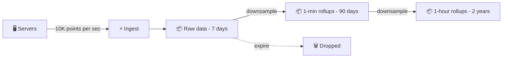

# 11 · Time-Series Databases

> [!info] Topic info
> **Subject:** System Design · **Chapter:** Databases · **Priority:** ⚡ Medium · **Status:** ✅ done · **Last reviewed:** 2026-11-19
>
> [← Back to Databases](README.md) · [Interview questions →](questions/databases-qa.md)

> [!abstract] In one line
> A **time-series database** is built for **timestamped measurements** — append-heavy writes, queries over **time ranges**, **downsampling**, and automatic **retention** — e.g. InfluxDB, TimescaleDB, Prometheus.

---

## 1. The problem

We track CPU, memory, and request latency for 2,000 servers, every 10 seconds, ~50 metrics each. That's **10K points/sec, ~860M per day**.

In plain Postgres the table explodes, inserts slow down as indexes grow, and "average latency per minute for last 7 days" scans billions of rows.

---

## 2. What makes time-series data special

Each point looks like: `(timestamp, metric, tags, value)` → `(10:00:00, cpu_usage, host=web-7 region=eu, 72.5)`.

- Writes are **append-only** and arrive roughly in time order. Old data almost never changes.
- Reads are **ranges and aggregates**: "avg per minute, last 6 hours".
- Recent data is hot; old data is rarely read and can be **summarized** or **deleted**.

---

## 3. How a TSDB handles it

- **Time partitioning** — data split into chunks by time (e.g. one per day). Queries skip old chunks; deleting a day = dropping a chunk, not millions of row deletes.
- **Compression** — consecutive timestamps and values are similar, so delta encoding squeezes data **10x or more**.
- **Downsampling / rollups** — keep raw data briefly, then store per-minute and per-hour averages.
- **Retention policies** — auto-delete data older than N days.
- **Time functions** built in: `time_bucket`, rate, moving average.

| | InfluxDB | TimescaleDB | Prometheus |
|---|---|---|---|
| **What** | Purpose-built TSDB | Postgres extension | Monitoring system with TSDB |
| **Query** | InfluxQL / SQL | Full SQL + joins | PromQL |
| **Model** | Push writes | Push writes | Pulls (scrapes) metrics |

> [!tip] 🎤 Say it like this
> "For metrics I'd use a time-series DB like TimescaleDB or InfluxDB. It partitions data by time, compresses it heavily, and supports retention and downsampling — so we keep raw data for a week and hourly rollups for years. Range queries skip irrelevant chunks, and deleting old data is just dropping a chunk."

**✅ Use when:** monitoring metrics, IoT sensor data, stock ticks, app analytics events over time.

**❌ Avoid when:** data gets updated a lot, or you need relational business data — use a normal DB.

> [!warning] High cardinality
> Tags like `user_id` (millions of values) create millions of separate series and can blow up memory. Use tags for low-cardinality labels (host, region, status).

> [!failure] Interview traps
> - Storing metrics in the main OLTP database alongside users and posts.
> - Keeping raw per-second data forever — plan **retention** from day one.

---

## Summary

- Data = (time, tags, value), append-only, read as ranges.
- Tricks: **time chunks**, **compression**, **downsampling**, **retention**.
- Watch tag **cardinality**. See also [Metrics](../observability/04-metrics.md).

> [!success] Key takeaway
> Timestamped, append-only, range-queried data → a TSDB stores it 10x smaller and queries it far faster.
