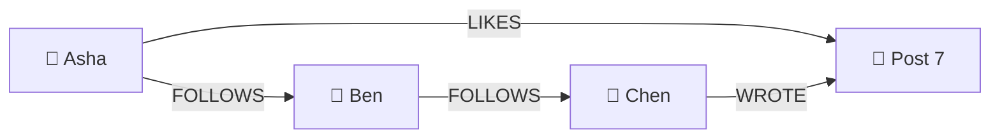

# 12 · Graph Databases

> [!info] Topic info
> **Subject:** System Design · **Chapter:** Databases · **Priority:** 💤 Low · **Status:** ✅ done · **Last reviewed:** 2026-11-19
>
> [← Back to Databases](README.md) · [Interview questions →](questions/databases-qa.md)

> [!abstract] In one line
> A **graph database** stores **nodes** (things) and **edges** (relationships) directly, so following connections many hops deep is **fast and natural** — e.g. Neo4j, Amazon Neptune.

---

## 1. The problem

"People you may know" = friends of my friends who aren't my friends yet. In SQL that's a self-join on `follows`, twice. Three hops = three joins over a 10B-row table.

Each extra hop multiplies the work. The query gets slow and painful to write.

---

## 2. How it works



- **Nodes** and **edges** both have properties (`since: 2024`).
- Each node keeps **direct pointers** to its neighbours (called *index-free adjacency*). A hop is a pointer follow, not an index lookup over a huge table.
- Cost depends on **how much of the graph you touch**, not the total size.

Query language (Cypher in Neo4j) reads like the picture:

```
MATCH (me:User {id: 1})-[:FOLLOWS]->()-[:FOLLOWS]->(s)
WHERE NOT (me)-[:FOLLOWS]->(s) RETURN s LIMIT 10
```

---

## 3. When to use / when not

**✅ Use when:** deep or variable-depth relationship queries — recommendations, fraud rings (accounts sharing devices/cards), knowledge graphs, access-control graphs.

**❌ Avoid when:** queries are 1 hop (a SQL join is fine), you need heavy aggregation, or massive write throughput — graphs are hard to shard because edges cross partitions.

> [!tip] 🎤 Say it like this
> "A graph DB stores relationships as first-class edges with direct pointers, so multi-hop queries like friends-of-friends or fraud rings stay fast regardless of total data size. For a simple follow list I'd keep it in SQL; I'd reach for a graph DB only when queries go several hops deep."

> [!failure] Interview traps
> - "Social network → must use a graph DB." Facebook's social graph runs on a sharded MySQL-backed store (TAO) with heavy caching. Simple follower lookups don't need a graph DB.

---

## Summary

- Nodes + edges with properties; hops = pointer follows.
- Great for multi-hop queries; weak at aggregation and sharding.

> [!success] Key takeaway
> Use a graph DB when the **relationships are the query**, several hops deep.
