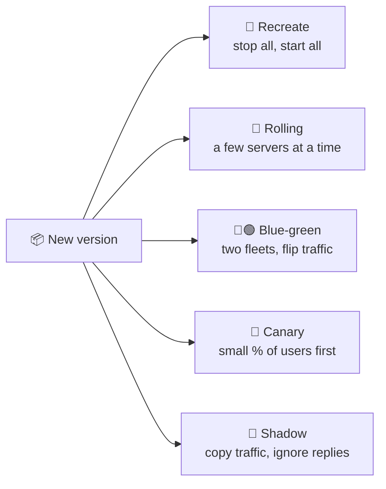

# 01 · Deployment Strategies

> [!info] Topic info
> **Subject:** System Design · **Chapter:** Deployment Patterns · **Priority:** 🔥 High · **Status:** ✅ done · **Last reviewed:** 2026-11-19
>
> [← Back to Deployment Patterns](README.md) · [Interview questions →](questions/deployment-qa.md)

> [!abstract] In one line
> A **deployment strategy** is the plan for **how new code replaces old code** in production — trading off **downtime**, **risk**, **rollback speed** and **cost**.

---

## 1. The problem

Our social media app runs on 20 servers and the team ships **10 times a day**. Every deploy is a chance to break things for 5 million users.

If we just stop everything, copy the new code, and start again, users see errors for a few minutes — every time. We need a way to swap versions **safely and quietly**.

> [!note] Quick recap
> The [Availability](../core-concepts/02-availability.md) note (section 13) already lists rolling, blue-green, canary and feature flags in one table. This note is the **decision guide**; each strategy has its own deep-dive note.

---

## 2. The five strategies

- **Recreate** — stop all old servers, then start new ones. Simple, but there is **downtime**. Fine for internal tools or batch jobs.
- **Rolling** — replace servers in small batches (say 2 of 20). No downtime, no extra servers. → [Rolling Deployments](03-rolling-deployments.md)
- **Blue-green** — run a full copy with the new version, then switch all traffic at once. Instant rollback, double cost. → [Blue-Green](04-blue-green.md)
- **Canary** — send 1–5% of real traffic to the new version, watch metrics, then grow. Smallest blast radius. → [Canary Releases](05-canary-releases.md)
- **Shadow (dark launch)** — copy live traffic to the new version but **throw away its replies**. Users never see it. Great for testing load and correctness of a rewrite.

> [!warning] Shadow traffic and side effects
> The shadow copy must not send emails, charge cards or write to the real database — otherwise every action happens **twice**. Stub or sandbox all writes.

---

## 3. Decision table

| Strategy | Downtime | Extra cost | Rollback speed | Users hit by a bad release | Best for |
|---|---|---|---|---|---|
| **Recreate** | Yes | None | Slow (redeploy) | All | Dev/internal, jobs |
| **Rolling** | No | ~None | Medium (roll back batch by batch) | Grows with each batch | Default for stateless services |
| **Blue-green** | No | 2× during deploy | Instant (flip back) | All, but briefly | Critical apps needing fast rollback |
| **Canary** | No | Small | Fast (route away) | 1–5% | High-traffic apps with good metrics |
| **Shadow** | No | Up to 2× | Nothing to roll back | None | Rewrites, perf testing |

> [!tip] 🎤 Say it like this
> "I'd default to rolling deploys for stateless services because they're cheap and have no downtime. For risky changes I'd add a canary step so only 1–5% of users see the new version while we watch error rate and latency. If the business needs instant rollback, blue-green. And in all cases I'd use feature flags so deploying code isn't the same as turning the feature on."

---

## 4. Things every strategy must handle

- **Two versions run at once** (except recreate). Old and new code must both work with the same database and API — see [Schema Migrations](08-schema-migrations.md).
- **Health checks** — the load balancer only sends traffic to servers that pass `/health`.
- **Connection draining** — let an old server finish in-flight requests (say 30 s) before killing it.
- **Automatic rollback** — if error rate or p99 latency crosses a threshold, stop and roll back without a human.

> [!failure] Interview traps
> - Saying "blue-green = zero risk". The database is usually **shared**, so a bad migration hurts both colors.
> - Forgetting that rolling and canary mean **mixed versions** serve users at the same time.
> - Treating deploy and release as the same thing — [feature flags](06-feature-flags.md) separate them.
> - Choosing a strategy without mentioning **how you detect a bad release** (metrics, alerts).

---

## Summary

- **Recreate** = simple but downtime. **Rolling** = cheap default.
- **Blue-green** = instant rollback, double cost. **Canary** = small blast radius, needs good metrics.
- **Shadow** = test with real traffic, users see nothing.
- All of them need backward-compatible DB changes, health checks and auto-rollback.

> [!success] Key takeaway
> Pick the strategy by asking: how bad is downtime, how fast must rollback be, and how much extra infra can we pay for?
