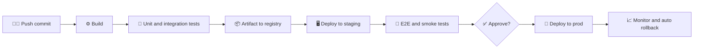

# 02 · CI/CD

> [!info] Topic info
> **Subject:** System Design · **Chapter:** Deployment Patterns · **Priority:** 🔥 High · **Status:** ✅ done · **Last reviewed:** 2026-11-19
>
> [← Back to Deployment Patterns](README.md) · [Interview questions →](questions/deployment-qa.md)

> [!abstract] In one line
> **CI/CD** is an **automated pipeline** that builds and tests every change (**Continuous Integration**) and pushes it to production safely and repeatably (**Continuous Delivery / Deployment**).

---

## 1. The problem

Our social media app has 40 engineers. Each one works on a branch for two weeks, then everyone merges on "release day". Merge conflicts everywhere, tests break, and the deploy is a manual 30-step checklist done at midnight.

Big, rare releases are **scary**. If 300 changes go out together and something breaks, nobody knows which change caused it.

---

## 2. How it works

- **Continuous Integration (CI)** — every developer merges small changes to `main` **many times a day**. Each push triggers a build + tests within ~10 minutes. A broken build gets fixed first.
- **Continuous Delivery** — every green build is **ready** to go to production. A human clicks "deploy".
- **Continuous Deployment** — no human click. Every green build goes to production **automatically**.

> [!example] Delivery vs Deployment
> Delivery = the car is fuelled and parked at the gate; someone presses go.
> Deployment = the car leaves on its own as soon as it is ready.

---

## 3. What makes a good pipeline

- **Build once, deploy many** — the same artifact (e.g. Docker image `app:abc123`) goes to staging and prod. Never rebuild for prod. See [Immutable Infrastructure](09-rollbacks-immutable-infra.md).
- **Fast feedback** — CI under ~10 minutes, or people stop waiting for it.
- **Test pyramid** — many fast unit tests, fewer integration tests, a handful of slow end-to-end tests.
- **Small changes** — small diffs are easy to review and easy to roll back.
- **Progressive rollout** — the deploy stage uses [canary](05-canary-releases.md) or [rolling](03-rolling-deployments.md), not "all at once".
- **Secrets from a vault**, not stored in the pipeline config — see [Secrets Management](../security/03-secrets-management.md).

> [!note] Trunk-based development
> CI works best when everyone commits to one main branch ("trunk") with short-lived branches (hours, not weeks). Unfinished features hide behind [feature flags](06-feature-flags.md).

> [!tip] 🎤 Say it like this
> "CI means every commit is built and tested automatically, so we catch problems in minutes. CD means every green build is deployable — with continuous deployment it goes to prod with no manual step. The key idea is small, frequent changes: if something breaks, the diff is tiny and rollback is easy."

**✅ Pros**
- Bugs found minutes after they're written, not weeks later
- Releases become boring and frequent
- Repeatable — no "works on my machine" or manual steps

**❌ Cons**
- Needs good automated tests — a weak test suite means you ship bugs faster
- Pipeline itself needs upkeep (flaky tests slow everyone)

> [!failure] Interview traps
> - Mixing up continuous **delivery** (manual approve) and continuous **deployment** (fully automatic).
> - Rebuilding the artifact for each environment — then prod runs something you never tested.
> - Saying CD is safe without mentioning **monitoring + automatic rollback**.

---

## Summary

| Term | Meaning |
|---|---|
| **CI** | Merge often, auto build + test every commit |
| **Continuous Delivery** | Every green build is deployable; human presses go |
| **Continuous Deployment** | Every green build goes to prod automatically |

> [!success] Key takeaway
> CI/CD turns deployment from a scary event into a boring routine: small changes, built once, tested automatically, rolled out progressively.
