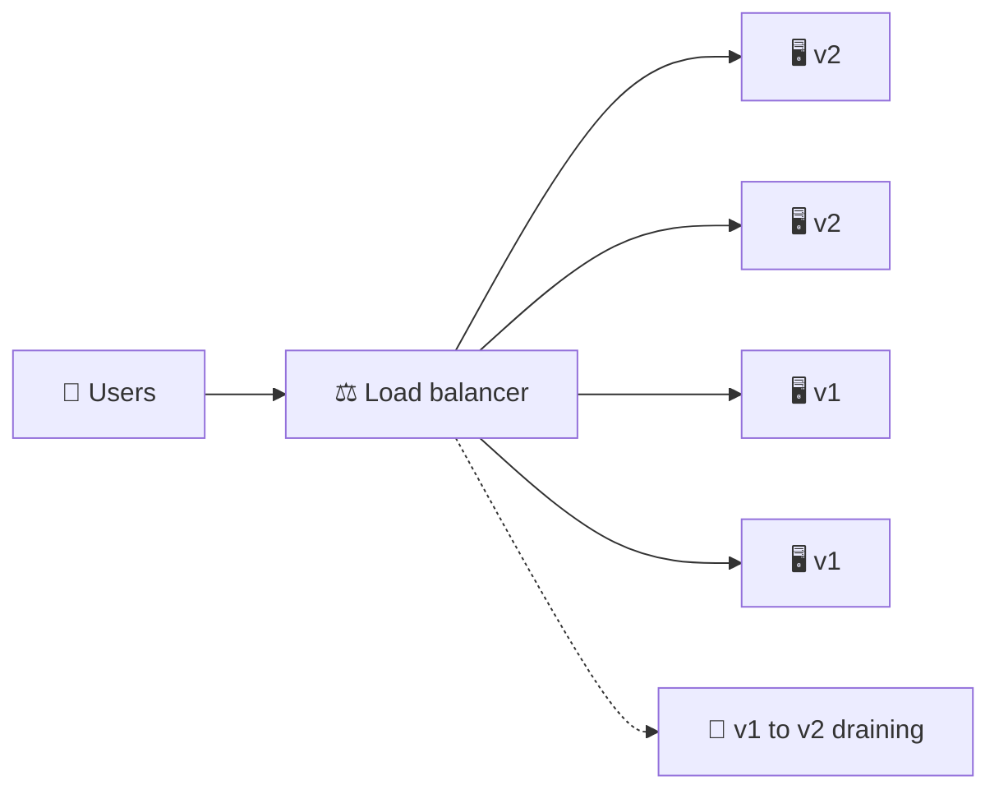

# 03 · Rolling Deployments

> [!info] Topic info
> **Subject:** System Design · **Chapter:** Deployment Patterns · **Priority:** 🔥 High · **Status:** ✅ done · **Last reviewed:** 2026-11-19
>
> [← Back to Deployment Patterns](README.md) · [Interview questions →](questions/deployment-qa.md)

> [!abstract] In one line
> A **rolling deployment** replaces servers **a few at a time**, so the app stays up with **no extra fleet** — but **old and new versions run side by side** during the rollout.

---

## 1. The problem

Our app runs on 20 stateless API servers behind a load balancer. We want to ship v2 with **zero downtime**, but we don't want to pay for a second set of 20 servers like blue-green does.

---

## 2. How it works

Pick a **batch size** (say 2 servers, or 10%). For each batch:

1. Take the servers **out of the load balancer** and let in-flight requests finish (**connection draining**, ~30 s).
2. Install v2 and start it.
3. Wait until the **health check** passes.
4. Put them back in the load balancer, then move to the next batch.

With 20 servers and batches of 2, the rollout takes 10 steps. If each step takes 2 minutes, the full deploy takes ~20 minutes.

> [!note] Two knobs
> **maxUnavailable** — how many servers can be down at once (capacity drops). **maxSurge** — how many extra servers you may add temporarily (keeps capacity full). Kubernetes Deployments use exactly these two settings.

---

## 3. The gotchas

**Mixed versions.** For 20 minutes, some users hit v1 and some hit v2 — even the **same user** on two requests. So:

- API responses must work for both old and new clients.
- Both versions share **one database** — schema changes must be backward compatible. See [Schema Migrations](08-schema-migrations.md).
- Messages on a queue written by v2 may be read by v1 — keep message formats compatible.

**Sessions.** If sessions are stored in server memory, users get logged out when their server is replaced. Keep servers **stateless** — sessions in Redis or a token. See [Scalability](../core-concepts/01-scalability.md).

**Capacity.** Taking 2 of 20 servers out cuts capacity by 10%. Don't roll out at peak, or use `maxSurge` to add servers first.

**Rollback is slow.** Rolling back means doing another rolling deploy of v1, batch by batch. A bad release can hit many users before you notice.

> [!tip] 🎤 Say it like this
> "A rolling deploy updates servers in small batches: drain, update, health-check, re-add, repeat. It needs no extra hardware and has no downtime, which is why it's the Kubernetes default. The catch is that two versions run together, so APIs and database changes must be backward compatible, and rollback is as slow as the rollout."

**✅ Pros**
- Zero downtime, almost no extra cost
- Built into Kubernetes, ECS, autoscaling groups

**❌ Cons**
- Mixed versions during the rollout
- Slow rollback; bad release spreads gradually to everyone
- No easy way to test v2 with real traffic before it is live

> [!failure] Interview traps
> - Forgetting connection draining — users get cut off mid-request.
> - Batch too big (50%) → a bad version takes out half the capacity at once.
> - Health check that only says "process is up" while the app can't reach the DB — the rollout continues with broken servers.

---

## Summary

- Replace servers in batches: drain → update → health-check → re-add.
- Cheap and zero-downtime; the safe default for stateless services.
- Must handle mixed versions, stateless sessions, and a reduced capacity window.
- Rollback = another rolling deploy, so it is not instant.

> [!success] Key takeaway
> Rolling is the cheap default. Add a [canary](05-canary-releases.md) step in front of it when you need to catch bad releases before they reach everyone.
