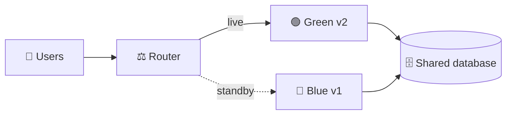

# 04 · Blue-Green Deployments

> [!info] Topic info
> **Subject:** System Design · **Chapter:** Deployment Patterns · **Priority:** 🔥 High · **Status:** ✅ done · **Last reviewed:** 2026-11-19
>
> [← Back to Deployment Patterns](README.md) · [Interview questions →](questions/deployment-qa.md)

> [!abstract] In one line
> **Blue-green** runs **two identical environments** — blue (live) and green (new version) — and switches **all traffic at once**, so rollback is just **switching back**.

---

## 1. The problem

Our app's checkout service is critical: 5 minutes of bad code means lost money. With a [rolling deploy](03-rolling-deployments.md), rolling back takes 20 minutes, batch by batch. We want rollback in **seconds**.

---

## 2. How it works

1. **Blue** serves all users with v1.
2. Deploy v2 to **green** — a full, identical copy. No users yet.
3. Run smoke tests against green (internal URL).
4. Flip the **router** (load balancer target, DNS, or Kubernetes service) → all traffic goes to green.
5. Keep blue running, idle, for a while. If v2 is bad, **flip back**.
6. Once green is stable, blue becomes the target for the next release.

> [!note] How to flip
> A **load balancer switch** is instant. A **DNS switch** is slow and messy — clients cache old records for minutes (TTL), so some users keep hitting blue. Prefer the load balancer.

---

## 3. The gotchas

**The database is shared.** Usually blue and green use the **same database** — copying a 2 TB DB per deploy isn't practical. So v2's schema change must still work with v1, or "flip back" won't save you. Use [expand → migrate → contract](08-schema-migrations.md).

**Sessions.** At the flip, users with sessions in blue's memory get logged out. Keep sessions in a shared store (Redis) or tokens.

**In-flight work.** Long requests, WebSocket connections and background jobs on blue need draining. Make sure only one color runs the **cron jobs and queue consumers**, or jobs run twice.

**Cost.** You need **2× the servers** during the deploy. With cloud autoscaling you can create green just for the deploy and delete blue after, so you pay double for an hour, not forever.

**All users switch at once.** If v2 has a bug that only shows under real load, **everyone** hits it — briefly. Canary avoids this.

> [!tip] 🎤 Say it like this
> "Blue-green keeps two identical environments. We deploy to the idle one, test it, then flip the load balancer so all traffic moves at once. Rollback is just flipping back, which takes seconds. The catches are double infrastructure during the deploy and the shared database — schema changes must work for both versions or rollback won't help."

**✅ Pros**
- Instant rollback
- Test the new version in a real prod environment before users see it
- No mixed versions serving users (after the flip)

**❌ Cons**
- 2× infrastructure during the deploy
- Shared DB makes rollback unsafe if the schema changed badly
- All-or-nothing switch — no gradual exposure

> [!failure] Interview traps
> - Claiming rollback is always instant — not if a migration already dropped a column.
> - Using DNS for the switch and expecting it to be instant.
> - Leaving workers running in both colors → duplicated jobs.

---

## Summary

| | Blue-green |
|---|---|
| **Downtime** | None |
| **Rollback** | Seconds — flip the router back |
| **Cost** | 2× during deploy |
| **Main risk** | Shared database and sessions |

> [!success] Key takeaway
> Blue-green buys **instant rollback** with **double infrastructure**. It only works if the database change is backward compatible.
