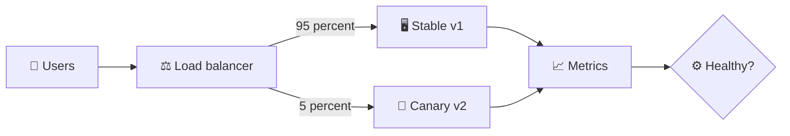

# 05 · Canary Releases

> [!info] Topic info
> **Subject:** System Design · **Chapter:** Deployment Patterns · **Priority:** 🔥 High · **Status:** ✅ done · **Last reviewed:** 2026-11-19
>
> [← Back to Deployment Patterns](README.md) · [Interview questions →](questions/deployment-qa.md)

> [!abstract] In one line
> A **canary release** sends a **small % of real traffic** (1–5%) to the new version, **compares its metrics** with the old one, and only then **gradually** increases traffic.

---

## 1. The problem

Our new feed ranking code passed every test in staging. In prod, under 50,000 req/s and real data, it adds 400 ms to p99 latency. With blue-green, **all** 5 million users would feel it before we react.

The name comes from coal miners, who carried a canary bird: if it got sick, the miners got out before the gas hurt them.

---

## 2. How it works

1. Deploy v2 to a few servers (or pods).
2. Route **1%** of traffic to them.
3. Watch for 10–30 minutes: **error rate, p99 latency, CPU, business metrics** (posts created, checkouts).
4. Compare canary vs stable — not vs "last week".
5. If healthy: 1% → 5% → 25% → 50% → 100%. If not: route 0% to canary and stop.

> [!note] Automated canary analysis
> Tools like Argo Rollouts, Flagger or Spinnaker can promote or roll back automatically: "if canary error rate > stable error rate + 0.5%, abort". No human has to watch dashboards at 2 a.m.

---

## 3. Choosing who is the canary

- **Random %** of requests — simple, but one user may bounce between v1 and v2.
- **Sticky by user** — hash the user ID, so the same 5% always see v2. Better experience, cleaner metrics.
- **Internal users first** — employees, then one region, then everyone ("ring" deployments).

---

## 4. The gotchas

- **Needs enough traffic.** At 10 req/s, 1% is one request every 10 s — too little to see anything. Canaries work best on high-traffic services.
- **Needs good metrics.** No dashboards or alerts = no canary, just a slow rollout. See [Metrics](../observability/04-metrics.md).
- **Mixed versions + shared DB** — same rules as [rolling](03-rolling-deployments.md): backward-compatible APIs and [schema changes](08-schema-migrations.md).
- **Bugs that hit rare paths** (e.g. a yearly billing job) may not show up in the canary window.

> [!tip] 🎤 Say it like this
> "A canary sends a small slice of real traffic, say 1–5%, to the new version. We compare its error rate and latency against the stable version, and if it's healthy we step up gradually to 100%. If it's not, we route traffic away in seconds and only a few users were affected. It needs enough traffic and good metrics to work."

**✅ Pros**
- Small blast radius — a bad release hits 1–5% of users
- Tests with real production traffic and data
- Fast rollback — just route 0% to the canary

**❌ Cons**
- Slower full rollout (can take hours)
- Needs solid monitoring and enough traffic
- Mixed versions in prod at the same time

> [!failure] Interview traps
> - Confusing canary with A/B testing — canary asks "is it **safe**?", A/B asks "is it **better**?". See [A/B Testing](07-ab-testing.md).
> - Watching only technical metrics. A bug that silently stops "Post" buttons working shows up in **business** metrics, not 5xx.
> - Comparing canary metrics with yesterday instead of the stable fleet right now.

---

## Summary

- Small % of real traffic → compare metrics → step up or roll back.
- Best blast-radius control of all strategies.
- Needs traffic volume, sticky routing, and automated analysis.

> [!success] Key takeaway
> Canary = "let a few users test it in prod, watched closely". It catches the bugs staging never will.
