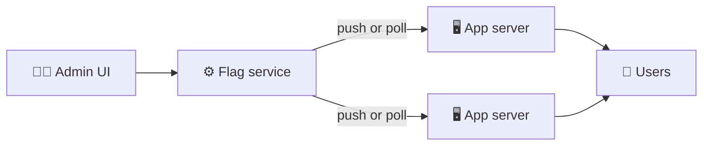

# 06 · Feature Flags

> [!info] Topic info
> **Subject:** System Design · **Chapter:** Deployment Patterns · **Priority:** 🔥 High · **Status:** ✅ done · **Last reviewed:** 2026-11-19
>
> [← Back to Deployment Patterns](README.md) · [Interview questions →](questions/deployment-qa.md)

> [!abstract] In one line
> A **feature flag** is an `if` switch in the code, controlled **at runtime**, that lets us **deploy code turned off** and **release it later** to chosen users — **deploy ≠ release**.

---

## 1. The problem

Our team is building "Stories" for the social media app. It takes 6 weeks. Keeping it on a long branch means painful merges. Merging it to `main` means half-built Stories would go live with the next deploy.

And when Stories finally launches and breaks, the only fix is a full redeploy — 20 minutes of pain.

---

## 2. How it works

```python
if flags.is_enabled("stories", user_id=user.id):
    show_stories()
```

The flag's value lives in a **flag service** (LaunchDarkly, Unleash, or a simple DB/config table), not in the code. Apps cache flag values locally and refresh every few seconds, so a check costs microseconds.



Now we can:

- **Merge daily** to main with Stories turned **off** (trunk-based development).
- **Turn it on** for employees → 1% of users → 10% → everyone.
- **Kill switch** — if Stories overloads the DB, turn it off in **seconds**, no deploy.

---

## 3. Types of flags

| Type | Purpose | Lives for |
|---|---|---|
| **Release flag** | Hide unfinished work, roll out gradually | Days–weeks, then delete |
| **Ops / kill switch** | Turn off heavy features under load | Long-lived |
| **Experiment flag** | Split users for an [A/B test](07-ab-testing.md) | Length of the test |
| **Permission flag** | Premium or beta-only features | Long-lived |

> [!note] Flags vs canary
> A [canary](05-canary-releases.md) rolls out a whole **new build** to some **servers**. A feature flag rolls out one **feature** to some **users**, inside the same build. They work well together.

> [!tip] 🎤 Say it like this
> "Feature flags separate deploy from release. We ship the code turned off, then turn it on for internal users, then a small percent, then everyone — and if something goes wrong we flip it off in seconds without a redeploy. The cost is flag debt: old flags must be cleaned up or the code fills with dead branches."

**✅ Pros**
- Instant rollback of a feature — no redeploy
- Gradual rollout by user, region, plan
- Enables trunk-based development and small merges

**❌ Cons**
- **Flag debt** — hundreds of stale `if`s make code hard to read
- More combinations to test (10 flags = 1,024 on/off combos)
- The flag service becomes a dependency — what if it's down?

> [!warning] Fail safe
> If the app can't reach the flag service, it must fall back to a **safe default** (usually "off") from a local cache — never crash. Otherwise the flag service is a new [single point of failure](../core-concepts/04-single-point-of-failure.md).

> [!failure] Interview traps
> - Thinking a flag protects you from **database** changes — the schema is changed for everyone, flag or not.
> - Never removing release flags. Give each one an owner and an expiry date.
> - Evaluating the flag differently on frontend and backend → user sees a button that the API rejects.

---

## Summary

- Flag = runtime `if`, value stored outside the code.
- Deploy ships code; the flag **releases** it.
- Kill switch = fastest rollback for a single feature.
- Clean up flags, and fail safe when the flag service is down.

> [!success] Key takeaway
> Feature flags make releases a **business decision** you can undo in seconds, not an engineering event.
