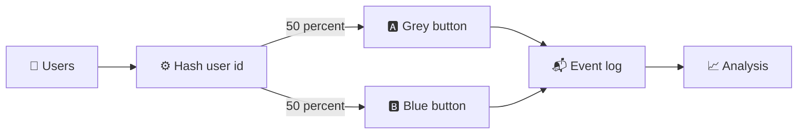

# 07 · A/B Testing

> [!info] Topic info
> **Subject:** System Design · **Chapter:** Deployment Patterns · **Priority:** ⚡ Medium · **Status:** ✅ done · **Last reviewed:** 2026-11-19
>
> [← Back to Deployment Patterns](README.md) · [Interview questions →](questions/deployment-qa.md)

> [!abstract] In one line
> **A/B testing** is an **experiment**: split users randomly into groups, show each a different version, and use **metrics + statistical significance** to decide which version is **better**.

---

## 1. The problem

The product team wants to change the "Post" button from grey to blue. One person says it'll boost posting, another says it won't matter. Opinions don't settle it — **data** does.

---

## 2. How it works

1. **Hypothesis** — "A blue button increases posts per user by 2%."
2. **Pick one main metric** — posts per user per day.
3. **Split users** — hash `user_id` so each user always lands in the same group: 50% see A (grey, control), 50% see B (blue).
4. **Run long enough** — usually 1–2 weeks to cover weekday/weekend patterns.
5. **Analyse** — is the difference bigger than random noise? Ship the winner, delete the loser.

> [!note] Statistical significance in plain words
> If B gets 2% more posts, was it the button or luck? A **p-value below 0.05** means "if the button did nothing, we'd see a gap this big less than 5% of the time". Small effects need **lots of users** to detect — decide the sample size **before** starting.

---

## 3. Feature flags vs A/B tests vs canary

| | Feature flag | A/B test | Canary |
|---|---|---|---|
| **Question** | Should this be on? | Which version is **better**? | Is this build **safe**? |
| **Split by** | Any rule you like | Random, sticky per user | Traffic % to servers |
| **Decided by** | A person flipping it | Metrics + statistics | Error rate, latency |
| **Owner** | Engineering | Product / data | Engineering / SRE |

A/B tests are usually **built on** feature flags — the flag decides which variant a user gets; the experiment adds tracking and statistics.

> [!tip] 🎤 Say it like this
> "A feature flag controls a release; an A/B test is an experiment. We split users randomly and stickily, track one main metric for each group, and only call a winner when the difference is statistically significant with enough sample size. A canary is different again — it checks that a build is safe, not that a feature is better."

> [!failure] Interview traps
> - **Peeking** — stopping the test the first day B looks ahead. Early results swing wildly; wait for the planned sample size.
> - Not making assignment **sticky** — users flip between A and B and the data is ruined.
> - Tracking 20 metrics and celebrating whichever one "won" — one will by chance.
> - Running tests that overlap and touch the same screen without accounting for it.

---

## Summary

- A/B = controlled experiment: hypothesis, one main metric, random sticky split.
- Needs enough users and time; check significance, don't peek.
- Flags = release control, A/B = measure which is better, canary = check safety.

> [!success] Key takeaway
> A/B testing replaces opinions with data — but only if the split is random and the stats are done honestly.
