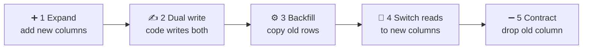

# 08 · Schema Migrations

> [!info] Topic info
> **Subject:** System Design · **Chapter:** Deployment Patterns · **Priority:** 🔥 High · **Status:** ✅ done · **Last reviewed:** 2026-11-19
>
> [← Back to Deployment Patterns](README.md) · [Interview questions →](questions/deployment-qa.md)

> [!abstract] In one line
> A **schema migration** changes the database structure; to do it with **zero downtime**, every step must be **backward compatible** — use **expand → migrate → contract** and never ship code and a **breaking** schema change together.

---

## 1. The problem

Our `users` table has a `name` column. We want to split it into `first_name` and `last_name`. The naive plan: rename the column and deploy new code in one go.

During a [rolling deploy](03-rolling-deployments.md), v1 servers still query `name` — which no longer exists. Errors for every v1 request. And rollback to v1 is now impossible, because v1 can't read the new schema.

> [!important] Golden rule
> At any moment, **the old code and the new code must both work with the current schema**. App servers can be rolled back in seconds; data changes usually can't.

---

## 2. Expand → migrate → contract

Split one breaking change into several safe deploys.

1. **Expand** — add `first_name`, `last_name` as **nullable**. Old code ignores them. Safe.
2. **Dual write** — deploy code that writes to **both** old and new columns, still reads `name`.
3. **Backfill** — a background job fills new columns for old rows, in small batches (say 1,000 rows at a time) so the DB isn't overloaded.
4. **Switch reads** — deploy code that reads the new columns. Keep writing both, so rollback still works.
5. **Contract** — days later, once nothing reads `name`, stop writing it and drop it.

Each step is its own deploy, and each one can be rolled back on its own.

---

## 3. Safe vs breaking changes

| Change | Safe in one step? | Do it like this |
|---|---|---|
| **Add nullable column / new table** | ✅ Yes | Just add it |
| **Add index** | ✅ Mostly | Build it online (e.g. `CREATE INDEX CONCURRENTLY` in Postgres) |
| **Add NOT NULL column** | ⚠️ Careful | Add nullable → backfill → add constraint |
| **Rename column** | ❌ No | Add new → dual write → backfill → switch → drop old |
| **Drop column** | ❌ No | First deploy code that stops using it, then drop |
| **Change column type** | ❌ No | New column + expand/contract |

---

## 4. Big tables — online migrations

On a 500 million-row table, a plain `ALTER TABLE` in MySQL can **lock the table** for hours. Every write to `posts` waits → the app is effectively down.

Tools like **gh-ost** (GitHub) and **pt-online-schema-change** (Percona) avoid this:

1. Create an empty **shadow copy** of the table with the new schema.
2. Copy rows over in small chunks, throttling if the DB gets busy.
3. Keep the copy in sync with live writes (via triggers or by reading the binlog — the DB's change log).
4. When caught up, **swap** table names in a quick, atomic rename.

> [!tip] 🎤 Say it like this
> "I never ship code and a breaking schema change together. I use expand, migrate, contract: add the new column, write to both, backfill in batches, switch reads, and only drop the old column once nothing uses it. Every step is backward compatible, so I can roll the app back at any point. For huge tables I'd use an online tool like gh-ost so the table isn't locked."

> [!failure] Interview traps
> - Running migrations **inside** app startup on 20 servers at once — 20 servers race to change the schema. Run them once, as a separate pipeline step.
> - Backfilling 100 million rows in one transaction — locks, replication lag, maybe a full disk.
> - Forgetting that [blue-green](04-blue-green.md) and [canary](05-canary-releases.md) **share the DB**, so they don't protect you from a bad migration.
> - Dropping a column right after deploy — rollback now breaks.

---

## Summary

- Old and new code must both work with the schema at every moment.
- Breaking change → expand → dual write → backfill → switch reads → contract.
- Additive changes are safe; renames, drops and type changes need multiple steps.
- Big tables: online migration tools copy in chunks and swap at the end.

> [!success] Key takeaway
> Code can be rolled back in seconds, data can't — so make database changes **small, additive and backward compatible**.
