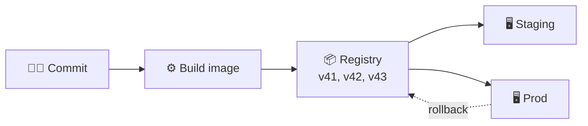

# 09 · Rollbacks & Immutable Infrastructure

> [!info] Topic info
> **Subject:** System Design · **Chapter:** Deployment Patterns · **Priority:** ⚡ Medium · **Status:** ✅ done · **Last reviewed:** 2026-11-19
>
> [← Back to Deployment Patterns](README.md) · [Interview questions →](questions/deployment-qa.md)

> [!abstract] In one line
> **Immutable infrastructure** means we **never patch** running servers — we **build an image once** and **replace** servers with it, so a **rollback is just redeploying the previous image**.

---

## 1. The problem

Over two years, engineers SSH into our 20 servers to "quickly" fix things: a library upgrade here, a config tweak there. Now no two servers are the same (**configuration drift**). A bug happens on server 7 only, and nobody knows why.

Rolling back is just as scary: "undo" means guessing which manual changes to reverse.

---

## 2. How immutable infra works

- **Build once** — CI builds one artifact per commit: a Docker image or VM image (e.g. `app:abc123`), with code, libraries and OS packages baked in.
- **Same artifact everywhere** — staging and prod run the exact same image; only config (env vars, secrets) differs.
- **Replace, don't patch** — to change anything, build a new image and roll out new servers. Old ones are destroyed.
- **No SSH changes** — servers are "cattle, not pets": if one is sick, kill it and start a fresh one.

> [!note] Infrastructure as Code
> The servers, load balancers and networks are also defined in files (Terraform, CloudFormation) kept in git. Recreating the whole environment is a command, not a wiki page.

---

## 3. Rollbacks

With immutable images, **rollback = deploy the previous image** (`v42` instead of `v43`). The registry keeps old versions, so this takes minutes and is the exact same thing that ran fine yesterday.

| Way to undo | Speed | When |
|---|---|---|
| **Flip a feature flag** | Seconds | Bug is inside one flagged feature |
| **Route traffic back** (blue-green, canary) | Seconds | Old version still running |
| **Redeploy previous image** | Minutes | Normal rollback |
| **Roll forward** with a fix | Minutes–hours | Rollback impossible, e.g. data already changed |

> [!warning] What rollback can't undo
> Data. If v43 ran a migration or wrote bad rows, redeploying v42 doesn't fix them. That's why [schema migrations](08-schema-migrations.md) must be backward compatible — so the old image still works.

> [!tip] 🎤 Say it like this
> "With immutable infrastructure we build one image per commit and never change running servers; to change anything we replace them. That kills configuration drift and makes rollback simple — just redeploy the previous image. The one thing rollback can't undo is data, so database changes must stay backward compatible."

**✅ Pros**
- No drift — every server is identical and reproducible
- Fast, predictable rollback
- What you tested in staging is exactly what runs in prod

**❌ Cons**
- Every small change needs a new build + deploy
- Needs a good pipeline and image registry
- Logs and data must live **off** the server (they die with it)

> [!failure] Interview traps
> - Rebuilding the image for prod "from the same commit" — dependencies may have changed; promote the **same** image.
> - Using the `latest` tag in prod — you can't tell what's running or roll back to it.
> - Thinking rollback fixes bad data.

---

## Summary

- Build once, promote the same image through every environment.
- Replace servers, never patch them → no drift.
- Rollback = redeploy previous image; flags and traffic switches are even faster.
- Data changes need their own safety (backward-compatible migrations).

> [!success] Key takeaway
> If every release is an immutable, versioned image, rollback stops being a crisis and becomes a one-line deploy.
