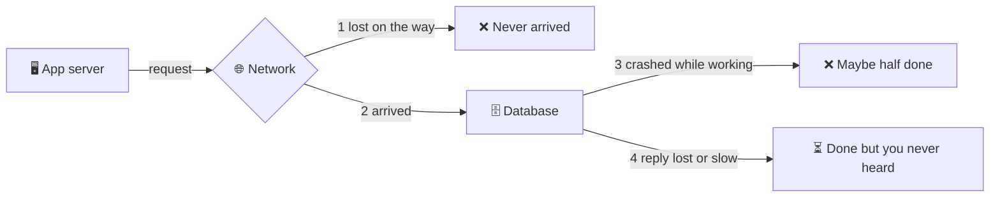

# 01 · Challenges of Distribution

> [!info] Topic info
> **Subject:** System Design · **Chapter:** Distributed Systems · **Priority:** 🔥 High · **Status:** ✅ done · **Last reviewed:** 2026-11-19
>
> [← Back to Distributed Systems](README.md) · [Interview questions →](questions/distributed-systems-qa.md)

> [!abstract] In one line
> A **distributed system** is many machines talking over a **network** to act like one — and it is hard because of **partial failure**, an **unreliable network**, and **unreliable clocks**.

---

## 1. The problem

Our social media app started on one server. If it crashed, everything stopped — simple to reason about.

Now it runs on 200 servers across 3 zones. Most of the time things work. But now **some** parts can fail while others keep going, and nobody knows for sure which ones.

> [!tip] 🎤 Say it like this
> "On one machine, things either work or crash. In a distributed system, one part can fail while the rest keeps running, and you often can't even tell whether a remote node is dead or just slow. Most of distributed systems design is about living with that uncertainty."

---

## 2. Partial failure — the core difficulty

On one machine, a function call either returns or the process dies. Over a network there is a **third outcome**: no answer.

When a request to the DB times out, you don't know which of these happened:

From the caller's side all four look **the same**: a timeout. That's why retries need [idempotency](../core-concepts/03-reliability.md) and why "is that node dead?" has no perfect answer.

> [!note] Partial failure is normal
> With 1,000 machines and each failing once every 3 years, roughly **one machine dies every day**. Failure is not an edge case — it's the steady state.

---

## 3. The 8 fallacies of distributed computing

Eight wrong assumptions developers make when they move from one machine to many. Interviewers love this list.

| # | Fallacy | Reality |
|---|---|---|
| **1** | The network is reliable | Packets get lost, links flap, cables get cut |
| **2** | Latency is zero | Same zone ~0.5 ms, cross-region 50–150 ms |
| **3** | Bandwidth is infinite | Big payloads saturate links; chatty services hurt |
| **4** | The network is secure | Assume anyone can sniff or spoof — use TLS, auth |
| **5** | Topology doesn't change | Servers come and go, IPs change, autoscaling |
| **6** | There is one administrator | Many teams, clouds, and configs |
| **7** | Transport cost is zero | Serialization CPU and cloud egress fees are real |
| **8** | The network is homogeneous | Mixed hardware, OSes, protocols, versions |

> [!example] Quick memory hook
> The first three are the ones that bite most often: **"reliable, instant, unlimited"** — the network is none of those.

---

## 4. Unreliable network and unreliable clocks

### Network
Messages can be **lost, delayed, duplicated, or reordered**. A delay of 30 seconds (GC pause, overloaded switch) looks exactly like a crash. → See [Network Partitions](02-network-partitions.md).

### Clocks
Every machine has its own clock, and they **drift** apart by milliseconds or more. So "which write happened first?" can't be answered by comparing wall-clock times. → See [Clock Synchronization](07-clock-synchronization.md) and [Logical Clocks](08-logical-clocks.md).

### Process pauses
A node can freeze for seconds (stop-the-world GC, VM migration) and then wake up thinking it is still the leader. → This is why we need [fencing tokens](05-handling-failures.md).

---

## 5. What we build to cope

| Challenge | Tool | Note |
|---|---|---|
| **Is a node alive?** | Heartbeats, failure detectors | [04](04-heartbeats.md) |
| **Requests fail or hang** | Timeouts, retries, idempotency | [05](05-handling-failures.md) |
| **Nodes must agree** | Consensus (Raft, Paxos) | [11](11-consensus.md) |
| **Who is in charge?** | Leader election | [14](14-leader-election.md) |
| **Ordering events** | Lamport / vector clocks | [08](08-logical-clocks.md) |
| **Two leaders at once** | Quorum + fencing | [03](03-split-brain.md) |

> [!failure] Interview traps
> - Saying "a timeout means the server is down" — it might be slow, or it might have **done the work**.
> - Ordering events by `System.currentTimeMillis()` across machines.
> - Treating failure as rare. At scale it's **constant** — design for it.

---

## Summary

- Distributed = many machines, one network, **no shared memory, no shared clock**.
- **Partial failure** + **unknown outcomes** are the root of the difficulty.
- Remember the **8 fallacies** — especially "network is reliable, latency is zero, bandwidth is infinite".
- Every later topic in this chapter is a tool to handle one of these problems.

> [!success] Key takeaway
> You can't prevent failure in a distributed system — you can only **detect it, contain it, and recover** safely.
