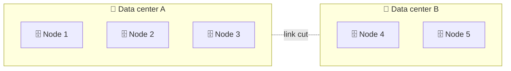

# 02 · Network Partitions

> [!info] Topic info
> **Subject:** System Design · **Chapter:** Distributed Systems · **Priority:** ⚡ Medium · **Status:** ✅ done · **Last reviewed:** 2026-11-19
>
> [← Back to Distributed Systems](README.md) · [Interview questions →](questions/distributed-systems-qa.md)

> [!abstract] In one line
> A **network partition** is when the network splits nodes into groups that **can't talk to each other**, while each group is still **alive and serving**.

---

## 1. The problem

Our app runs a 5-node database cluster across two data centers. A fiber link between them gets cut.

Both sides are healthy. Both sides think the **other** side died. What should each side do with writes?

> [!note] Recap from CAP
> [CAP Theorem](../core-concepts/07-cap-theorem.md) already covers the big choice: during a partition you pick **Consistency** (reject some requests) or **Availability** (accept them and fix conflicts later). This note covers what partitions look like in practice and how systems react.

---

## 2. What a partition looks like

Side A has **3 of 5** nodes (a majority). Side B has **2 of 5** (a minority).

### Kinds of partitions
- **Full** — two groups fully cut off (the picture above).
- **Partial** — A can talk to B, B to C, but A can't reach C. Very confusing for failure detection.
- **One-way** — A's messages reach B, but B's replies are dropped.
- **"Gray" / slow** — packets aren't lost, just delayed by seconds. Looks like a partition to timeouts.

> [!warning] They're not rare
> Partitions happen from bad switch configs, cloud network blips, firewall changes, even long GC pauses. Real outages at big cloud providers have been caused by them.

---

## 3. How systems react

| Strategy | What happens | Example |
|---|---|---|
| **Majority keeps going (CP)** | Side with quorum (3 of 5) serves writes. Minority refuses writes. | etcd, ZooKeeper, MongoDB primary |
| **Both sides keep going (AP)** | Both accept writes. Conflicts merged after healing. | Cassandra, DynamoDB, CouchDB |
| **Read-only on minority** | Minority serves stale reads, rejects writes. | Many SQL replica setups |

When the link comes back, the system must **heal**: minority catches up from the majority's log (CP), or replicas exchange and merge data (AP — read repair, anti-entropy, [CRDTs](17-crdts.md)).

> [!tip] 🎤 Say it like this
> "A partition means nodes are alive but can't reach each other. The safe default is: only the side with a majority of nodes may accept writes; the minority steps down or goes read-only. If the business needs writes on both sides, we go AP and plan how to merge conflicts after the network heals."

> [!failure] Interview traps
> - Thinking you can "choose not to have partitions" — you can't; you only choose how to **react**.
> - Using an **even** number of nodes (4) — a 2–2 split leaves **no** majority, so nobody can write.
> - Forgetting that the danger is **both** sides acting as leader → see [Split Brain](03-split-brain.md).

---

## Summary

- Partition = nodes alive, network split. Can be full, partial, one-way, or just very slow.
- CP systems: **majority side wins**, minority stops writing.
- AP systems: both sides write, **merge later**.
- Use an **odd** number of nodes so one side always has a majority.

> [!success] Key takeaway
> Partitions will happen. Decide up front which side is allowed to write, and how you'll heal when the link returns.
