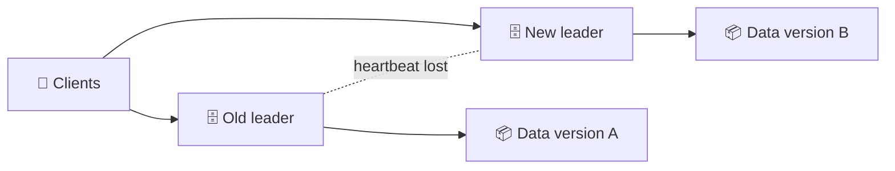

# 03 · Split Brain

> [!info] Topic info
> **Subject:** System Design · **Chapter:** Distributed Systems · **Priority:** ⚡ Medium · **Status:** ✅ done · **Last reviewed:** 2026-11-19
>
> [← Back to Distributed Systems](README.md) · [Interview questions →](questions/distributed-systems-qa.md)

> [!abstract] In one line
> **Split brain** is when **two nodes both believe they are the leader** and both accept writes, so data **diverges** and can be lost or corrupted.

---

## 1. The problem

Our payments DB has a primary and a standby. The heartbeat link between them drops for 10 seconds.

The standby thinks the primary died and **promotes itself**. But the primary is fine and still taking writes. Now there are two primaries. User A's balance is updated on one, user B's refund on the other. 💥

> [!note] Recap
> [Availability](../core-concepts/02-availability.md) introduced split brain with the two fixes: **quorum** and **fencing**. Here we go a bit deeper on how each one works.

---

## 2. How it happens

Common triggers:
- **Network partition** between leader and followers.
- **Long pause** — the old leader freezes for 20 s in GC, a new leader is elected, then the old one wakes up and keeps writing.
- **Two-node clusters** — with only 2 nodes, neither can tell "the other died" from "the link died".

---

## 3. The fixes

### 1. Quorum (majority vote)
A node can be leader only if a **majority** (more than half) of the cluster agrees. In a 5-node cluster you need 3 votes.

Two majorities **always overlap** by at least one node, so two leaders can't both win the same term. The minority side simply cannot elect anyone.

### 2. Fencing tokens
Every new leader gets a **higher number** (epoch / term). Storage rejects any write with an older number.

So when the old leader wakes up and writes with token 33, the storage has already seen 34 and says **no**. → More in [Handling Failures](05-handling-failures.md) and [Distributed Locks](15-distributed-locks.md).

### 3. STONITH ("shoot the other node in the head")
Before taking over, the new leader **forcibly powers off** the old one (via power switch or cloud API). Brutal but sure.

### 4. Witness / tie-breaker
For 2 data nodes, add a tiny third **witness** node (or a cloud quorum service) that only votes. Now there's always a majority.

> [!tip] 🎤 Say it like this
> "Split brain is two leaders writing at the same time. I prevent it with a majority quorum, so only one side of a partition can elect a leader, and I add fencing tokens so a stale leader that wakes up late gets its writes rejected by storage."

> [!failure] Interview traps
> - Saying "heartbeats prevent split brain" — heartbeats **detect** failure; a lost heartbeat is often what **causes** split brain.
> - Running a **2-node** cluster with automatic failover and no witness.
> - Relying only on quorum — a paused old leader doesn't know it lost; you still need **fencing**.

---

## Summary

| Fix | How it helps |
|---|---|
| **Quorum** | Only a majority can elect a leader |
| **Fencing token** | Storage rejects writes from old leaders |
| **STONITH** | Physically kill the old leader |
| **Witness node** | Breaks ties in small clusters |

> [!success] Key takeaway
> Quorum stops two leaders being **elected**; fencing stops an old leader from **doing damage**. Use both.
