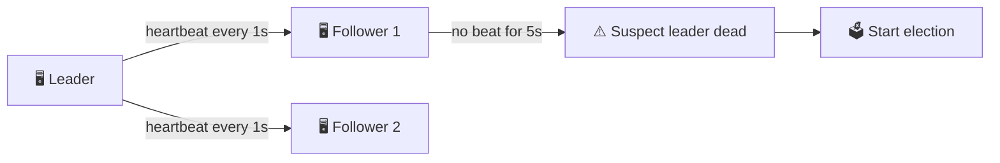

# 04 · Heartbeats

> [!info] Topic info
> **Subject:** System Design · **Chapter:** Distributed Systems · **Priority:** ⚡ Medium · **Status:** ✅ done · **Last reviewed:** 2026-11-19
>
> [← Back to Distributed Systems](README.md) · [Interview questions →](questions/distributed-systems-qa.md)

> [!abstract] In one line
> A **heartbeat** is a small "I'm alive" message sent **every few seconds**; if several are **missed**, the node is **suspected dead**.

---

## 1. The problem

Our cluster has a leader and 4 followers. If the leader crashes, followers must notice fast and elect a new one. But a crashed node can't tell you it crashed.

So we flip it: alive nodes keep **saying** they're alive. Silence = trouble.

> [!note] Recap
> [Availability](../core-concepts/02-availability.md) covered **health checks** from a load balancer (HTTP `/health` every 5 s). Heartbeats are the same idea **between nodes** of a cluster.

---

## 2. How it works

Two knobs:
- **Interval** — how often to send (e.g. every 1 s).
- **Timeout** — how long without a beat before declaring dead (e.g. 5 s = ~5 missed beats).

### Push vs pull
- **Push** — the node sends heartbeats out (Raft leader → followers).
- **Pull** — a monitor pings the node and waits for a reply (load balancer health checks).

### Centralized vs gossip
- **Central monitor** — every node beats to one coordinator (ZooKeeper sessions). Simple, but the monitor must itself be highly available.
- **Gossip** — nodes share heartbeat info with random peers, so news spreads to all → [Gossip Protocol](16-gossip-protocol.md). Scales to thousands of nodes.

---

## 3. The trade-off — timeout length

| Timeout | Upside | Downside |
|---|---|---|
| **Short (1–2 s)** | Fast failover | **False alarms** on GC pauses or network blips → needless elections |
| **Long (30 s)** | Few false alarms | Users see errors for 30 s before failover |

> [!important] A heartbeat failure means "suspected", not "dead"
> You can't tell dead from slow. So the system acts on **suspicion**, and must be safe even if the node comes back → that's why we need [fencing](03-split-brain.md).

### Smarter: phi accrual failure detector
Instead of a yes/no timeout, it tracks the **usual gap** between beats and outputs a **suspicion level** (phi). If beats normally arrive every 1 s ± 50 ms, a 3 s gap is very suspicious; on a jittery network, less so. Used by Cassandra and Akka.

> [!tip] 🎤 Say it like this
> "Each node sends a small heartbeat every second or so. If we miss a few in a row, we suspect it's dead and fail over. The tricky part is the timeout: too short and GC pauses cause false failovers, too long and users wait. Adaptive detectors like phi accrual tune this automatically."

> [!failure] Interview traps
> - Treating a missed heartbeat as **proof** of death.
> - Sending heartbeats on the same overloaded queue as real work — a busy node looks dead.
> - Every node heartbeating every other node: that's **N²** messages. Use gossip or a coordinator at scale.

---

## Summary

- Heartbeat = periodic "I'm alive". Miss enough → **suspect** failure.
- Tune **interval + timeout**: speed vs false alarms.
- Central coordinator for small clusters; **gossip** for big ones.
- Pair detection with **quorum + fencing** to act safely.

> [!success] Key takeaway
> Heartbeats tell you *probably dead*. Design the rest of the system so being wrong is safe.
