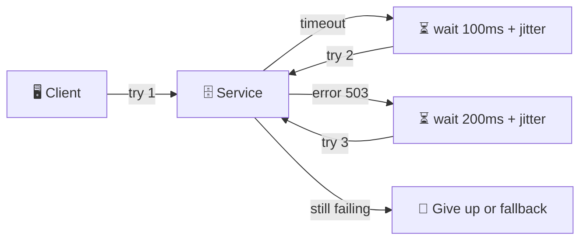

# 05 · Handling Failures

> [!info] Topic info
> **Subject:** System Design · **Chapter:** Distributed Systems · **Priority:** 🔥 High · **Status:** ✅ done · **Last reviewed:** 2026-11-19
>
> [← Back to Distributed Systems](README.md) · [Interview questions →](questions/distributed-systems-qa.md)

> [!abstract] In one line
> We handle failures with **timeouts** (don't wait forever), **retries with backoff + jitter** (try again politely), **idempotency** (retries are safe), **failure detectors** (spot dead nodes), and **fencing tokens** (stop stale nodes).

---

## 1. The problem

Our feed service calls the posts DB. One day the DB gets slow — 5 s per query instead of 20 ms.

Without care, feed threads all hang waiting, retries pile on more load, and a half-sick DB takes down the whole app. We need rules for **what to do when a call fails or hangs**.

> [!note] Recap
> [Availability](../core-concepts/02-availability.md) covers circuit breakers, bulkheads and cascading failures. [Reliability](../core-concepts/03-reliability.md) covers idempotency keys and delivery guarantees. Here we tie them together as a toolkit.

---

## 2. Timeouts — never wait forever

Every network call needs a timeout. No timeout = a stuck thread forever.

- Set it from real latency: e.g. **p99 is 200 ms → timeout ~500 ms**.
- Use a **deadline** across the whole request: if the user's request has 2 s total, and 1.8 s is gone, don't start a 1 s downstream call.

> [!warning] A timeout means "unknown", not "failed"
> The server may have **done the work** and only the reply got lost. So blindly retrying a "charge card" call can charge twice. → Needs idempotency (§4).

---

## 3. Retries with exponential backoff + jitter

Many failures are **transient** (a blip, a restart). Retrying helps — if done carefully.

- **Exponential backoff** — wait 100 ms, then 200, 400, 800… gives the server time to recover.
- **Jitter** — add randomness (e.g. wait a random time between 0 and the backoff). Without it, 10,000 clients all retry at the **exact same moment** → a "thundering herd".
- **Cap** — max 3–5 attempts, and a max wait (e.g. 10 s).
- **Retry budget** — only retry if retries are < ~10% of total traffic, so retries can't double the load during an outage.

> [!important] What to retry
> ✅ Retry: timeouts, 503, 429 (respect `Retry-After`), connection resets.
> ❌ Don't retry: 400, 401, 404 — they'll fail the same way every time.

---

## 4. Idempotency — make retries safe

An operation is **idempotent** if doing it twice has the same effect as once.

- `SET likes = 10` ✅ idempotent. `likes = likes + 1` ❌ not.
- For non-idempotent actions (payments, posts), the client sends an **idempotency key** (a UUID). The server stores the key and returns the **saved result** if it sees it again.

→ Details in [Reliability](../core-concepts/03-reliability.md) and [API Idempotency](../api-fundamentals/03-idempotency.md).

---

## 5. Failure detectors

A **failure detector** decides "is node X dead?" — usually with [heartbeats](04-heartbeats.md) + a timeout.

It can only ever **suspect**: it will sometimes call a slow node dead (false positive) or take a while to notice a dead one. Real systems accept that and make actions safe either way.

---

## 6. Fencing tokens — stopping zombie nodes

The trickiest failure: a node **pauses** (20 s GC), the cluster gives its job to someone else, then the old node **wakes up and keeps going** as if nothing happened. A "zombie".

Fix: every time a lock or leadership is granted, hand out an **increasing number** (the fencing token). The storage remembers the highest token it has seen and **rejects anything lower**.

→ Used in [Distributed Locks](15-distributed-locks.md) and [Split Brain](03-split-brain.md).

> [!tip] 🎤 Say it like this
> "Every remote call gets a timeout. Transient errors get retried with exponential backoff and jitter, capped at a few attempts. Because a timeout doesn't tell me if the work happened, every retried write is idempotent using an idempotency key. And when a node can lose leadership or a lock, I use fencing tokens so a paused zombie can't overwrite newer data."

> [!failure] Interview traps
> - Retrying at **every layer** — 3 retries × 3 layers = **27×** load on the bottom service. Retry at one layer only.
> - Backoff **without jitter** — clients stay synchronized and hammer together.
> - Retrying non-idempotent writes → duplicate posts, double charges.
> - Trusting a lock's TTL alone to protect data — a paused client can outlive its lease.

---

## Summary

| Tool | Fixes |
|---|---|
| **Timeout + deadline** | Hanging forever on a slow call |
| **Backoff + jitter + cap** | Retry storms, thundering herd |
| **Idempotency key** | Duplicates from retries |
| **Failure detector** | Knowing (probably) who is dead |
| **Fencing token** | Zombie nodes writing stale data |
| **Circuit breaker** | Hammering a service that's clearly down |

> [!success] Key takeaway
> Assume every call can hang, fail, or **succeed silently**. Timeouts + careful retries + idempotency + fencing make that safe.
